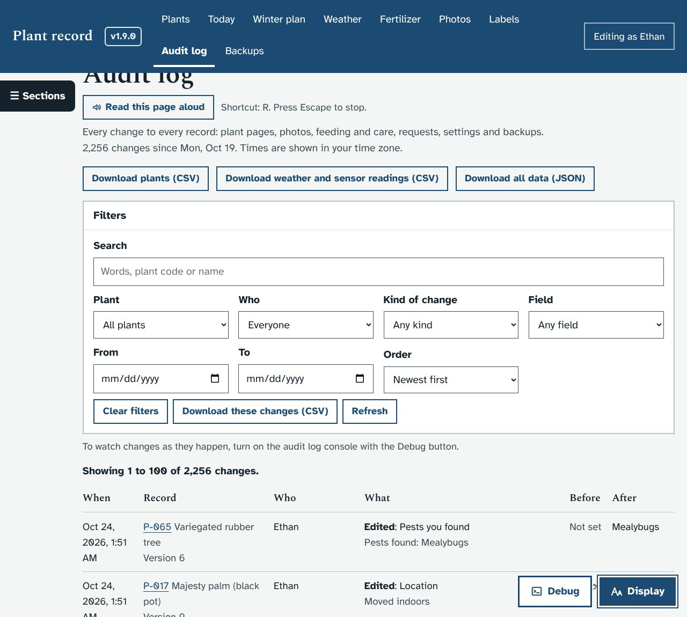
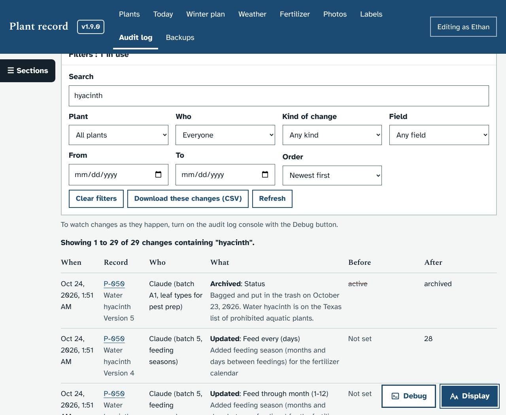
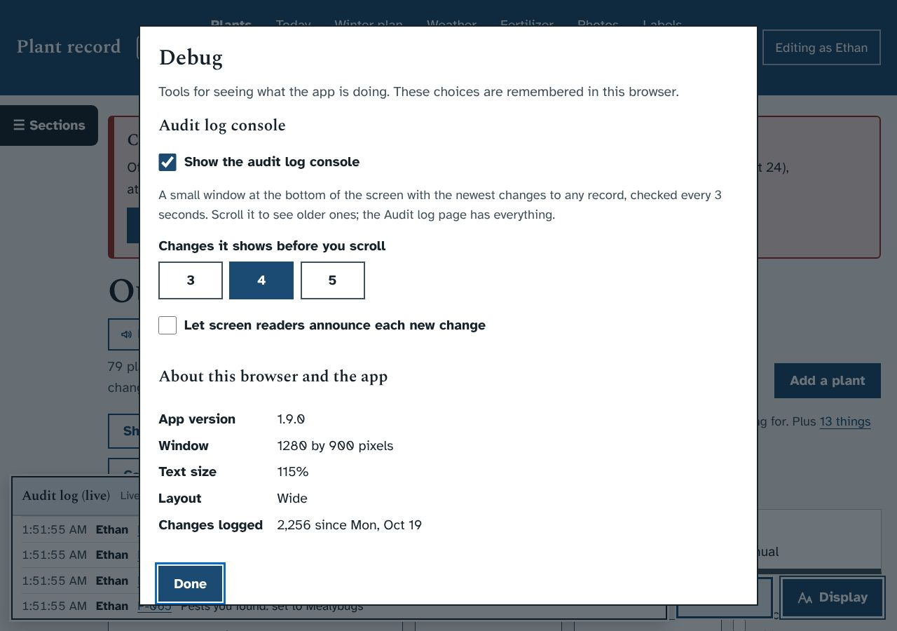
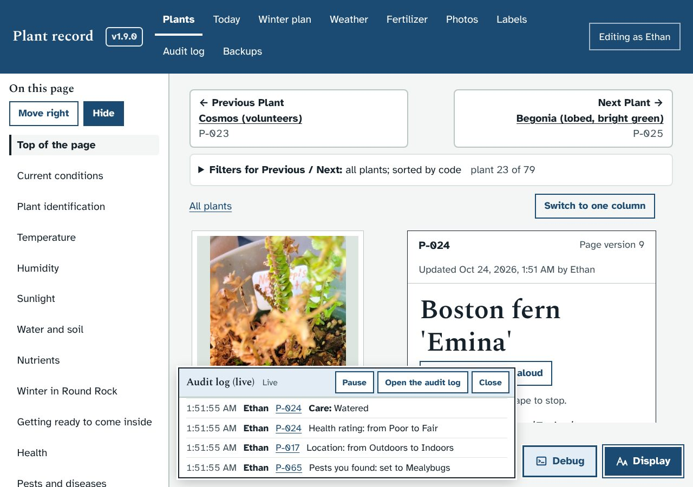
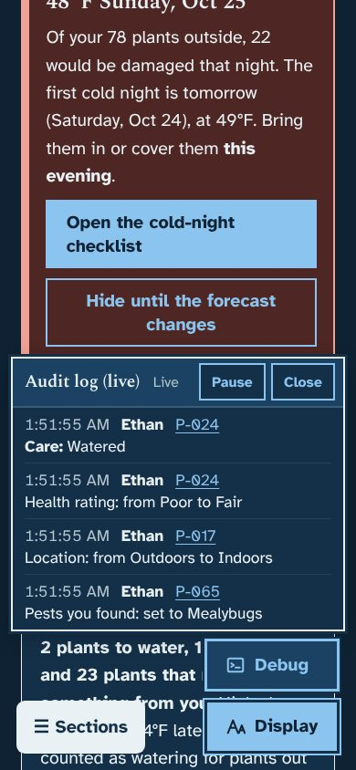
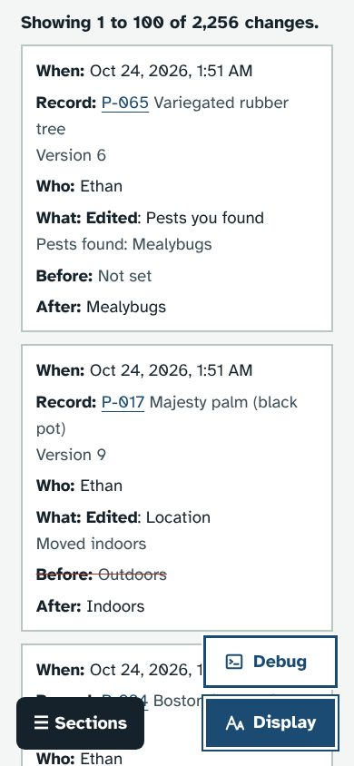

# Audit log page, Debug button and live console

Asked for by Ethan on October 24, 2026: an audit log page to see every change to every record, with filters to search through them, and a **Debug** button like **Display** that opens its own window. For now the window has one main option: a toggle for an audit log console that shows the newest 3 to 5 changes as they happen and can be scrolled.

## What it does
- **Audit log page** (`#/history`, also `#/audit`; the menu link was "Change log"):
  - Every change, newest first: plant page edits, plants added, archived or brought back, photos, feeding and care, requests and answers, the "Still to photograph" list, settings and backups.
  - Each row has when, the record (plant code and name, with a link), who, what (with the note), and before and after. Long values fold away. On phones each change is a block with its own labels.
  - **Filters:** Search, Plant (or "Not about one plant"), Who (a person, People, or Claude's updates), Kind of change, Field, From, To, Order. Changing one updates the list straight away and keeps your place in the form. The heading says how many filters are in use; on phones the filters start folded unless one is in use.
  - "Showing 1 to 100 of 2,253 changes containing "hyacinth"" says what is shown. 100 changes a page, with Previous page and Next page.
  - **Download these changes (CSV)** follows the filters. The other downloads stay.
  - The filters are remembered in this browser until **Clear filters**.
- **Debug button**, next to Display (Debug above Display on phones). Its window has:
  - **Show the audit log console**, and **Changes it shows before you scroll**: 3, 4 or 5.
  - **Let screen readers announce each new change** (off to start with).
  - **About this browser and the app**: version, window size, text size, layout, number of changes logged.
  - Messages show inside the window, since the usual pop-up notes are hidden behind it.
- **The console**: a window at the bottom of the screen.
  - Newest change at the bottom, older ones above. It is exactly as tall as the newest 3, 4 or 5 changes, and keeps the last 200 to scroll through.
  - It checks for new changes every 3 seconds, and stops checking while the browser tab is hidden.
  - Each line: time (with seconds), who, plant code (a link), and what changed in words ("Health rating: from Poor to Fair").
  - If you have scrolled up, new changes don't move the view; a **new changes below: show** button appears instead.
  - **Pause** / **Resume**, **Open the audit log** (left out on phones, where the menu bar has it), **Close**.
  - It never covers the Debug, Display or Sections buttons. Plant pages leave room for it, on wide screens and phones.

## Screenshots
| | |
|---|---|
|  |  |
|  |  |
|  |  |

## What it changes in the database
Nothing. The page and the console only read `audit_log`.

## How it works
- `server.py`: `audit_query()` (all the filters), `audit_rows()` (labels and plain action words), `GET /api/audit` (`?after=ID` for the console), `GET /api/audit/search`, `GET /api/audit/facets`. `GET /api/audit.csv` takes the same filters; empty cells no longer get a stray `'`.
- `app.js`: `viewHistory()` (the page), `debugDialog()`, and the console (`conPoll()`, `conAdd()`, `conLayout()`, `pinLayout()`). Settings: localStorage `plantdb.auditf` and `plantdb.debug`.
- `index.html`: `#corner` holds Debug and Display; `#console` is the console.
- `style.css`: one block, "1.10.0".
- Tests: `dev/test/audit_check.py` covers the server filters, CSV, the page and each filter (with focus), the Debug window, the console (fit, new changes, scrolled up, Pause, Close) and phones at 360 and 390 pixels at every text size. The smoke test now fails if any of the pinned buttons overlap.
