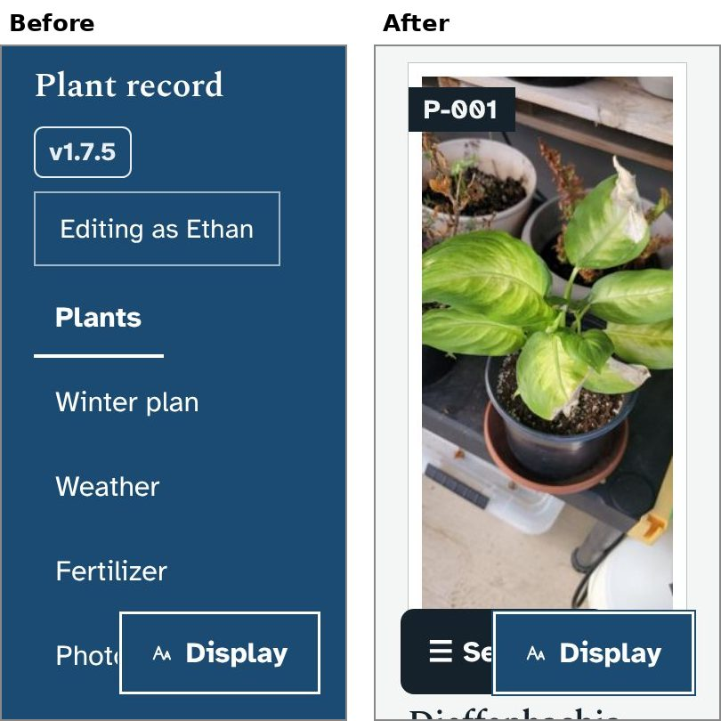
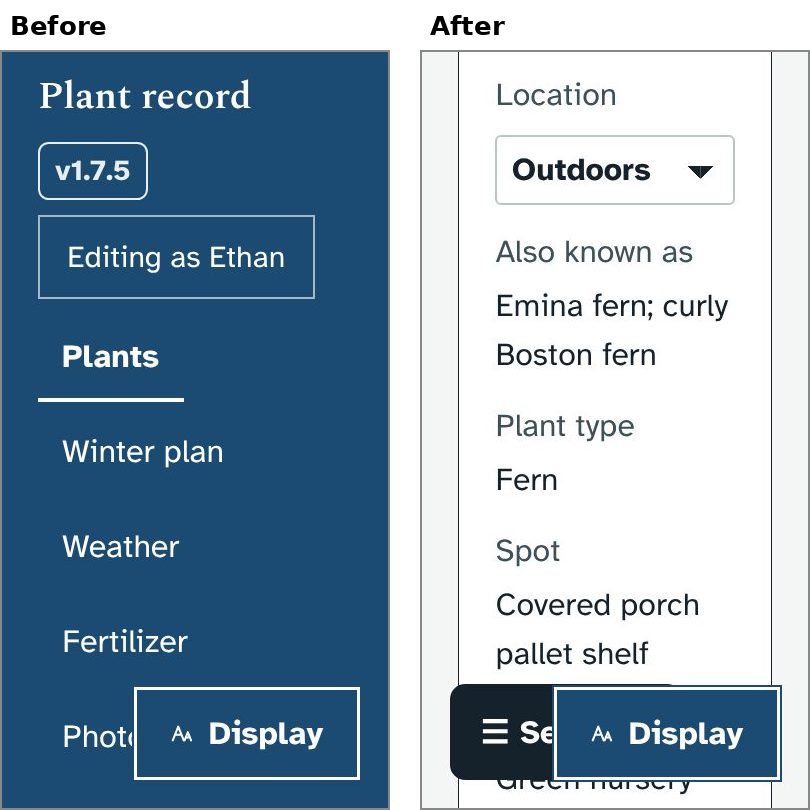
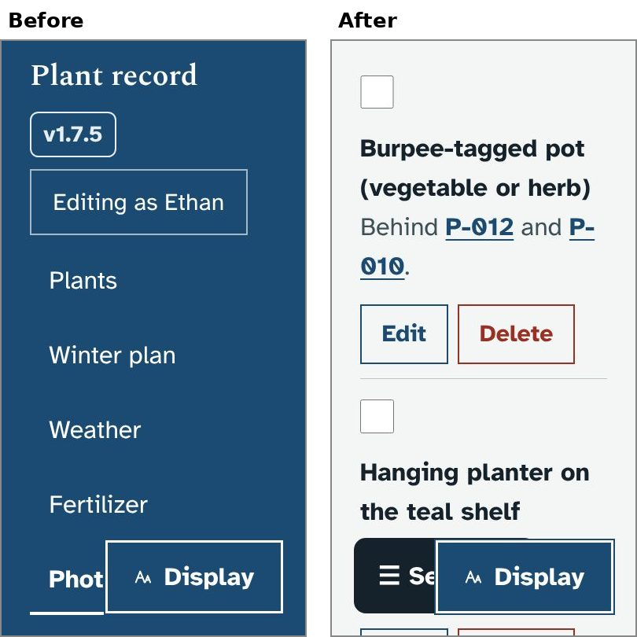

# Fix: phones with large text

## What it fixes
This is a fix rather than a new feature. I found these problems while testing the other prototypes with a bigger text size (Display, Text size) on a phone-sized screen:

- **The menu bar filled the whole screen.** At the two largest text sizes it stayed pinned at the top and covered everything, so nothing else could be seen. On a phone it now scrolls away with the page, like on most websites. Scroll back to the top to reach it. The Sections and Display buttons stay at the bottom as before.
- **Pages ran off the right edge** at the larger text sizes, so you had to scroll sideways to read them. This happened on the Plants page, plant pages, Edit, Winter plan, Weather, Photos, Labels and Backups. Now everything fits the width of the screen at every text size:
  - plant cards, photo cards and labels shrink to the screen width instead of keeping a fixed minimum width
  - on a plant page, the details beside the label (Location, Spot and so on) go under their headings instead of in two columns
  - long plant names, web addresses and changes in the page history wrap onto the next line
  - in "Still to photograph", the Edit and Delete buttons go under the text instead of squeezing it into a thin column
- **The Sections and Display buttons covered each other** at the two largest text sizes on a phone. Sections now sits just above Display.

At normal text sizes on a laptop, nothing looks different.

## Screenshots
A phone with the largest text size:

| | |
|---|---|
|  |  |
|  | |

## How to try it
Change Display, Text size to the largest on your phone and open any page. If you would like it on your PC before merging, say so and I will build a zip marked PROTOTYPE; the updater makes a backup first.

## What it changes in the database
Nothing. It only changes the page layout.

## How it works (for whoever merges it)
- `style.css`: one block, "1.8.0: phones and large text". Grid columns use `minmax(min(14rem, 100%), 1fr)` instead of `minmax(14rem, 1fr)`, because rem grows with the text size. Fieldsets, inputs and selects may shrink (`min-width: 0`). The rules are inside `@media screen`, so printed labels are unchanged.
- `app.js`: one line in `navLayout()` sets `--top-h` to 0 on narrow screens, so sticky headings no longer leave room for a menu bar that has scrolled away. (This part used to be in the read-aloud prototype. It has moved here, so that one is only about reading aloud and shortcuts.)
- `dev/test/smoke.py` now also opens every page on a phone at the largest text size, and fails if the Sections and Display buttons overlap. Run against the current version, it finds 36 problems (16 pages that scroll sideways, and the buttons overlapping on 20); with this fix, none.
- This branch merges cleanly with the other open prototype branches.

## Questions for Ethan
1. Do you use Plant record on your phone, for example after scanning a label, and at what text size?
2. On a phone the menu bar now scrolls away. Would you rather have a small "Menu" button that stays at the top instead?
