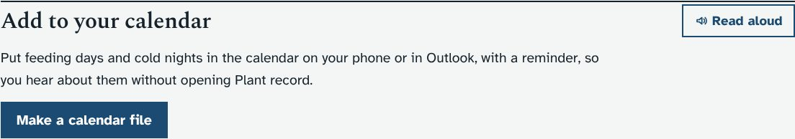
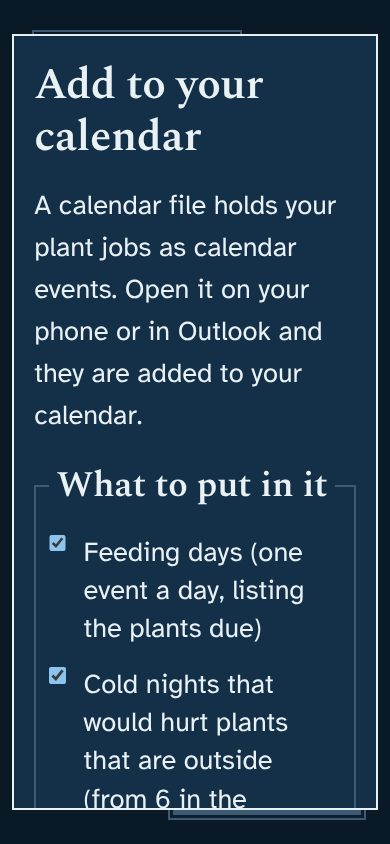
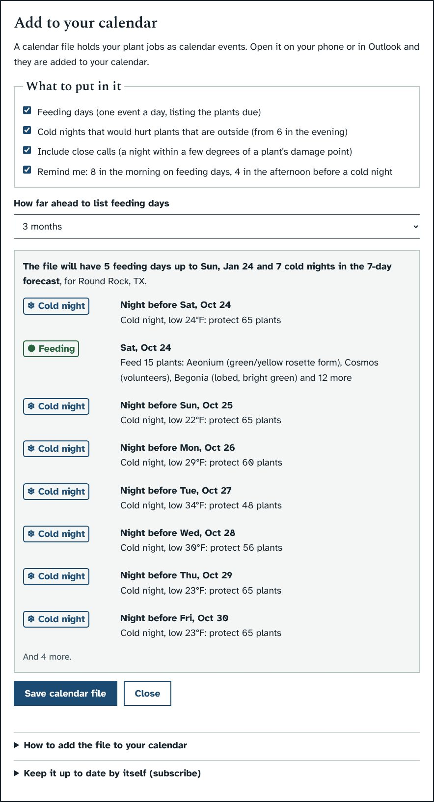
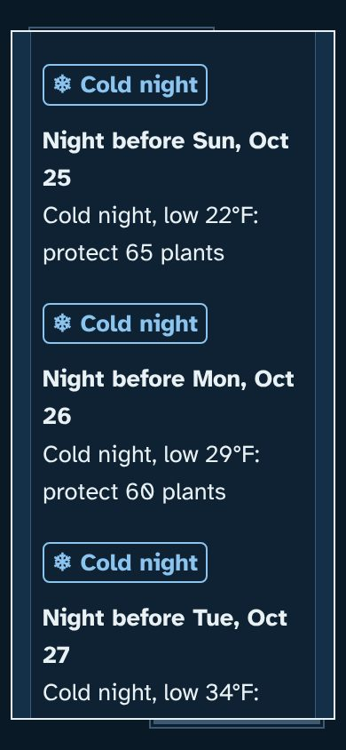

# Prototype: calendar file of feeding days and cold nights

## What it does
Plant record knows when each plant is next due for fertilizer and which nights in the forecast would hurt plants that are outside, but you only see that when you open it. This puts those days into the calendar you already use, on your phone or in Outlook, with a reminder.

- **Add to your calendar** is a new section at the bottom of the **Today**, **Fertilizer** and **Cold-night checklist** pages. Its button, **Make a calendar file**, opens a window.
- **In the window you choose:**
  - **Feeding days:** one event per day, named for the plants due ("Feed 2 plants: Aeonium, Petunia 'Ray Black'"). The notes list every plant, how often it is fed and when it was last fed.
  - **Cold nights:** one event per night that would hurt a plant that is outside, from 6 in the evening to 8 the next morning, because the low comes just before dawn. It is named for what matters ("Cold night, low 29°F: protect 4 plants"). The notes list the plants under "Could die", "Damaged" and "Close call".
  - **Include close calls:** nights within 3°F of a plant's damage point. Untick it for fewer events.
  - **Remind me:** a reminder at 8 in the morning on a feeding day, and at 4 in the afternoon before a cold night.
  - **How far ahead to list feeding days:** 1, 3, 6 or 12 months. Cold nights only go as far as the 7-day forecast.
- **A preview** under the choices says how many events the file will have and lists the first eight. It changes as soon as you change a choice.
- **Save calendar file** saves `plant-record-calendar-<date>.ics` to your Downloads folder. Open it and your calendar adds the events. "How to add the file to your calendar" in the window has the steps for iPhone, Android, Outlook and Google Calendar.
- **Every event links back** to the Fertilizer page or the cold-night checklist.
- **Saving again replaces rather than duplicates.** Each day has the same event ID every time, so most calendars update the event instead of adding a second copy. A day that drops out (say a plant was fed early) is not removed by importing a new file, though; you would delete that event yourself. A subscribed calendar removes it by itself.
- **Subscribing:** "Keep it up to date by itself" has a calendar link and **Copy calendar link**. A calendar that subscribes checks the link every few hours. This only works for a calendar that can reach your PC: Outlook on the PC itself, or an app on a phone on your home Wi-Fi. Google Calendar and Outlook.com fetch it from the internet and cannot reach it.
- Your choices are remembered in this browser. The file uses the place chosen with the Location button.

## Screenshots
The plants and weather in these screenshots come from the test copy with a made-up cold week, so the counts are much higher than you would see.

| | |
|---|---|
|  |  |
|  |  |

## How to try it
The screenshots show it working. If you would like it on your PC before merging, say so and I will build a zip marked PROTOTYPE; the updater makes a backup first.

## What it changes in your database
Nothing. It only reads the plants, the feeding log and the forecast. Nothing is written, so nothing appears in the audit log.

## How it works (for Claude)
- `server.py`, new block before backups: `GET /api/calendar` (JSON preview) and `GET /api/calendar.ics` (the file). Options: `feed`, `cold`, `close`, `remind` (1/0), `months` (1 to 12), `download=0` (no attachment header, for subscribing) and `place=ID` (stands in for the `X-Place` header, which a download link cannot send).
- Feeding days follow the Fertilizer page's `nextDue()` (last feeding plus "Feed every (days)", not before today, moved to the start of the feeding season). The later dates repeat every "Feed every (days)" and skip the resting months. Cold nights come from `frost_report()`.
- The file follows RFC 5545: CRLF line ends, lines folded at 75 bytes, text escaped. Feeding days are all-day events, and cold nights are timed in UTC. The file sets `REFRESH-INTERVAL` and `X-PUBLISHED-TTL` to 6 hours for subscribers.
- `app.js`, new block at the end: a `MutationObserver` on `#app` adds the section to the three pages, and `icsDialog()` handles the window. Choices are kept in localStorage `plantdb.ics`. `style.css` gets its own block at the end.
- Test: `dev/test/calendar_check.py` (checks the file's format and options, the window, the download, and phone width in dark and light).

## Open questions for you
1. **Which calendar do you use?** If it is Google Calendar or Outlook.com, saving the file now and then is the way. Subscribing only works with a calendar that can reach your PC.
2. **Are the reminder times right?** 8 am on feeding days and 4 pm before a cold night. Would you rather choose them, or have the cold-night reminder the evening before as well?
3. **Feeding days list each plant's own schedule.** A day like "Feed 15 plants" happens when several are due at once. Would you rather have one event per plant, or one weekly "feeding day" that gathers everything due that week?
4. **Should watering checks go in too?** They change with the weather every day, so they would only be right for a day or two. My suggestion is to leave them out.
