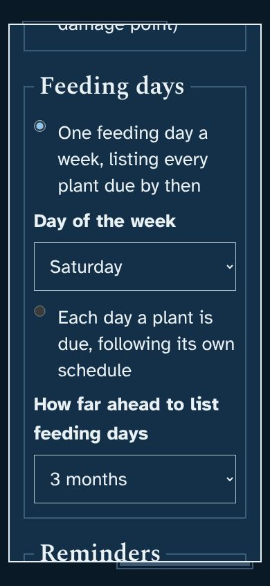
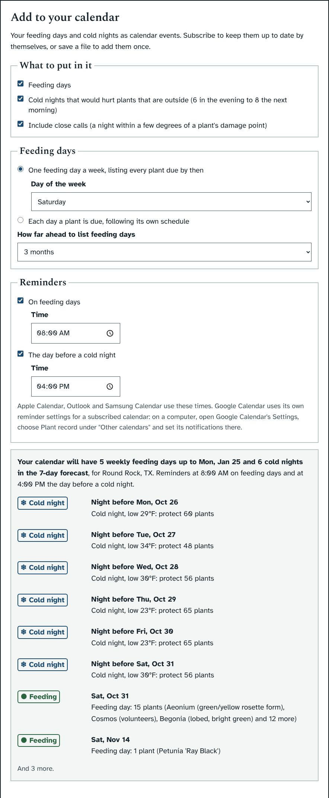
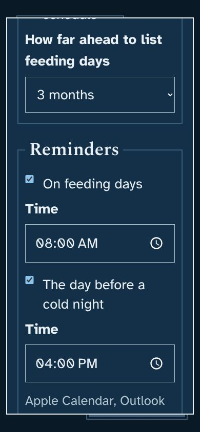
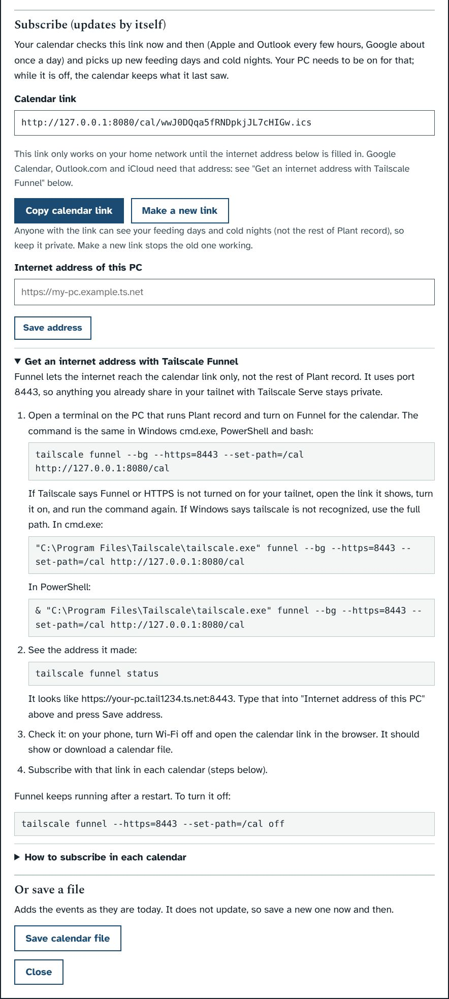

# Prototype: your plant calendar (feeding days and cold nights)

## What it does
Plant record knows when each plant is next due for fertilizer and which nights would hurt plants that are outside, but you only see that when you open it. This puts those days into the calendars you use (Google, Outlook, Samsung and Apple), with reminders, and keeps them up to date by themselves.

- **Add to your calendar** is a new section at the bottom of the **Today**, **Fertilizer** and **Cold-night checklist** pages. Its button, **Set up your calendar**, opens a window. Every choice in it is saved as soon as you make it.
- **What to put in it:** feeding days, cold nights, and whether to include close calls (nights within 3°F of a plant's damage point).
- **Feeding days:**
  - **One feeding day a week** (the default, as you asked), on the day of the week you choose (Saturday to start with). Each plant goes on the first feeding day on or after the day it is due, so it is never fed early (as you asked); at most it waits six days. Its next feeding is counted from that day, because that is when you will feed it. The event is called "Feeding day: 7 plants (…)" and its notes list every plant, how often it is fed and when it was last fed.
  - **Each day a plant is due:** one event per day, following each plant's own schedule.
  - **How far ahead:** 1, 3, 6 or 12 months.
- **Cold nights:** one event per night that would hurt a plant that is outside, from 6 in the evening to 8 the next morning, because the low comes just before dawn. It is named for what matters ("Cold night, low 29°F: protect 4 plants"), and the notes list the plants under "Could die", "Damaged" and "Close call".
- **Reminders, at your own times:** a time on feeding days (8:00 to start with) and a time on the day before a cold night (4:00 pm to start with). Each can be turned off.
  - Apple Calendar, Outlook and Samsung Calendar use these times.
  - Google Calendar uses its own reminder settings for subscribed calendars. In Google Calendar's Settings, choose Plant record under "Other calendars" and set its notifications there. The window says this too.
- **A preview** says how many events your calendar will have and lists the first eight.
- **Subscribe (updates by itself):** a private calendar link with **Copy calendar link**.
  - Your calendar checks the link now and then: Apple and Outlook every few hours, Google about once a day. It picks up new feeding days, cold nights from the latest forecast, and any change to your choices.
  - Your PC needs to be on for that. While it is off, the calendar keeps what it last saw.
  - The link works without your Plant record password, because calendar services cannot type one. The long private code in it is the key, and it only shows feeding days and cold nights. **Make a new link** stops the old one working.
  - **Internet address of this PC:** Google Calendar, Outlook.com and iCloud fetch the link from the internet, so your PC needs an internet address that reaches Plant record. Until one is saved here, the link only works on your home network.
  - **Get an internet address with Tailscale Funnel** (as you chose) has the steps and commands in the window, and the README has them for cmd.exe, PowerShell and bash. Funnel shares only `/cal/` on port 8443, so the rest of Plant record and anything on port 443 stay private.
  - "How to subscribe in each calendar" has the steps for Google (which Samsung Calendar shows through your Google account), Apple on iPhone and Outlook.
- **Or save a file:** **Save calendar file** adds the events as they are today, without updates.

## Screenshots
The plants and weather in these screenshots come from the test copy with a made-up cold week, so the counts are much higher than you would see.

| | |
|---|---|
|  |  |
|  |  |
|  | |

## What it changes in your database
It adds nothing to your plants. Two new entries go in the settings table: `ics_options` (your choices) and `ics_token` (the private code in the calendar link, made the first time it is needed). Changing a choice or making a new link is written to the audit log. Older versions ignore these entries, so nothing needs upgrading.

## How it works (for Claude)
- `server.py`, new block before backups:
  - `GET /api/calendar` gives the preview (JSON) plus `links`.
  - `GET /api/calendar.ics` is the file.
  - `GET /cal/<token>.ics` is the subscription. `guard()` lets `/cal/` GET/HEAD through without the password; the route takes the last part of the path (`<token>.ics`, so `/cal/cal/<token>.ics` behind a proxy works too), compares the token with `hmac.compare_digest` and gives 404 when it is wrong. Event links use the labels' `base_url`, or the request's address unless that is the public one (Funnel only shares `/cal/`), or are left out.
  - `GET/PUT /api/calendar/settings` reads and saves the choices (`ICS_DEFAULTS`, checked by `ics_clean()`), and `POST /api/calendar/new-link` replaces the token.
  - Query arguments with the same names override the saved choices for one request; the tests use this. `place=ID` stands in for `X-Place` on download links.
  - The link's address is the "Internet address" when one is set, otherwise the labels' `base_url` setting, otherwise the address the browser used.
- `ics_feed_days(c, today, end, weekday)` follows the Fertilizer page's `nextDue()`. With a weekday, it moves each feeding to the first feeding day on or after its due date (never early) and counts the next feeding from there.
- Reminders: feeding days use `TRIGGER;RELATED=START:PT<h>H<m>M` on the all-day event. Cold nights use an absolute `TRIGGER;VALUE=DATE-TIME` on the day before, in the place's time zone.
- The file follows RFC 5545: CRLF line ends, lines folded at 75 bytes, text escaped, stable UIDs, and `REFRESH-INTERVAL`/`X-PUBLISHED-TTL` of 6 hours.
- `app.js`, block at the end: a `MutationObserver` on `#app` adds the section, and `icsDialog()` handles the window. Changes are saved with `icsPut()`. `style.css` has its own block at the end.
- Test: `dev/test/calendar_check.py` covers the file's format and every choice, weekly days, reminder times, the subscription link (wrong token, new link, saved choices), the audit log, the window, the download, and phone width in dark and light.

## Open questions for you
1. **The Tailscale command is untested here.** I can't run Tailscale from my sandbox. The calendar link works whether Funnel passes on the `/cal` part of the address or not. Try step 3 in the window (open the link on your phone with Wi-Fi off) and tell me what you see.
2. **Links in the events** go to Plant record on your home network (the address set for labels, if there is one). Funnel does not share the rest of the app, so they only open at home or over Tailscale. Is that all right?
