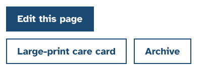
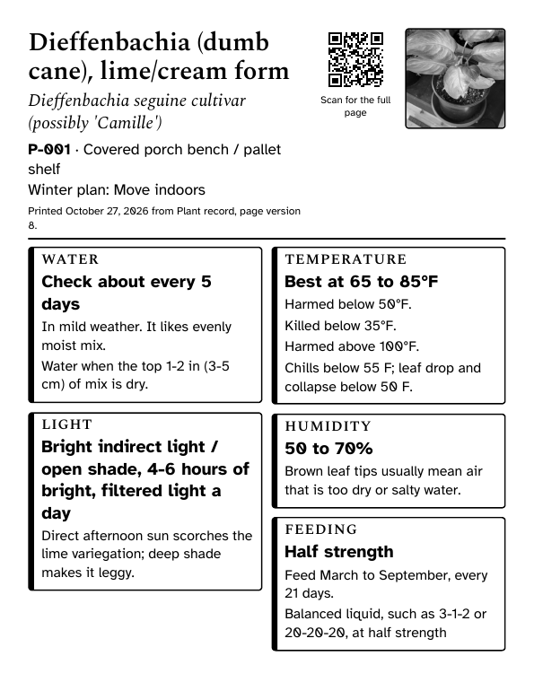
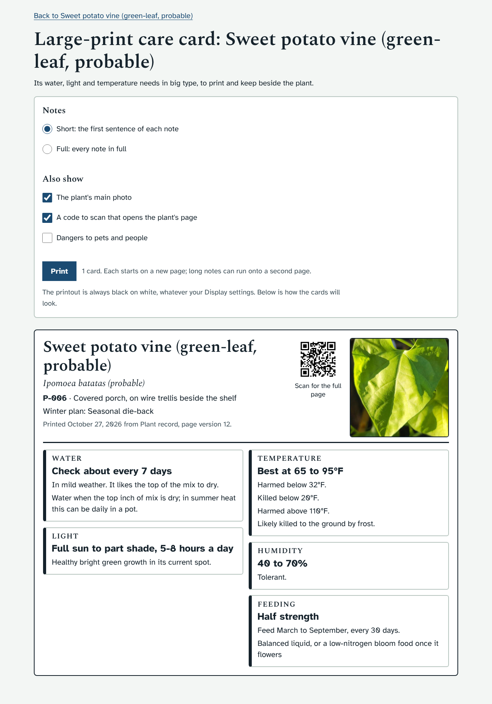
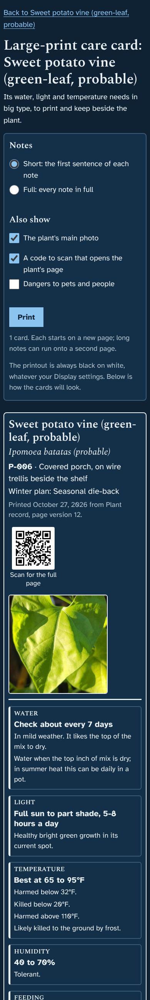
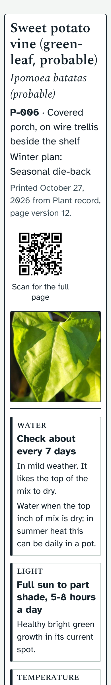

# Prototype: large-print care cards

## What it does
A printable card for one plant, or one for every plant in a group, with what it needs in big type. You can keep it beside the plants indoors over winter and read it without opening the app.

- **Where to find it:**
  - On every plant page there is a new button, **Large-print care card**, next to "Edit this page".
  - On a group's page there is **Large-print care cards**, which makes one card for each plant in the group.
- **On each card:**
  - The plant's name, Latin name, code, where it is and its winter plan.
  - Its main photo, and a code to scan with a phone that opens the plant's page.
  - Six boxes, each headed with a word, so nothing depends on colour:
    - **Water:** how often to check, from its watering setting or its soil moisture range, the same figure the Today list uses.
    - **Light**
    - **Temperature:** the best range, and the temperatures below or above which it is harmed or killed.
    - **Humidity**
    - **Feeding:** the strength, and which months and how often to feed.
    - **Careful** (off unless you tick it): its dangers to pets and to people.
  - The main fact in each box is in bold. Under it, a short note from the plant's page.
- **Choices, above the cards** (remembered in this browser):
  - **Notes:** short (the first sentence of each note) or full.
  - **Also show:** the photo, the code to scan, and the dangers to pets and people.
  - **Print** opens your browser's print window.
- **The printout:**
  - It is always black on white, whatever your Display settings.
  - The options, menus and buttons are left off.
  - Each plant starts on a new page.
  - The smallest text is about 16 point (large print). The main facts are about 20 point, and the plant's name about 30 point.
  - With the usual choices, most plants fit on one page. A plant with long notes, or with the dangers ticked, can run onto a second page.
- **On screen** it follows your Display settings (text size, dark mode, high contrast). It works at phone width with the largest text and no sideways scrolling.

People who can only view the app can open and print cards too, because a card changes nothing.

## Screenshots
| | |
|---|---|
|  |  |
|  |  |

## How to try it
1. Open any plant and press **Large-print care card**, or open a group and press **Large-print care cards**.
2. Choose what to show, then press **Print**. Your browser's print window lets you pick the printer, or "Save as PDF".

## What it changes in your database
Nothing. The cards only read what is already on each plant's page. No new tables or columns, no upgrade batch.

## How it is built
- `app/static/card.html` and `app/static/card.js` make a page of their own (`/card.html?plant=P-006` or `?group=3`), so the printout carries nothing but the cards. It uses the same `style.css` and Display settings, and has no inline scripts.
- `card.js` reads `/api/plants/<code>`, `/api/groups/<id>`, `/api/water` (for "check about every N days") and `/api/settings` (the address the scan code opens, as on the Labels page).
- `app.js` has one new block at the end. When a plant or group page draws, a `MutationObserver` adds the button, so `route()` and `viewPlant()` are not changed.
- `style.css` has one new block, headed "prototype proto/care-card", placed before the 1.16.0 groups block.
- Choices are stored in localStorage `plantdb.card`.
- Test: `dev/test/card_check.py`. It covers the buttons, cards for one plant and for a group, the choices and remembering them, no sideways scrolling, and the printout (black, large print, a new page for each plant). It saves a PDF to `dev/tmp/shots/card-print.pdf`.

## Open questions for Ethan
1. Is the print size right? It is about 16 point for notes and 20 point for main facts. Bigger means more plants run onto two pages.
2. Should the dangers to pets and people be on by default? They are off now, to keep most cards to one page.
3. Two plants on a page (smaller type), or a small card about 4 by 6 inches, to tape to a pot or shelf?
4. Should the Labels page have a "Print care cards for all plants" (or "for plants that are indoors") button too?
5. Anything else you would want on the card, such as the pot size, the potting mix, or the grow light spot it sits under?
