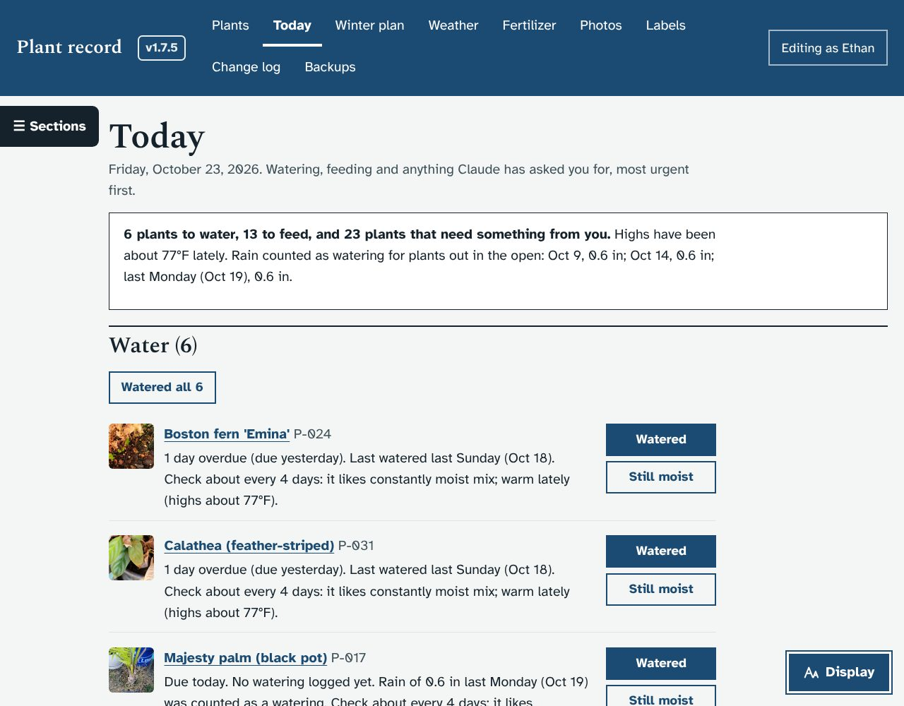
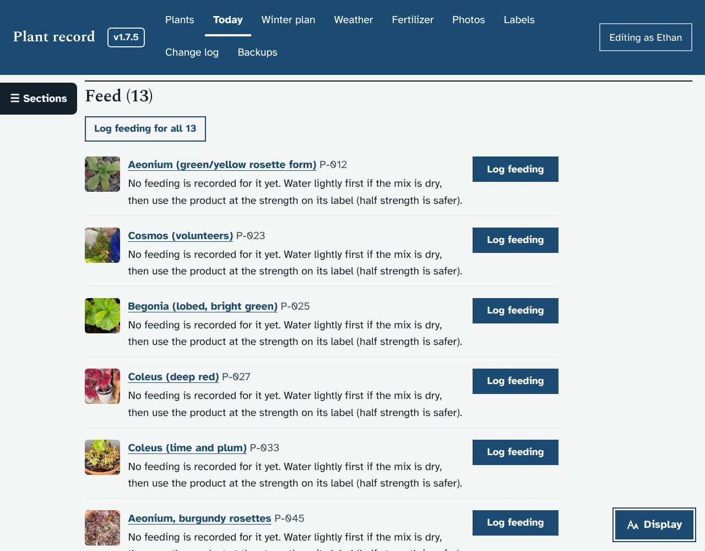
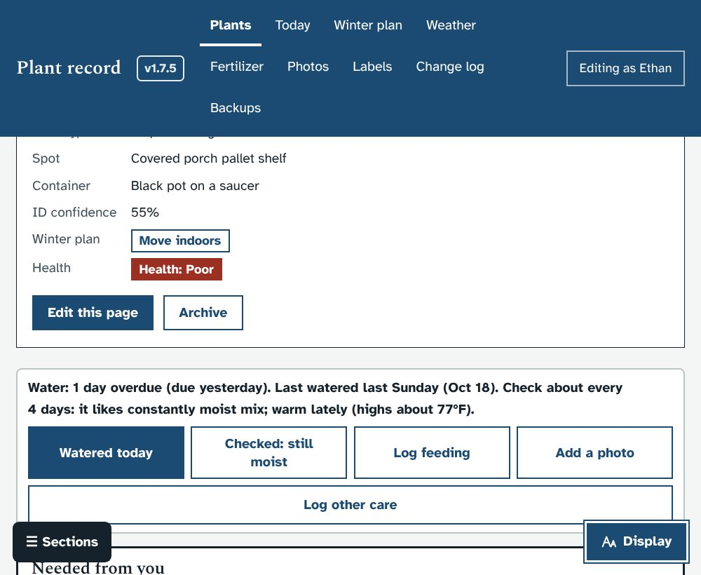
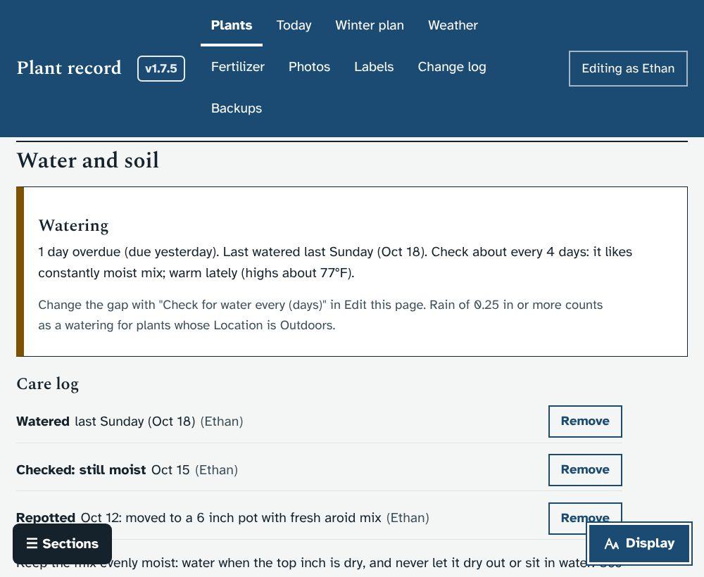
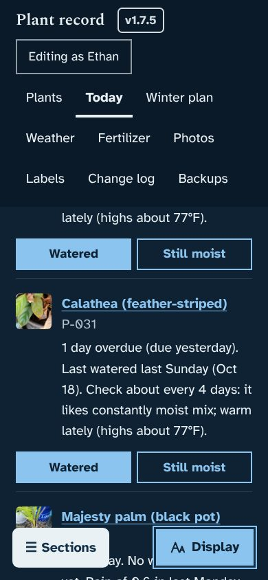
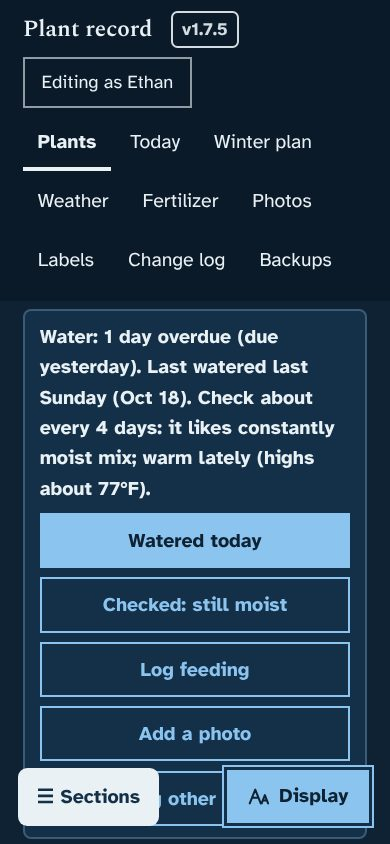

# Prototype: watering log, quick care buttons and a Today page

## What it does
- **A Today page** (new "Today" link in the menu, next to Plants), with the most urgent first:
  - **Water:** plants due or overdue for a check. Each has **Watered** and **Still moist** buttons, and there is "Watered all N" for a whole round.
    - "Check tomorrow" lists the next day's plants.
    - "No watering logged yet" lists plants with no reminder yet, with one button, "I watered all N today", to start the clock for all of them after a round with the hose.
  - **Feed:** plants due for fertilizer today (the same schedule as the Fertilizer page), with **Log feeding**.
  - **Needed from you:** the open requests, each with a link to answer it on the plant's page.
- **Quick care buttons on every plant page**, just under the label, big enough to use on a phone in the garden right after scanning a plant's label:
  - **Watered today**, **Checked: still moist**, **Log feeding**, **Add a photo** (opens the phone camera), and **Log other care** (repotted, pruned, treated for pests, or a note, with a date)
  - above them, one line says when the plant was last watered and when to check it next
- **Water and soil section** on each plant page: the watering status, explained, and a **care log** with a Remove button on each entry.
- **How the reminders work:**
  1. **Starting gap**, from the plant's soil moisture range:
     - 14 days for plants that like to dry out completely (cacti, aloes)
     - 10 days for plants that like to dry out between waterings
     - 7 days for plants that like the top of the mix to dry
     - 5 days for plants that like evenly moist mix
     - 4 days for plants that like constantly moist mix (ferns, calatheas)
  2. **Weather:** the gap is shortened in hot weather (highs of 85°F or more) and lengthened in cool weather or indoors.
  3. **Rain:** 0.25 in or more on one day counts as a watering for plants whose Location is Outdoors.
  4. **Checked: still moist** puts the next check a third of the gap later.
  5. **Your own gap:** set "Check for water every (days)" on the Edit page to override all of this.
- **Covered porch locations:** 25 plants whose spot says they are on the covered porch ("Covered porch pallet shelf", "Porch shelf", "Porch edge under the roof") get Location: Covered porch, so rain is not counted for them. Spots that name two places ("Porch shelf / front table", "Porch shelf / black bench") are left as Outdoors for you to decide. This is upgrade batch `batch9d`, and it leaves alone any plant whose Location you already changed.

## Screenshots
| | |
|---|---|
|  |  |
|  |  |
|  |  |

(Made-up weather with rain every fifth day.)

## What it changes in the database
- **New table `care_log`:** one row per Watered / Checked / Repotted / Pruned / Treated / Note, with the date, who and an optional note. Every entry and removal also goes in the Change log.
- **New plant field "Check for water every (days)"** (`water_every_days`). It is empty unless you set it.
- **Batch 9d** sets Location to Covered porch for 25 porch plants, as above.
- **Start-up fix:** the default Location ("Outdoors") is now filled in before upgrade batches run, so a batch can rely on it on a brand-new install too.

## How it works (for whoever merges it)
- **API:**
  - `GET /api/water` (`water_report()`): each plant's gap, why, last watering, rain and check, next check and state (due, soon, ok, unknown)
  - `GET/POST /api/care`: list, or add for one plant or many
  - `DELETE /api/care/<id>`
- **Front end:**
  - `viewToday()` is `#/today`
  - `careQuick()` and `loadCarePlant()` are on plant pages
  - acts: `care`, `careall`, `careother`, `caredel`, `todayneeds`
- **Test:** `dev/test/care_check.py`. The mock server now makes a dry spell with 0.6 in of rain every fifth day.

## Questions for Ethan
1. Do the starting gaps feel right for your plants in Round Rock heat? Any you already know you water more or less often?
2. Should **Watered all** on the Today page also offer "everything on the porch" or "everything in the yard" rounds?
3. Five plants have spots that name two places ("Porch shelf / front table", "Porch shelf / black bench"): P-042, P-045, P-055, P-056 and P-081. Which are under the porch roof?
4. When the frost-alert prototype is merged, the Today page should also list that night's cold-night jobs. Shall I add that once both are in?
