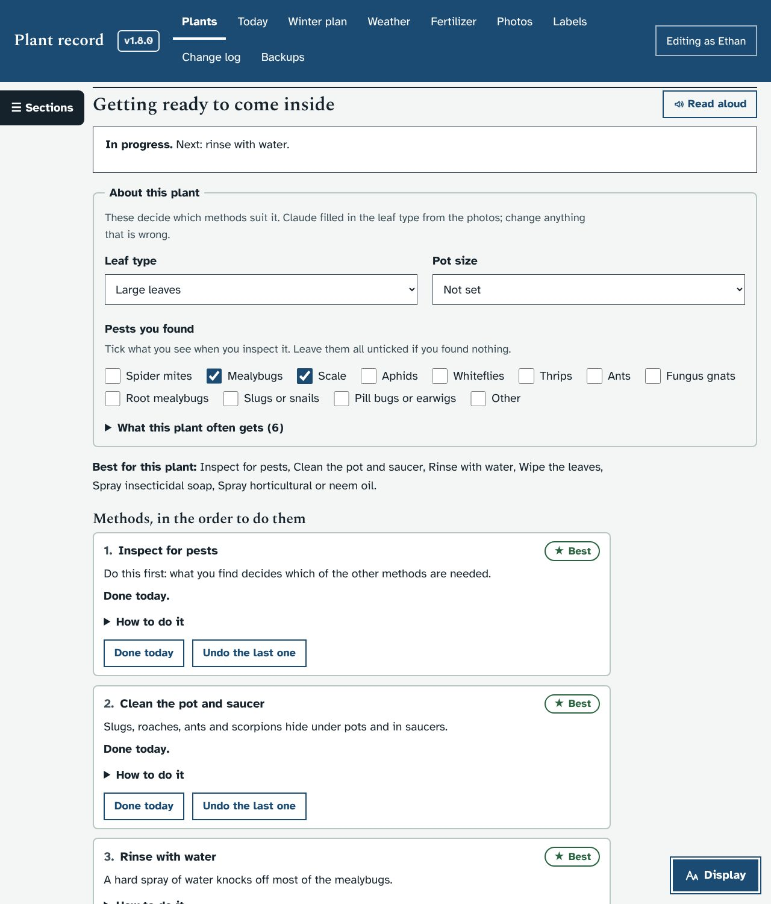
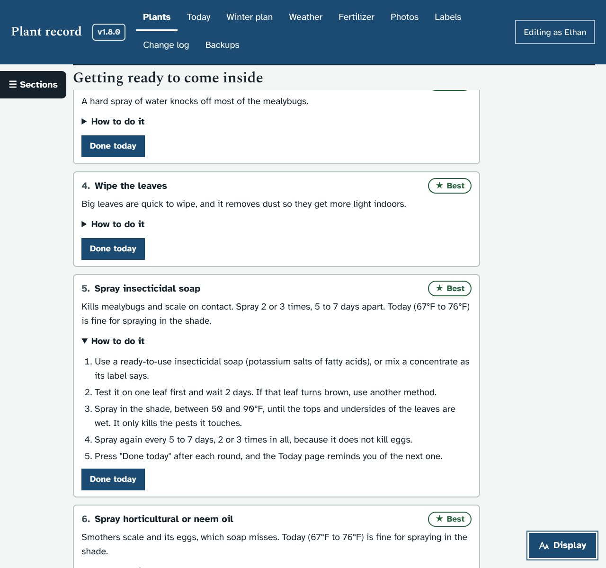
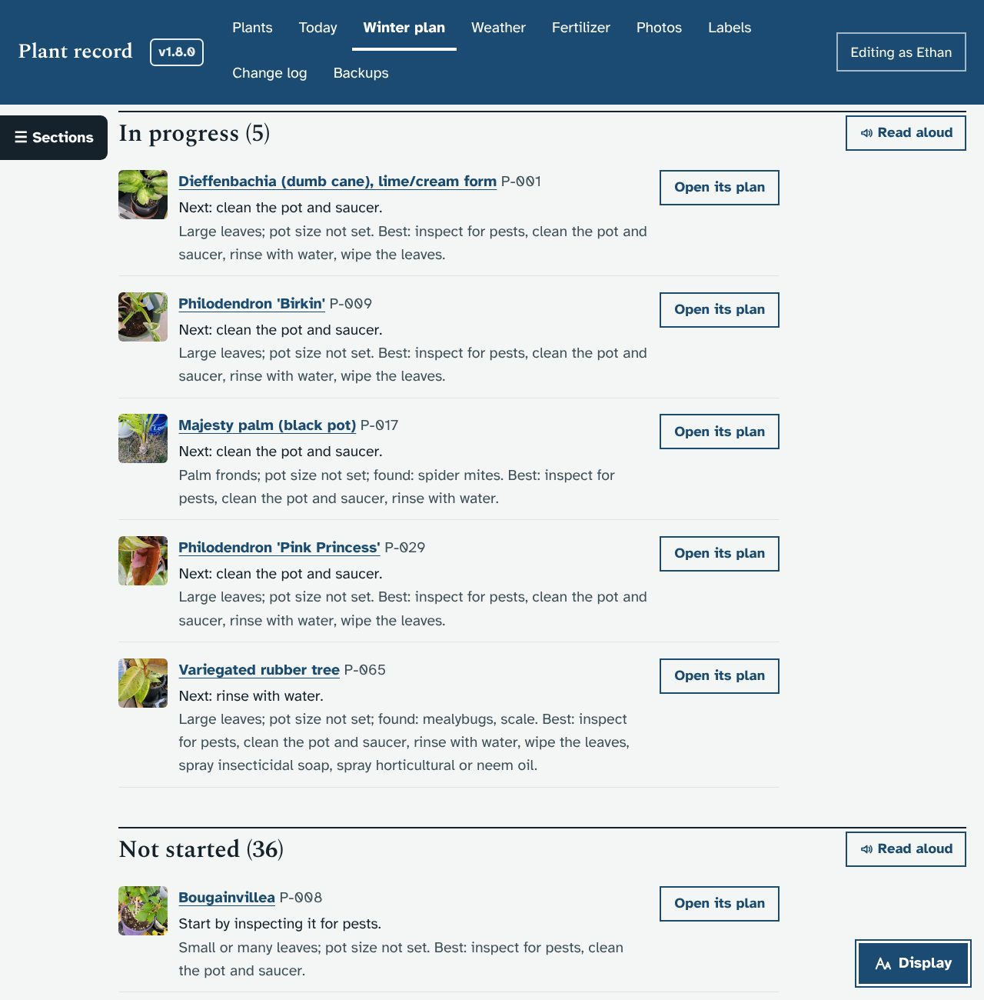
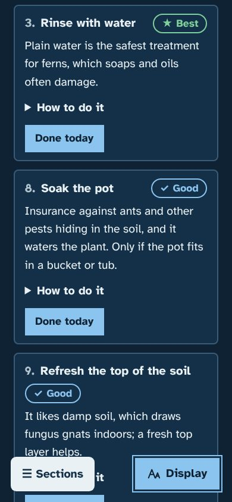

# Getting plants ready to come inside (pest checks)

Asked for by Ethan on October 23, 2026: the ten ways to keep outdoor pests out of the house, built into Plant record as part of moving plants inside, with steps for each and the best methods rated for each plant. No bleach anywhere.

## What it does
- **Each plant page** has a new section, **Getting ready to come inside**, after Winter in Round Rock:
  - **About this plant:** **Leaf type** and **Pot size** menus, and **Pests you found** tick boxes. Claude filled in the leaf type for every plant (upgrade batch `batchA1`) and the pot size where the photos make it clear. Each change is saved as a page version.
  - **What this plant often gets:** the pests from its page, to know what to look for.
  - **The ten methods**, each rated **Best**, **Good**, **Use with care**, **Not needed** or **Not for this plant**, with the reason, a **How to do it** fold with the steps, **Done today** and **Undo the last one**. Methods that are not needed or not suitable are folded away under one line.
  - A status line: Not started, In progress (with the next step), Ready to come inside, Inside and kept apart (until a date), or Inside and settled.
- **What the ratings use:** leaf type (succulents are never soaked or oiled, ferns get water only, fuzzy leaves are brushed, not wiped), pot size (a pot too big for a bucket is not soaked), the pests found (soap for mites, aphids and mealybugs; oil and alcohol for scale; soaking for ants; a fresh top layer for fungus gnats; repotting for root mealybugs), how dry it likes its soil, its health (struggling plants are not repotted and get "test one leaf first"), and today's forecast (no spraying above 90°F).
- **Rounds and keeping apart:** soap and oil rated Best need 2 rounds; the second is due 5 days after the first and appears on the **Today** page with a Done today button. A plant that comes inside is kept apart from the other houseplants for 21 days, or 2 weeks after its last treatment if pests were found, and the Today page says when that ends.
- **A Getting plants ready to come inside page** (`#/inside`, linked from Winter plan, the cold-night checklist and the Today page): every plant coming inside, grouped by status, with its next step and best methods; the order of work; the steps for all ten methods; and how to keep plants apart.
- The steps go into the care log, so they show in the plant's timeline and in "Copy my answers for Claude". A soak or a repot counts as a watering.
- **Pots without bleach:** hot soapy water and a brush, rinse, a day drying in the sun; for extra cleaning, 10 minutes in 3% hydrogen peroxide, then rinse (never mixed with vinegar or other cleaners); or a new pot.
- The water hyacinth page (P-050) is archived: it was bagged and put in the trash.

## Screenshots
| | |
|---|---|
|  |  |
|  |  |

## What it changes in the database
- Three new plant fields: `leaf_type`, `pot_size` (both optional menus) and `pests_found` (a list). They are added on the next start.
- New care log kinds `prep_inspect` … `prep_repot`.
- Upgrade batch `batchA1`: leaf types (and some pot sizes) set only where empty; P-050 archived.

## How it works
- `server.py`: `PREP_METHODS` (titles and steps), `prep_rate()` (the ratings), `prep_plan()` (progress, status, keep-apart date), `GET /api/prep`, `GET /api/plants/<code>/prep`, `POST /api/plants/<code>/prep-traits`.
- `app.js`: the plant page section (loaded by a `MutationObserver`, like the timeline), `viewInside()`, `todayPrep()` on the Today page, and the Edit page now draws every menu from `META.enums`, with "Not set" for optional ones.
- Test: `dev/test/prep_check.py` (31 checks). All other focused checks and the smoke test pass, on a fresh install and on a copy of a 1.8.0 database.
