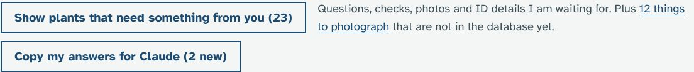
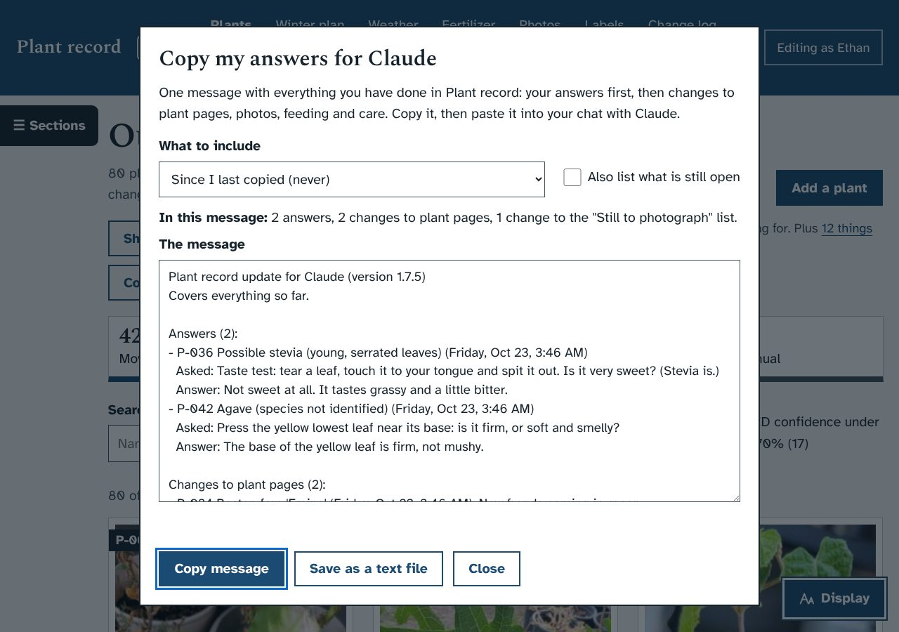
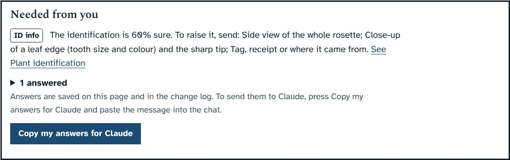
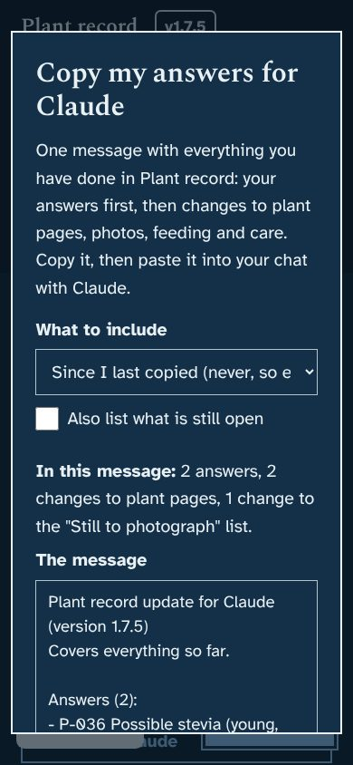

# Prototype: copy my answers for Claude

## What it does
When you answer a question or do a check in Plant record, I can't see it until you tell me. This gathers everything into one message to paste into our chat.

- **Copy my answers for Claude** is a new button in two places:
  - the Plants page, next to "Show plants that need something from you". It says how many answers are new, for example "(2 new)".
  - the "Needed from you" box on each plant page, under your answers.
- It opens a box with the message and a **Copy message** button. Paste it into the chat with Ctrl+V. The box says "Copied" when it worked.
- **The message** is plain text, with your answers first:
  - **Answers:** the plant, what I asked and your answer. A request you marked done without writing an answer says so.
  - **Changes to plant pages:** your edits, with the important values in words ("Health rating: from Poor to Fair", "Location: from Outdoors to Indoors").
  - **Photos:** how many you added to each plant, with their captions, and any you moved or removed. Photos can't travel in a text message, so it reminds you to attach the ones you want me to look at.
  - **Feeding and care:** feedings, and waterings and cold-night covers if those prototypes are merged.
  - **"Still to photograph" list:** what you ticked off or added.
  - How many requests and photos are still open.
- **It remembers where you got to.** Next time it starts from your last copy, so nothing is sent twice. Changes I made with an update are left out, because I already know them.
- **What to include:** "Since I last copied", "The last 7 days", "The last 30 days" or "Everything". **Also list what is still open** adds the open requests and photos, which helps if you start a new chat with me.
- **Save as a text file** puts the same message in your Downloads folder, if you would rather attach it.

## Screenshots
The answers in these screenshots are examples typed in for the test, not yours.

| | |
|---|---|
|  |  |
|  |  |

## How to try it
The screenshots show it working. If you would like it on your PC before merging, say so and I will build a zip marked PROTOTYPE; the updater makes a backup first.

## What it changes in the database
No new tables or columns.
- One new setting, `claude_copied_at`: when you last copied or saved the message.
- The change log gets a line when you copy it ("Copied my answers for Claude"), and, from now on, a line when you add, tick off or remove something on the "Still to photograph" list. Before, that list kept no history.

## How it works (for whoever merges it)
- `server.py`, new section before `POST /api/plants`:
  - `GET /api/for-claude?range=last|7|30|all&open=0|1` returns the message, counts and the time it covers. `for_claude_message()` builds it from the `requests` table (answers) and `audit_log` (everything else), leaving out rows signed "Claude (...)", which come from upgrade batches.
  - `GET /api/for-claude.txt` is the same message as a download.
  - `POST /api/for-claude/copied {until}` remembers the copy. It only moves forward.
  - `to_photograph()` and `to_photograph_item()` now write `todo` rows to the change log.
- `app.js`: `forClaudeDialog()` and helpers, placed before `fitPanes()`; acts `forclaude`, `fccopy`, `fcsave`; change handlers `fcrange`, `fcopen`. Copying uses the clipboard API. Where the browser turns that off (a page opened by the computer's network address, such as from a phone), it selects the text and copies it the older way, and if that fails too it asks for Ctrl+C. Messages show inside the dialog, because the usual pop-up notes are hidden behind an open dialog.
- CSS: one block, "1.8.0: copy my answers for Claude".
- Test: `dev/test/copy_check.py`. It answers a request in the browser, edits plants and ticks off a photo, then checks the message, the clipboard, the "(new)" count, starting from the last copy, every choice in the dialog, the text file, the change log, the largest text on a phone, and copying on a page opened by a network address. It passes on a fresh install and on a 1.7.4 database copy, and the smoke test passes.
- This branch merges cleanly with the other open prototype branches.

## Questions for Ethan
1. Is the message the right length, or should it leave out changes to plant pages and keep only answers?
2. Would a third place for the button help, for example the Change log page?
3. Would you like a stronger reminder, such as a line at the top of the Plants page saying "You have 3 answers Claude hasn't seen yet", instead of only the count on the button?
