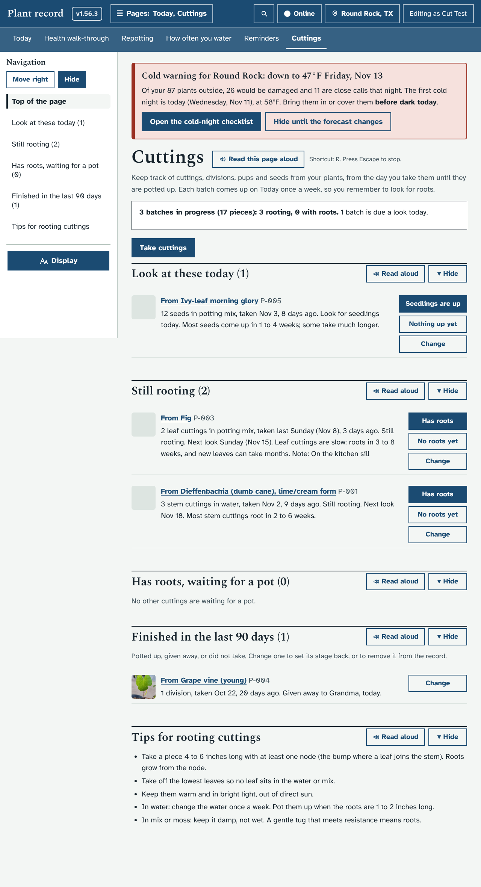
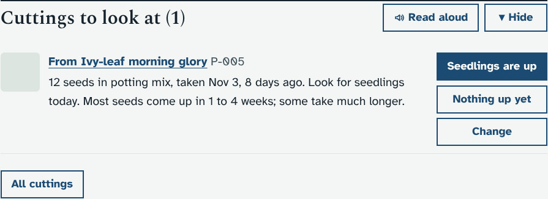
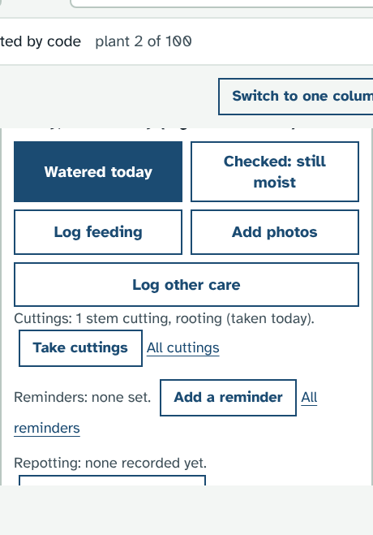
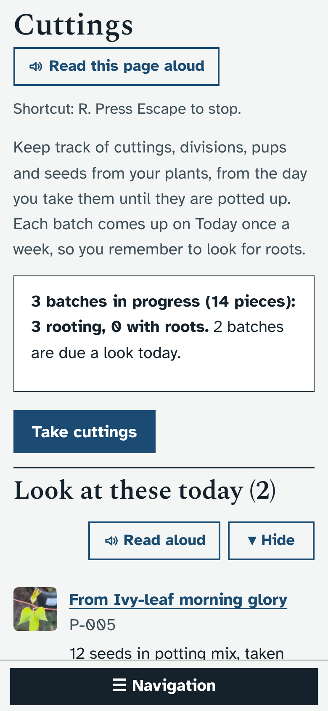
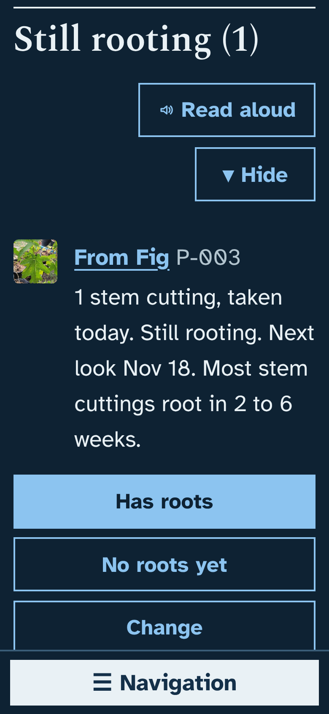
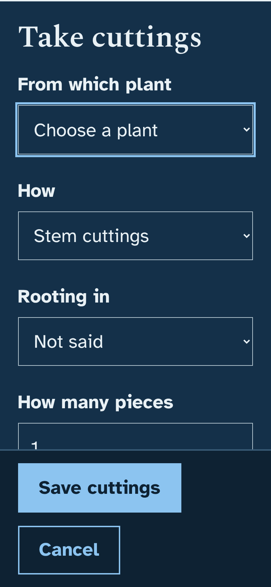
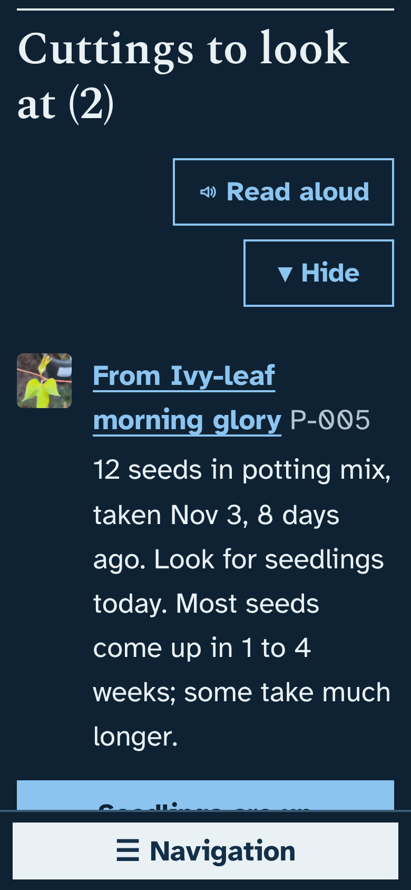

# Prototype: Cuttings

Branch `proto/cuttings`. Suggested by Claude (the ideas list had nothing left to take).

## What it does and why
With about 80 plants, some will be giving cuttings, pups or divisions, and a jar of cuttings on a windowsill is easy to forget. This keeps track of each batch from the day you take it until it is potted up, and reminds you once a week to look for roots.

- **Today → Cuttings** is a new page with a **Take cuttings** button. You say which plant, how (stem cuttings, leaf cuttings, division, offsets or pups, air layering, seed), what they are rooting in (water, potting mix, sphagnum moss, perlite, LECA, still on the plant, other), how many pieces, the day, and a note.
- **Once a week** each batch comes up on Today under **Cuttings to look at** (with a **Cuttings (1)** jump button). Press **Has roots**, or **No roots yet** to be asked again in a week. A batch with roots then asks **Potted up** or **Not ready yet** the same way. Seeds say **Seedlings are up** and **Nothing up yet** instead.
- **The page** groups the batches: Look at these today, Still rooting, Has roots (waiting for a pot), Finished in the last 90 days, and short tips for rooting. Each batch says how long ago it was taken and how long that kind usually takes ("Most stem cuttings root in 2 to 6 weeks").
- **Change** sets any field, marks a batch **Given away** (and to whom) or **Did not take**, or removes it from the record (it asks first).
- **A plant's page** gets one line under the care buttons: "Cuttings: 3 stem cuttings in water, rooting (taken Nov 2)", with **Take cuttings**, which already knows the plant.
- People who can only view see the cuttings but not the buttons. Every change is in the Audit log under the plant the cuttings came from.

## How it looks
The page on a laptop:

On Today, and the line on a plant's page:

On a phone, light, and dark with large text:

The empty grey squares are where your plant photos go; the test server has no photos.

## What it changes in your database
One new table, `cuttings`, made the first time the page or Today asks for it. Nothing else changes, and nothing is filled in: the list starts empty. A removed batch is only marked as removed.

## How to try it
Screenshots are usually enough. To run it here: start `dev/test/mock_server.py` with a fresh `DATA_DIR`, then `python3 dev/test/cuttings_check.py` (screenshots in `dev/tmp/shots/cuttings-*.png`).

## Open questions for Ethan
1. **Is once a week right** for the look-for-roots reminder? It could be every 3 or 4 days for cuttings in water, or a setting.
2. **When a cutting is potted up**, should the app offer to add it as a new plant in the record (with the parent's name and care filled in)? It does not yet; Potted up just finishes the batch.
3. **Where should the page live?** It is in the Today row after Repotting, because one more page in the Care row makes the top bar two lines tall on a laptop.
4. If **"Your own reminders"** (#86) is merged too, should "look for roots" use those instead of its own weekly look?
