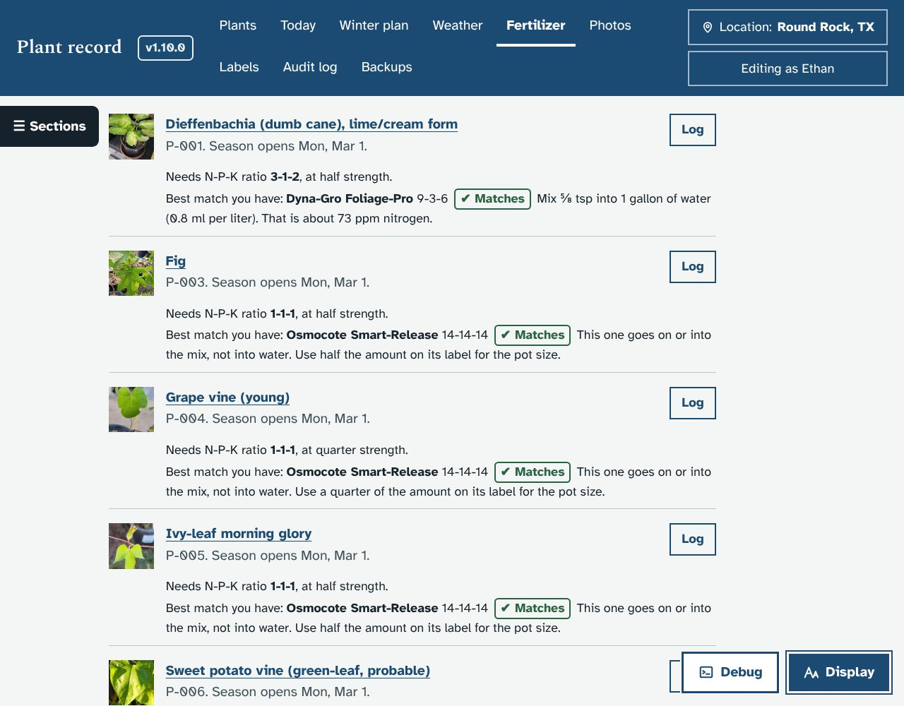
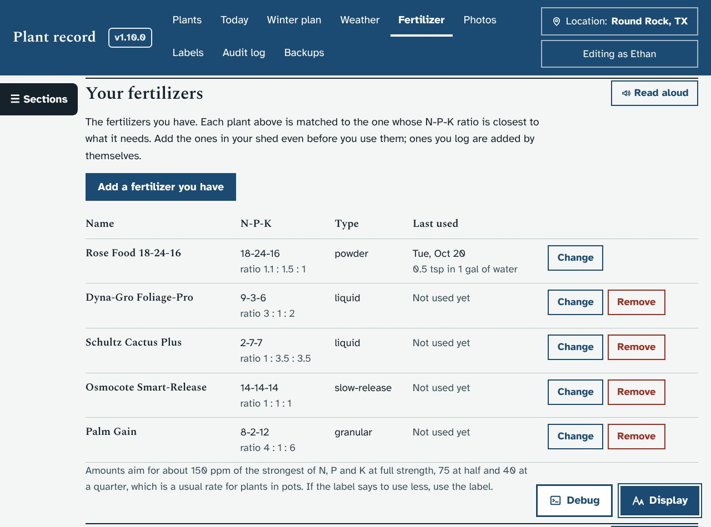
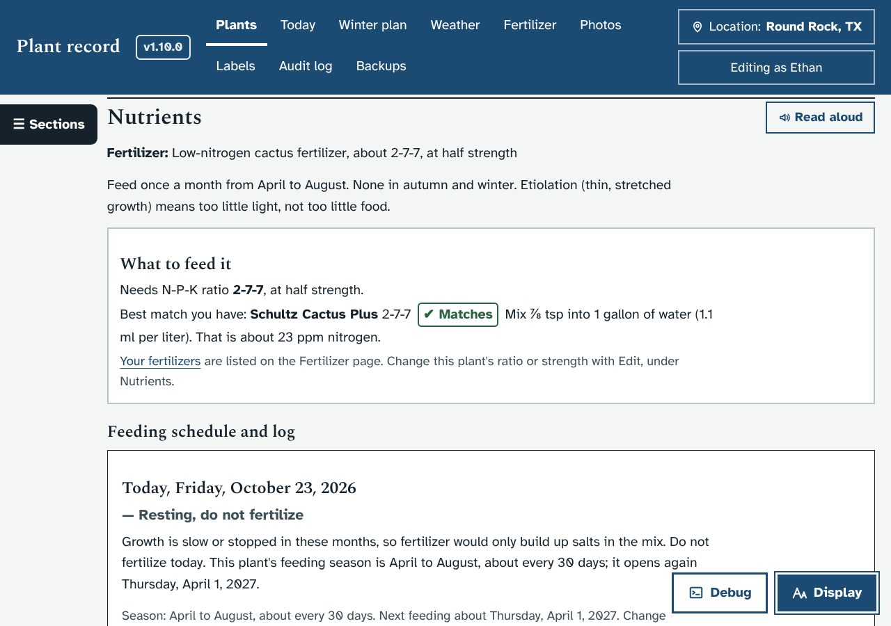
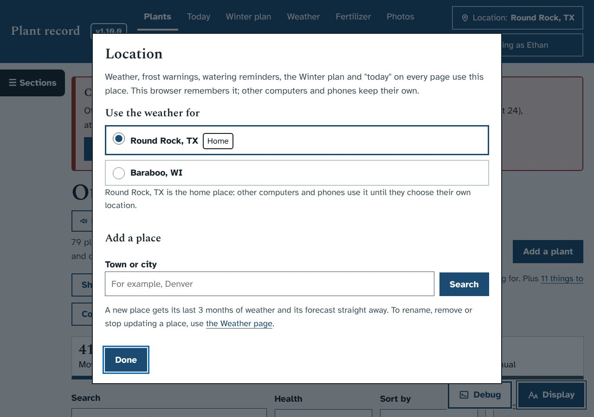
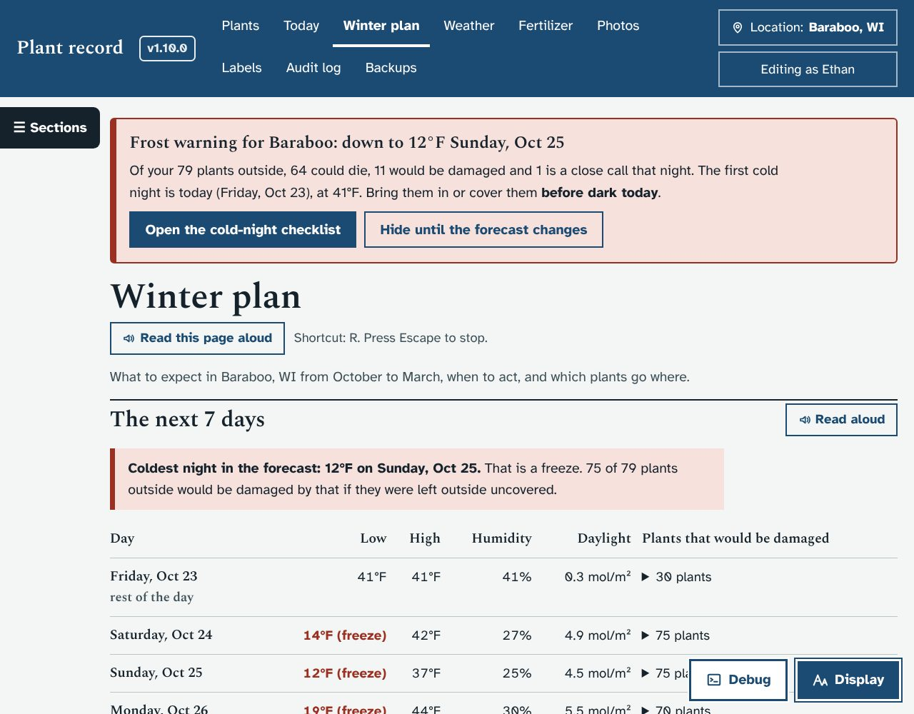
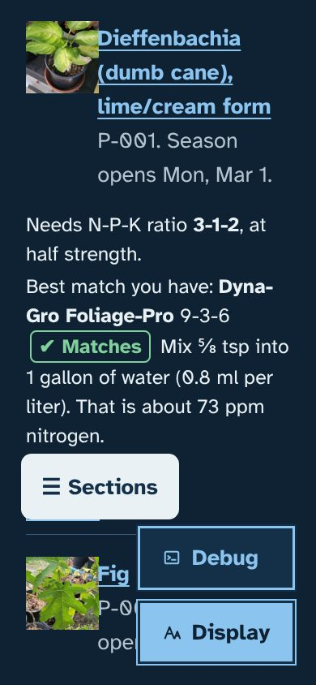

# Fertilizer needs and matches; location on every page

Asked for by Ethan on October 23, 2026:
1. On the Fertilizer page, each plant's N-P-K ratio, under its ID and last-logged line. Also the logged fertilizer that matches it best, with its name, its numbers and how much to mix into water for that fertilizer's type.
2. A location menu on every screen that shows weather, so nothing is tied to Round Rock, in case someone else uses the app.

This branch also carries Ethan's answers of October 23 (upgrade batch `batchA2`).

## What it does
- **Fertilizer page:** each plant row has two lines under "P-013. Never logged.":
  - "Needs N-P-K ratio 2-7-7, at half strength."
  - "Best match you have: Schultz Cactus Plus 2-7-7 ✔ Matches. Mix ⅞ tsp into 1 gallon of water (1.1 ml per liter). That is about 23 ppm nitrogen."
  - How close it is: ✔ Matches, ✔ Close, ▲ Usable or ■ Not a good match. Each has a symbol and a word, not only a colour. It also says what is off ("more nitrogen and less potash than this plant needs").
  - Granular, slow-release, spikes and organic solids say what share of the label amount to use, instead of a water mix.
  - Plants that need none say so.
- **Your fertilizers:** the logged ones, plus **Add a fertilizer you have** (name, type, N-P-K), with **Change** and **Remove**. Ethan has not logged any yet, so this is where he starts.
- **Plant pages:** a **What to feed it** box in Nutrients. **Log** for one plant pre-fills the feeding form with its match and amount.
- **Edit page:** "Fertilizer ratio needed (N-P-K)" and "Fertilizer strength", under Nutrients.
- **Location button** at the top of every page (or the L key) opens the **Location** window:
  - choose a place, which takes effect straight away;
  - search for a town and add it;
  - make the chosen place the home place for everyone.
  - Each browser remembers its own choice, and the Weather page's menu is the same choice.
- **What follows the location:**
  - the frost banner and checklist
  - current conditions and "today"
  - watering and rain
  - the Winter plan and the Weather page
  - "Winter in <place>" on plant pages
  - the temperature and humidity strip marks, taken from that place's own weather history
- **Round Rock-only text** shows only when Round Rock is in use: the Winter plan's written notes, sources and expected-weather table. Elsewhere, the expected columns come from 3+ years of that place's history.

## Screenshots
| | |
|---|---|
|  |  |
|  |  |
|  |  |

## What it changes in the database
- Two plant fields, `npk_ratio` and `fert_strength`, added on the next start.
- A new table, `fertilizers`, for the ones you add.
- Upgrade batch `batchA2`:
  - every plant's ratio and strength, set only where empty;
  - Ethan's answers for P-017, P-025, P-036, P-042, P-048, P-053, P-055, P-060, P-066 and P-081, plus photo notes for P-006, P-031 and P-061. Each change states the value it replaces;
  - 10 requests closed and 1 added (P-036: square or round stem, and the smell of a crushed leaf).

## How it works
See `docs/ARCHITECTURE.md`, "1.11.0 additions". Test: `dev/test/fertloc_check.py`.
