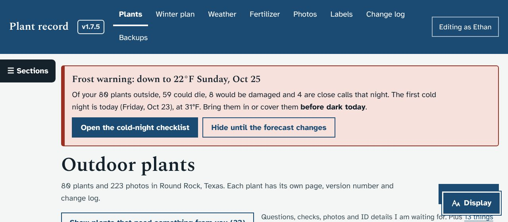
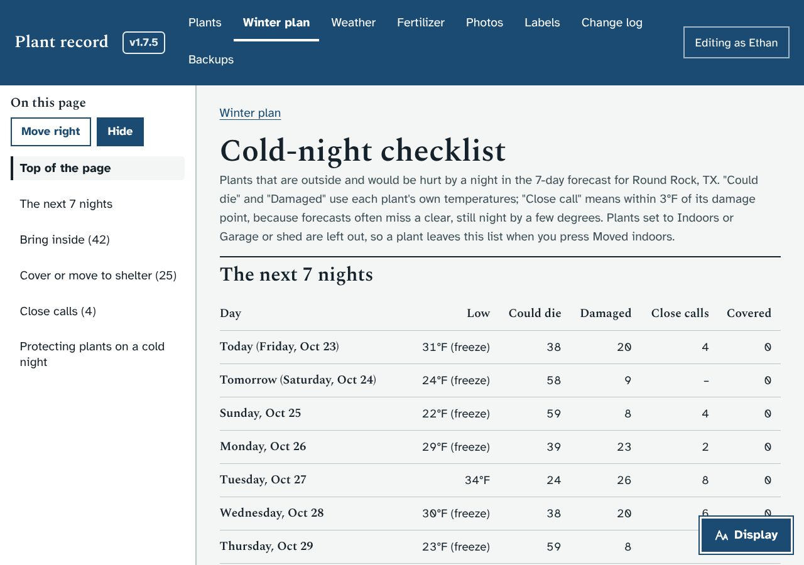
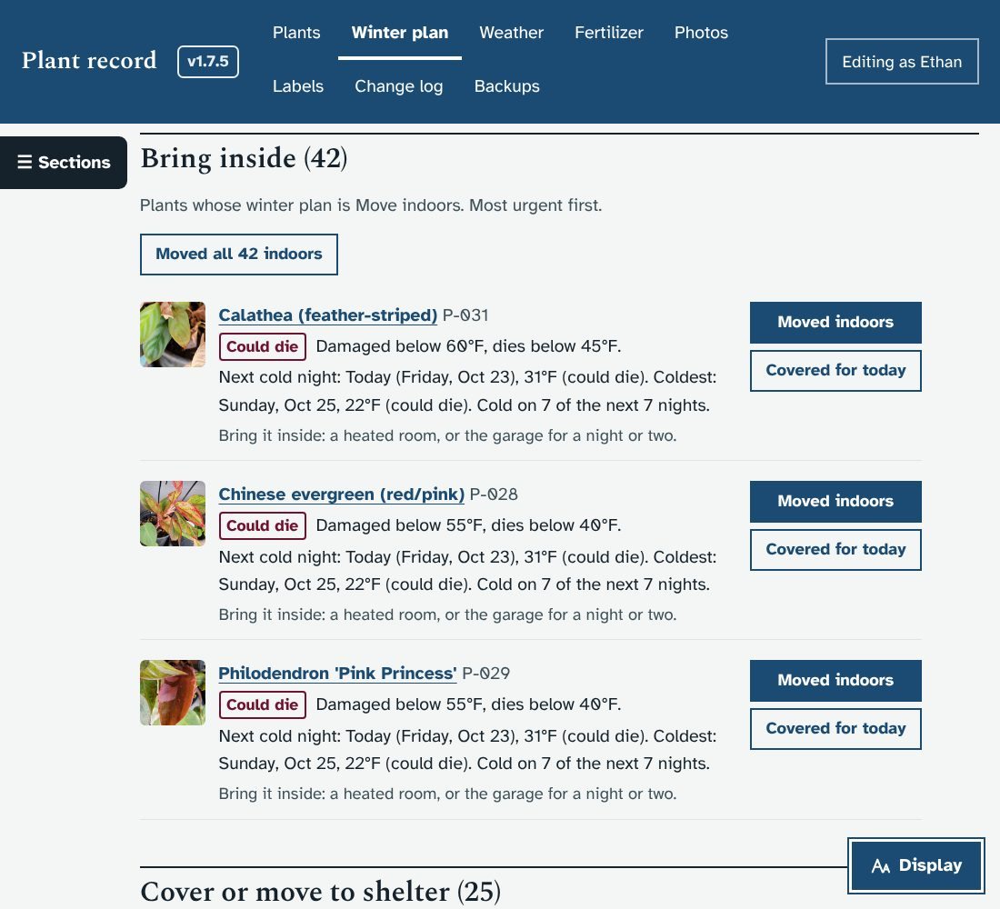
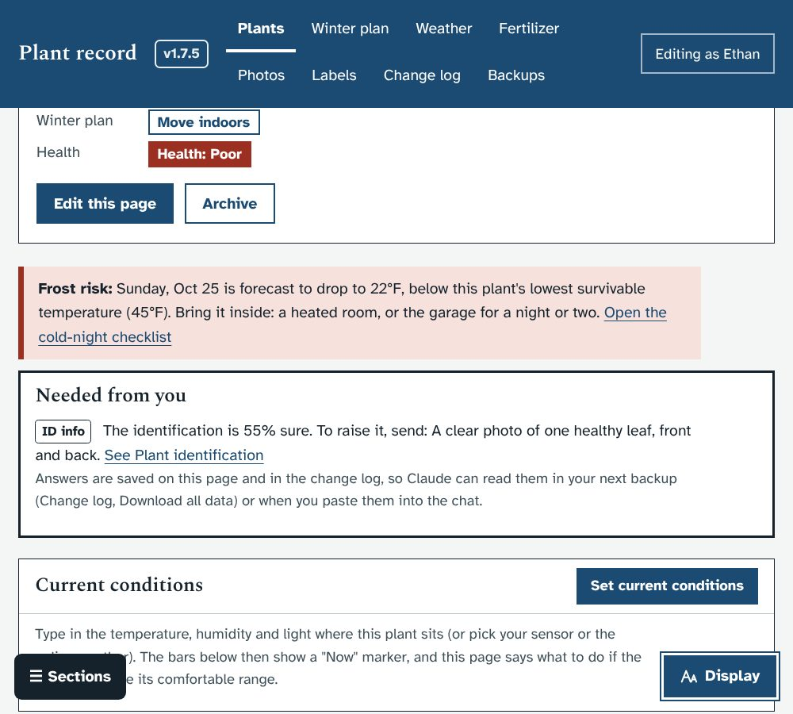
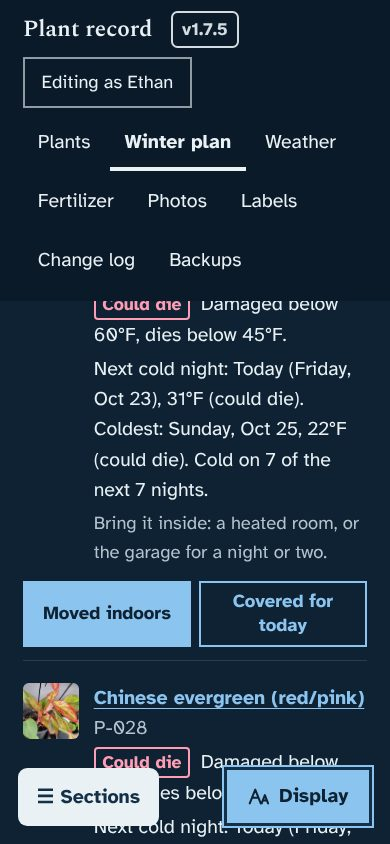
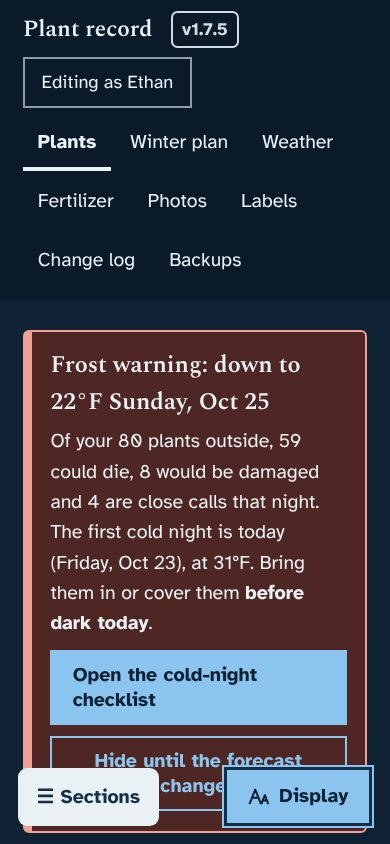

# Prototype: frost alert and cold-night checklist

## What it does
- **A warning banner at the top of every page** whenever a night in the 7-day forecast would hurt a plant that is outside. It says:
  - how cold it will get, and which night
  - how many plants could die, would be damaged, or are close calls
  - when to act, for example "before dark today", "this evening" or "Saturday evening"

  It is titled "Frost warning" at 36°F or below, "Cold warning" above that (the tropical plants are hurt at 50-60°F), and "Cold night ahead" when only close calls are expected. "Hide until the forecast changes" hides it until the forecast gets colder or more plants are at risk.
- **A cold-night checklist** (Open the cold-night checklist, or Winter plan → "Open the cold-night checklist"):
  - **The next 7 nights:** each night's low, with how many plants could die, would be damaged, or are close calls, and how many you have covered.
  - **Bring inside:** plants whose winter plan is Move indoors.
  - **Cover or move to shelter:** plants that stay outside but would be hurt.
  - **Close calls:** within 3°F of the damage point, because forecasts often miss a clear, still night by a few degrees.

  Each plant is listed once, most urgent first, with:
  - its photo, its damage and survival temperatures, and what to do for its winter plan
  - its next cold night and its coldest night
  - **Moved indoors** (sets Location to Indoors, so it leaves every list and warning) and **Covered for tonight** (ticks it off for its next cold night; it comes back for the night after, because covers need putting on again each night), with Undo
  - each group also has a "Moved all … indoors" or "Mark all … as covered" button, which asks first
- **On each plant's page**, a "Frost risk" note when that plant is in danger, with what to do and a link to the checklist.
- Tips for protecting plants on a cold night at the bottom of the checklist.

Plants set to Indoors or Garage or shed are never counted. Plants on the Covered porch are counted, with a note that the porch helps a little but not in a freeze.

## Screenshots
| | |
|---|---|
|  |  |
|  |  |
|  |  |

(Screenshots use a made-up cold week, so nearly every plant is at risk.)

## What it changes in the database
- **No new tables or columns.**
- "Covered" ticks are kept in one setting (`frost_done`). Ticks for nights that have passed are forgotten automatically.
- Each tick or untick is written to the Change log ("Covered for the cold night of …").
- "Moved indoors" uses the same Location change as the Winter plan page.

## How it works (for whoever merges it)
- `GET /api/frost` works out, from the home place's forecast:
  - every night with the plants at risk on it, at three levels: could die (below `temp_lethal_below`), damaged (below `temp_damage_below`), close call (within 3°F above it)
  - the same plant by plant, with each plant's next and coldest night
  - the overall warning
- `POST /api/frost/done {date, code, what: 'covered' | null}` ticks or unticks a plant for one night.
- Front end: `loadFrost()` runs with every page change, at most every 5 minutes. `frostBanner()` is put at the top of `#app`, `viewFrost()` is the `#/frost` page, and `frostNote()` is on plant pages.
- Test: `MOCK_BASE_F=40` gives the mock server a cold week. `dev/test/frost_check.py` clicks through the banner, Covered, Undo, Moved indoors and Hide, then checks phone and dark mode for sideways scrolling.

## Questions for Ethan
1. Is "close call = within 3°F" right, or do you want more warning (5°F) or less?
2. Should plants on the covered porch get a few degrees of credit? A roofed porch is often 2-4°F warmer than open ground on a clear night.
3. The banner shows on every page until you hide it. Would you rather see it only on the Plants and Winter plan pages?
4. Once the watering prototype lands, should the Today page list these cold-night jobs too? (I'd say yes.)
