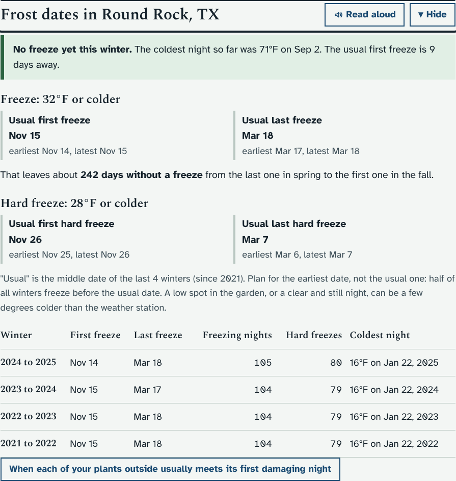
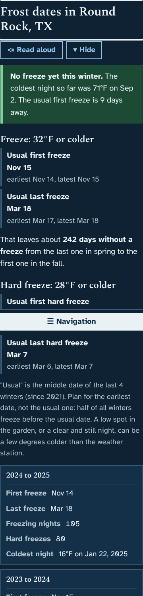
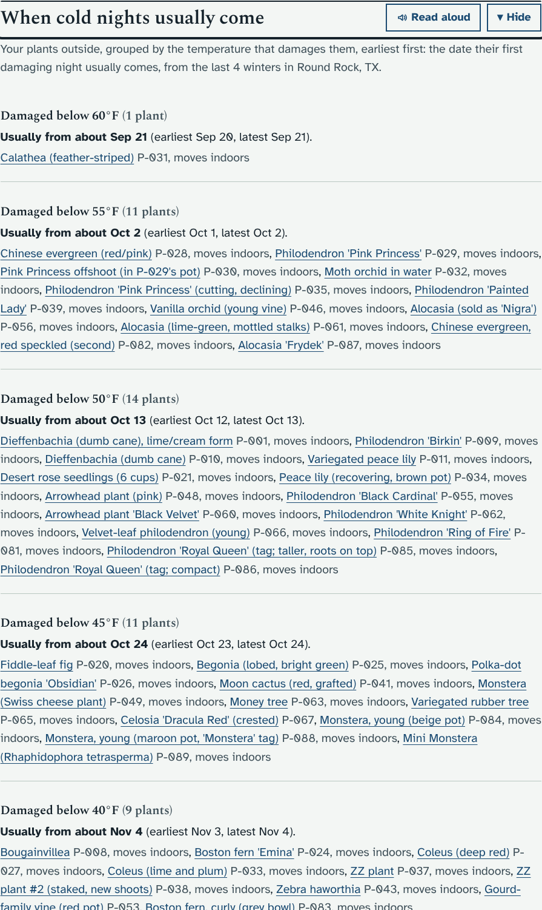
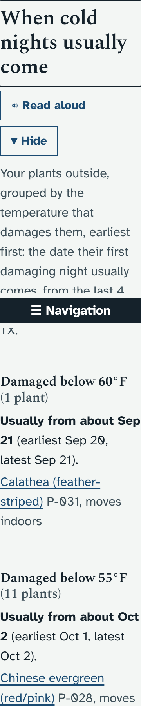

# Prototype: frost dates

Branch `proto/frost-dates`. Suggested by Claude: the two ideas left in `docs/IDEAS.md` (summer heat and the sensor dashboard) were already built in 1.34.0 to 1.36.0.

## What it does and why
It is early November, and the question in the garden is "how long have I got?". The app already knows each night's low for years back (Load history), so it can answer from Round Rock's own weather instead of a general table.

**On the Weather page**, a new section **Frost dates in Round Rock, TX** (after "Your climate"):
- **This winter so far,** for example: "No freeze yet this winter. The coldest night so far was 41°F on Nov 2. The usual first freeze is 9 days away." Or, once it has happened, the date and temperature of this winter's first freeze.
- **Freeze, 32°F or colder:** the usual first and last freeze, each with the earliest and latest seen.
- **About how many days without a freeze** from the last one in spring to the first one in the fall.
- **Hard freeze, 28°F or colder:** the same.
- **A table, one row per winter** (July to June, newest first): first and last freeze, how many freezing nights, how many hard freezes, and the coldest night. On a phone the rows become boxes.
- A button to the Cold-night checklist part below.

**On the Cold-night checklist**, a new section **When cold nights usually come**:
- Your plants outside are grouped by the temperature that damages them ("Damaged below 45°F, 11 plants"), earliest first.
- Each group says when its first damaging night usually comes ("Usually from about Oct 24, earliest Oct 23, latest Oct 24"), or "Already this winter: 44°F on Nov 3", or "Not in any of the last 5 winters".
- Each plant is a link to its page; plants whose winter plan is Move indoors say "moves indoors".
- Plants set to Indoors or Garage or shed are left out, the same as the rest of the checklist.

"Usual" is the middle date of the winters that had such a night. The page says to plan for the earliest date, because half of all winters are colder sooner than the usual date.

Dates need **3 whole winters** of history at the place (the same rule as the winter and summer zones). Until then the section says how many it has so far. It follows the place chosen with the Location button.

## How it looks
Laptop, light theme (the mock server's made-up weather, so the dates are not Round Rock's):

Phone, dark theme:

The Cold-night checklist, laptop:

Phone with the largest text:

## What it changes in your database
Nothing. It only reads the daily weather you already have. No new tables or columns, no upgrade batch, and nothing in the audit log.

## Accessibility
- Every date is written in words, in the text, not shown by colour.
- The usual dates are in bold with the earliest and latest on the next line; the table has a caption for screen readers and stacks on a phone.
- Both sections get Read aloud and Hide like every other section, and appear in the Navigation menu.
- No buttons that change anything, so nothing is added for viewers to hide.

## How it was tested
- `python3 -m pytest dev/test/unit -q`: three new tests (the winter and day counting, first and last dates with winters that had none, and the 3-winter rule).
- `dev/test/frostdates_check.py` (new, in `run_checks.py`): the dates, the plant groups (every plant outside listed once, in date order), nothing written, and the pages at laptop and phone width, light and dark, and the largest text, with no sideways scrolling.
- The smoke test, `frost` and `sectionmenu` checks pass.

## Files
- `app/plantdb/frostdates.py` (new): `frost_dates()`, `season_stats()`, `GET /api/frost/dates[?loc=]`. Added to the module lists in `server.py`.
- `app/static/js/frostdates.js` (new): fills the two placeholders when the pages draw. Added to `index.html` and `sw.js`.
- `app/static/js/weather.js`: one placeholder line on each page.
- `app/static/style.css`: its own block at the end.

## Open questions for Ethan
1. **Thresholds.** The Weather page uses 32°F (freeze) and 28°F (hard freeze). Would a "frost possible" line at 36°F help as well?
2. **Plant names.** In each group the plants run on as one line of names separated by commas, to keep the page short. Would you rather have one plant per line, with its photo, even though the section gets much longer?
3. **Spring.** The same numbers could go on the Back outside page ("the usual last freeze is Mar 18; 9 of 10 springs had none after Apr 1"). Should it?
4. **Today.** Should the "No freeze yet, the usual first freeze is 9 days away" line also show on Today in October and November?
