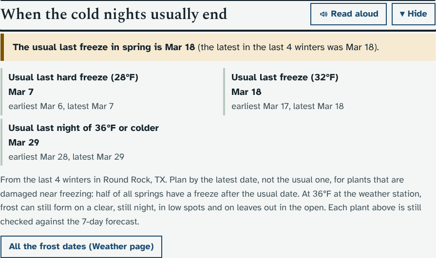
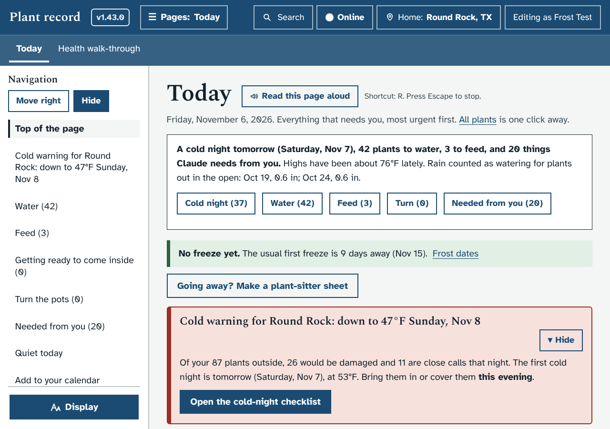

# Prototype: frost dates

Branch `proto/frost-dates`. Suggested by Claude: the two ideas left in `docs/IDEAS.md` (summer heat and the sensor dashboard) were already built in 1.34.0 to 1.36.0.

## What it does and why
It is early November, and the question in the garden is "how long have I got?". The app already knows each night's low for years back (Load history), so it can answer from Round Rock's own weather instead of a general table.

**On the Weather page**, a new section **Frost dates in Round Rock, TX** (after "Your climate"):
- **This winter so far,** for example: "No freeze yet this winter. Frost was possible on Nov 3 (35°F). The usual first freeze is 9 days away." Or, once it has happened, the date and temperature of this winter's first freeze.
- **Frost possible, 36°F or colder:** the usual first and last night that cold, each with the earliest and latest seen. Frost can form at 36°F at the weather station on a clear, still night, in low spots and on leaves out in the open.
- **Freeze, 32°F or colder:** the same, then about how many days without a freeze from the last one in spring to the first one in the fall.
- **Hard freeze, 28°F or colder:** the same.
- **A table, one row per winter** (July to June, newest first): the first 36°F night, the first and last freeze, how many freezing nights, how many hard freezes, and the coldest night. On a phone the rows become boxes.
- Buttons to the Cold-night checklist part and to Back outside.

**On the Cold-night checklist**, a new section **When cold nights usually come**:
- Your plants outside are grouped by the temperature that damages them ("Damaged below 45°F, 11 plants"), earliest first.
- Each group says when its first damaging night usually comes ("Usually from about Oct 24, earliest Oct 23, latest Oct 24"), or "Already this winter: 44°F on Nov 3", or "Not in any of the last 5 winters".
- Then the plants, **one a line, with its photo**: the name (a link to the plant's page) and, under it, the code, "moves indoors" if that is its winter plan, and "covered porch" if it is on the porch.
- A group of more than 6 plants shows the first 5, then a button "Show the other 6 plants damaged below 45°F" that opens the rest.
- Plants set to Indoors or Garage or shed are left out, the same as the rest of the checklist.

**On Back outside**, a new section **When the cold nights usually end** (before "The next 7 nights"):
- The usual last hard freeze (28°F), freeze (32°F) and 36°F night, each with the earliest and latest seen.
- From January to June each says how many days to go ("in 23 days", or "5 days ago"), and the line at the top says "The usual last freeze (Mar 1) is 23 days away." From July to December it gives the dates only.
- This winter's latest freeze so far, once there has been one.
- Each plant on the page is still checked against the 7-day forecast, as before; this is for planning.

**On Today**, one line under the summary at the top:
- **October and November**, until the first freeze: "No freeze yet. The usual first freeze is 9 days away (Nov 16)." with a link to the frost dates on the Weather page.
- **February and March**, until three weeks after the usual last freeze: "The usual last freeze (Mar 1) is 23 days away." with a link to Back outside. After the usual date it says so and reminds you that a late one can still come.
- At any other time, or without enough history, there is no line.

"Usual" is the middle date of the winters that had such a night. The pages say to plan for the earliest date in fall and the latest in spring, because half of all winters are colder sooner (or later) than the usual date.

Dates need **3 whole winters** of history at the place (the same rule as the winter and summer zones). Until then the sections say how many winters they have so far, and Today has no line. The Weather page and Today follow the place chosen with the Location button; the checklist and Back outside use your home place, like the rest of those pages.

## Your answers, and what changed
1. **A "frost possible" line at 36°F: yes.** It is on the Weather page (its own part, first), in the line about this winter so far, as a column in the table, and on Back outside.
2. **One plant a line, with its photo: yes.** It is a list, not a table. Long groups show 5 plants and fold the rest behind a button.
3. **The same numbers on Back outside: yes.** See above.
4. **The line on Today: yes,** in October and November. I also added the spring line in February and March, because it fits the same place and the same rule, and it points to Back outside. It stops three weeks after the usual last freeze so it does not sit there all spring.

## How it looks
The mock server's made-up weather, so the dates are not Round Rock's.

The Weather page, laptop, light theme:

Phone, dark theme:

The top of the Cold-night checklist part, laptop (the full list runs on for all 87 plants):

The top of it on a phone with the largest text:

Back outside, laptop (in November, so it gives the dates without the days to go):

Today, laptop:

## What it changes in your database
Nothing. It only reads the daily weather and photos you already have. No new tables or columns, no upgrade batch, and nothing in the audit log.

## Accessibility
- Every date and temperature is written in words, in the text, not shown by colour.
- The usual dates are in bold with the earliest and latest on the next line; the table has a caption for screen readers and stacks on a phone.
- The plant photos have an empty description, because the name is right beside them; screen readers read the name once. The photos grow with the Display text size.
- The "Show the other plants" button opens with Enter or Space and has a visible focus ring.
- The sections get Read aloud and Hide like every other section, and appear in the Navigation menu.
- No buttons that change anything, so nothing is added for viewers to hide.

## How it was tested
- `python3 -m pytest dev/test/unit -q`: three tests (the winter and day counting, first and last dates with winters that had none, and the 3-winter rule, now with the 36°F dates and the days to the usual last dates).
- `dev/test/frostdates_check.py` (in `run_checks.py`): the dates, the 36°F night, the plant groups (every plant outside listed once, in date order, one a line, photos with empty descriptions, long groups folded and opened from the keyboard), Back outside, the Today line in the months it belongs to, nothing written, and the pages at laptop and phone width, light and dark, and the largest text, with no sideways scrolling.
- The smoke test and the `frost`, `outside`, `jobs` and `pages` checks pass.

## Files
- `app/plantdb/frostdates.py` (new): `frost_dates()`, `season_stats()`, `GET /api/frost/dates[?loc=]`. Added to the module lists in `server.py`.
- `app/static/js/frostdates.js` (new): fills the three placeholders when the pages draw, and adds the line on Today. Added to `index.html` and `sw.js`.
- `app/static/js/weather.js`: one placeholder line on each of the three pages.
- `app/static/style.css`: its own block.

## Open questions for Ethan
None.
