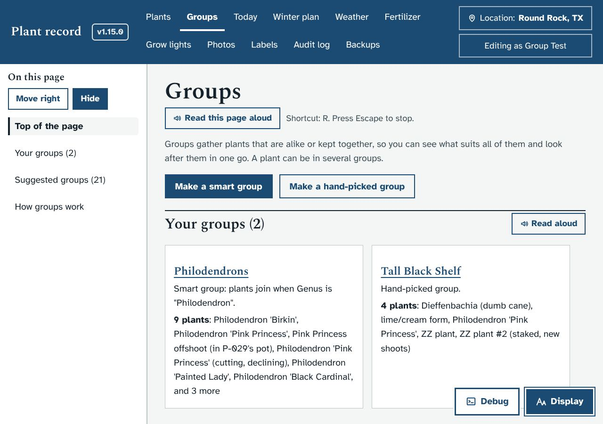
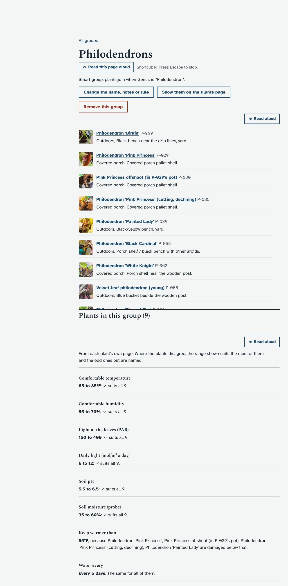
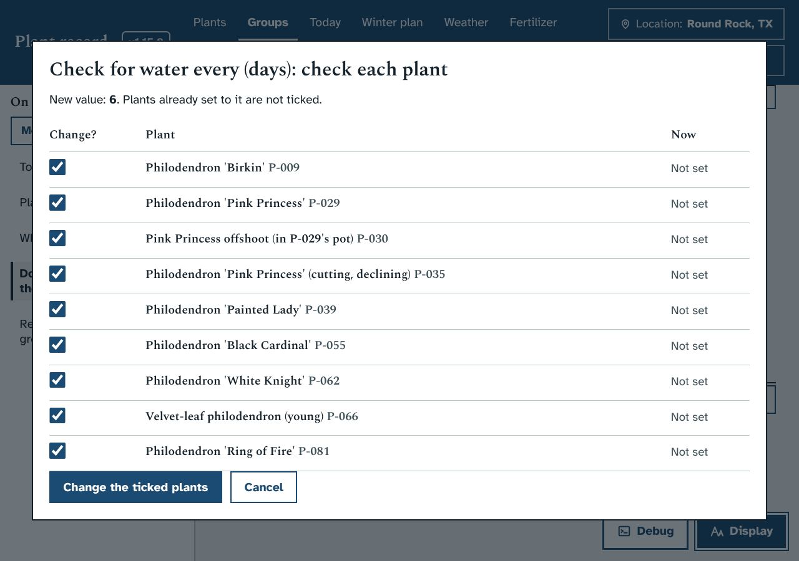
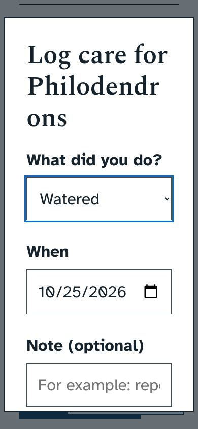

# Groups of plants (1.16.0)

Asked for by Ethan on October 25, 2026. He wanted similar plants grouped, so he could sort and filter by group and do things to the whole group, such as potting them in the same mix or moving them to the same place with the same light. Claude gave feedback and asked three questions. He chose:
- both smart and hand-picked groups;
- all three kinds of bulk action (care, moving, settings), in any order;
- any editor can make and change groups.

## What it does
- **Groups page** in the top menu: your groups, then suggested groups.
- **Suggested groups** are each genus with 2 or more plants, the families whose plants share care, and each grow light spot. On his database that gives 22, including:
  - Aroids (21 plants), Aloes and haworthias, Cacti
  - Philodendrons (9), Roses, Majesty palms, Peace lilies and more
- **Smart groups** keep a rule with up to 8 parts, joined by "all" or "any". The fields are name, genus, family, order, type of plant, plant type, Location, Spot, winter plan, health, leaf type, pot size and grow light spot. The window shows which plants fit while you type.
- **Hand-picked groups** use a tick list with a search box.
- **Plants page:** a Group filter and a "Group A to Z" sort. Previous and Next follow them.
- **Plant page:** a "Groups" line in the top card, and **Change groups**.
- **A group's page:**
  - its plants, and "What suits all of them";
  - three bulk actions;
  - recent bulk changes, with Undo.
- **Safety:**
  - A setting change shows each plant's current value first. Plants already set are unticked, and plants unlike the rest are marked.
  - A plant edited between the preview and the change is skipped.
  - Undo leaves alone any plant changed again since.
  - Only care, place, light, soil, feeding, winter and pest-prevention settings can be changed in bulk. Names, identification, health and the About facts can't.

## Claude's advice, kept from the conversation
- Groups by **what a plant is** (genus, family) and by **where it is** (a shelf, a light spot) are both supported, because physical jobs follow place and care facts follow kind.
- Groups do not pass settings down to their plants automatically. Bulk changes with a preview give most of the benefit, without hiding where a plant's values come from or clashing with guarded upgrade batches.

## Screenshots
| | |
|---|---|
|  |  |
|  |  |

## What it changes in the database
- New tables `plant_groups`, `group_members` and `bulk_changes`, made on start.
- No plant fields change, and no upgrade batch is needed.

## Tests
`dev/test/groups_check.py` (48 checks) covers:
- suggestions, rules, hand-picked members and archived plants;
- the fit, preview and apply (with a skipped plant), and undo (with a kept plant);
- moving, light spots, care for many plants and the audit log;
- viewers;
- the pages, the filter and sort, Previous and Next, the plant page, and phone width.
