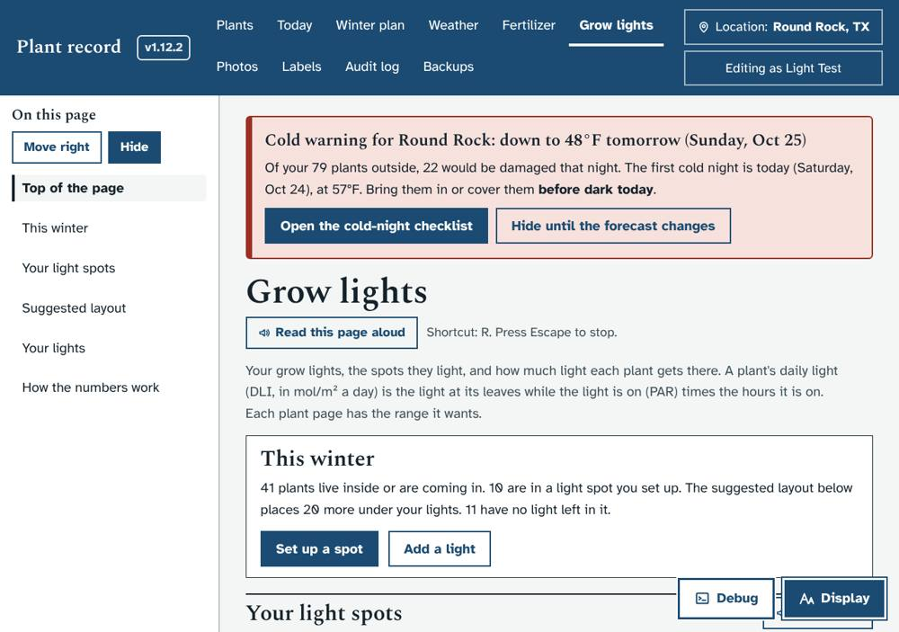
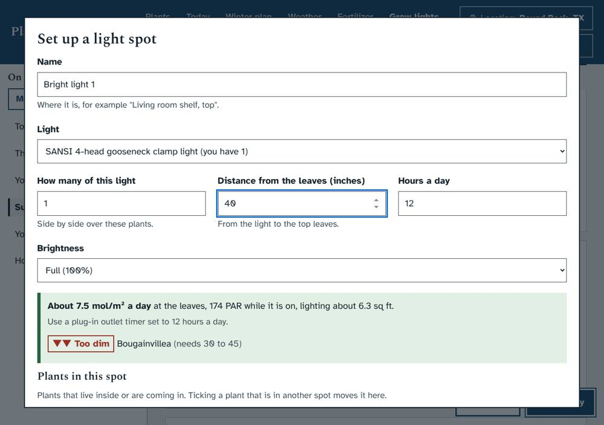
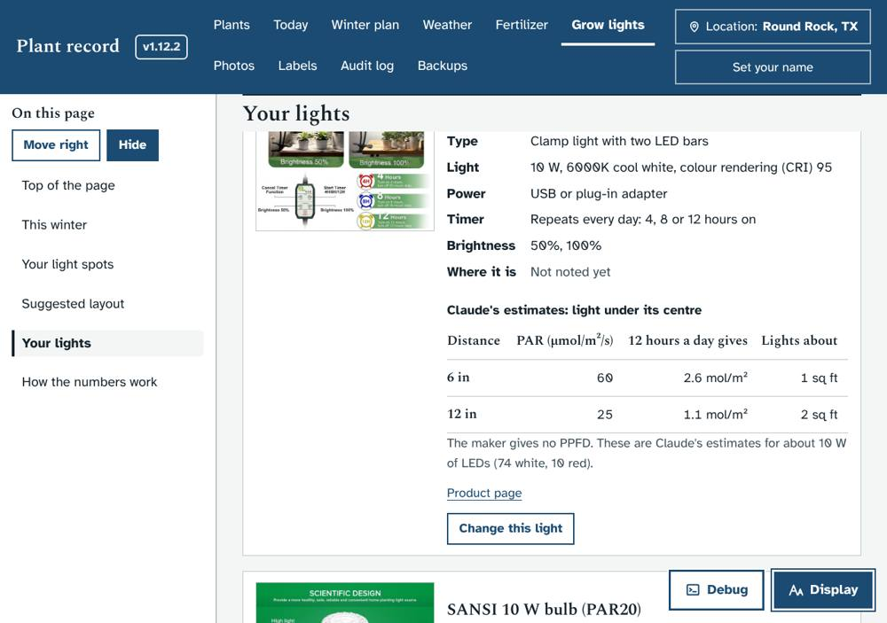
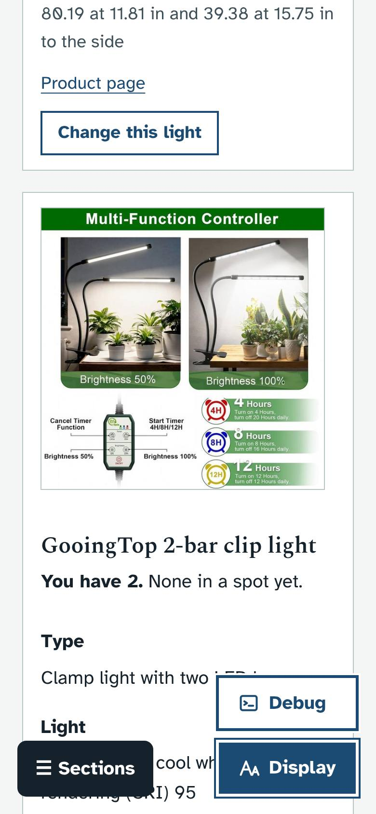

# Grow lights (1.13.0)

Asked for by Ethan on October 24, 2026. He saved photos and listing screenshots of his grow lights in `Plants\Grow Lights`, one folder per light, with how many he has of each. He asked for the useful photos to go into the app. The idea (docs/IDEAS.md) was a light library, indoor spots, matching plants to lights by daily light, and a step-down plan from outdoor to indoor light.

## What it does
- **Your lights.** All 11 lights, from his photos (`dev/seed_src/build_batchA3.py` → `app/seed/batches/batchA3.json` and `app/static/lights/`). Each light has:
  - a product photo with a description, and the maker's chart where there is one;
  - count, type, light (watts, lumens, colour temperature, CRI), colour mix, power, timer, brightness steps and size;
  - the maker's PPFD at each distance, with the 12-hour daily light and the area it lights.
- **Estimates.** The GooingTop clips, the Barrina T5 strips and the disk light have no PPFD from their makers. Claude estimated them from watts, lumens and beam, and the app marks them "Claude's estimates". The 8 T5 strips are modelled as 2 banks of 4 (4 power cords; strips side by side add up).
- **Light spots.** Each spot has a light, how many side by side, distance from the top leaves, hours and brightness. The window shows the light at the leaves while you type, with a verdict for every plant ticked.
- **Suggested layout.** Places 33 of the 41 plants that are inside or coming in, using every light Ethan has without using any twice. The other 8 are listed with the reason: his lights are full.
- **Easing in.** Each spot gives a first and second week brighter and longer than its setting.
- **Plant pages** show the plant's spot or suggestion, under Sunlight.
- **Requests for Ethan:**
  - which lamps the E26 bulbs go in (6 × 10 W, 2 × 30 W, 80 W);
  - the T8 set's strip count and watts;
  - where the disk light is;
  - where the plants will go.

## Screenshots
| | |
|---|---|
|  |  |
|  |  |

## What it changes in the database
- New tables `lights`, `light_spots` and `light_assign`, created on start.
- Batch `batchA3` adds the 11 lights once and 4 requests.
- No plant fields change.

## Tests
`dev/test/lights_check.py` (60 checks) covers:
- the maths and the batch's lights and photos
- the layout never using a light more than its count
- spots set up, moved, changed and removed
- lights edited, added and removed
- the audit log, viewers refused, and the page, window and plant page
- phone width at the largest text

The smoke test now opens `#/lights` too.

The suggested layout was also run on a copy of Ethan's database: 33 of 41 plants are placed, all with "Good" light.
