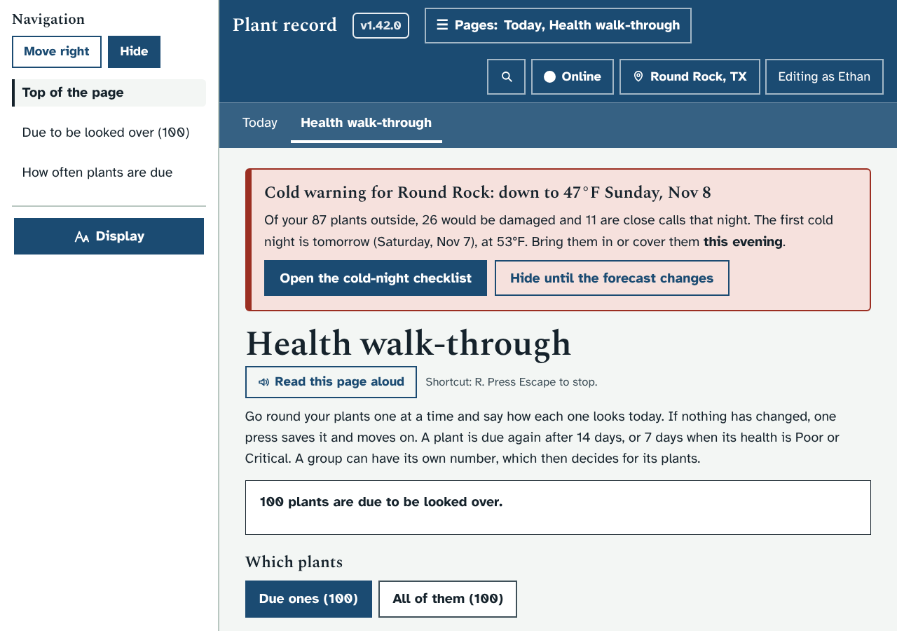
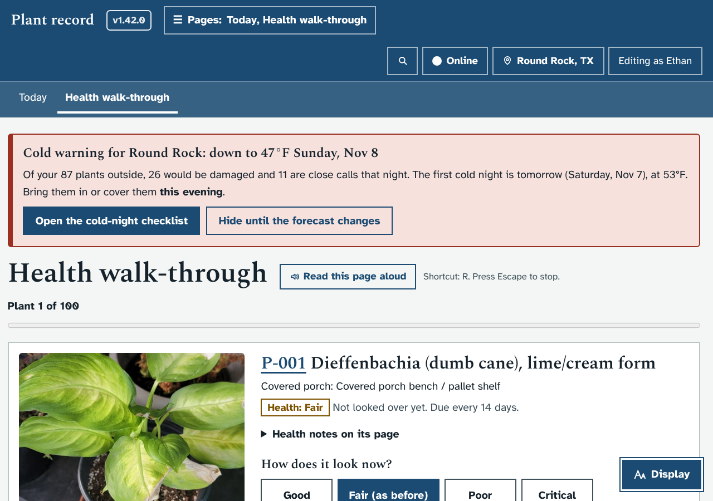
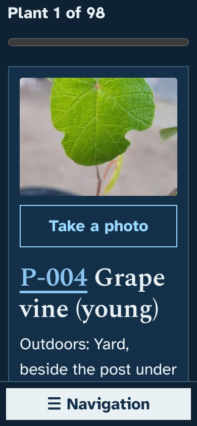
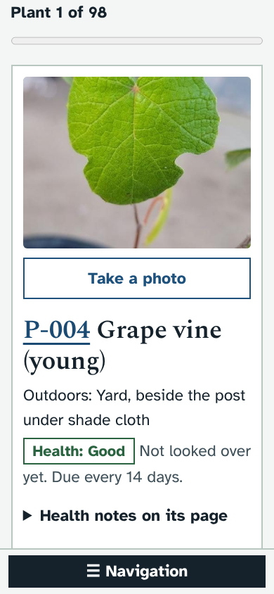
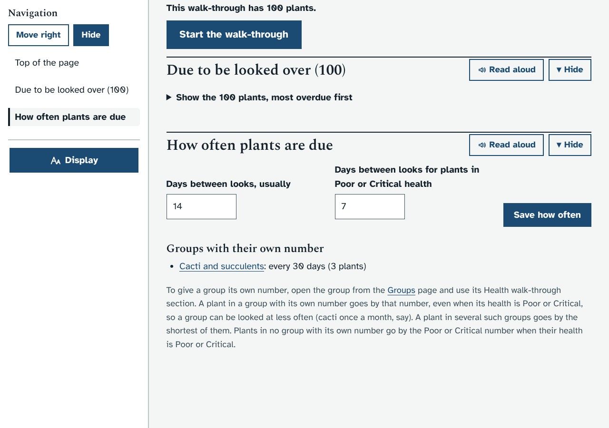
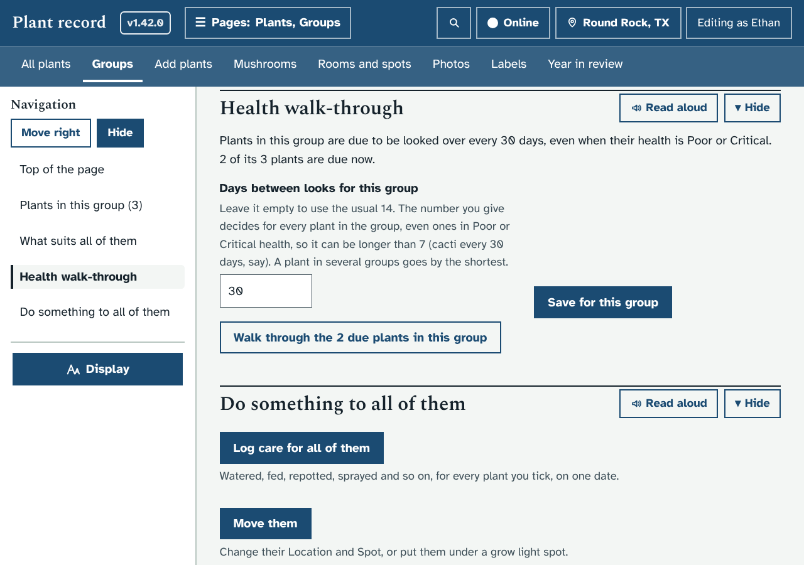
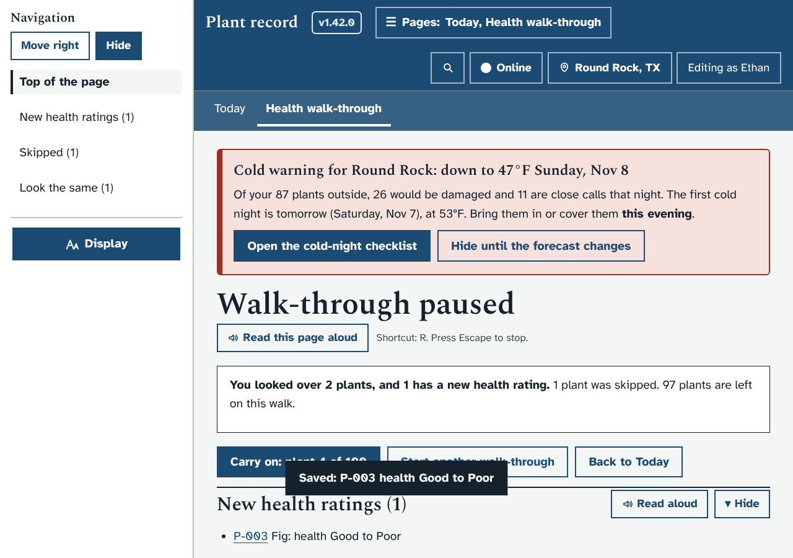
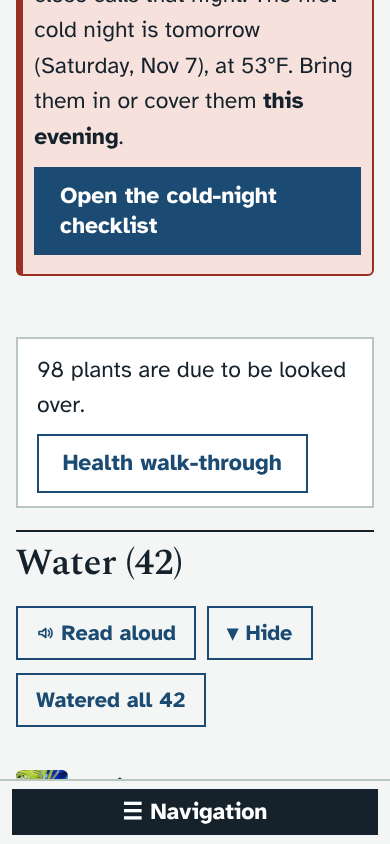

# Prototype: Health walk-through

Branch: `proto/health-walk`. Rebuilt on November 6 for 1.42.0 (the code was split into modules in 1.32.0); the feature is the same, with Ethan's answers of November 6 added.

## What it does and why
Each plant has a health rating (Good, Fair, Poor or Critical). With about 85 plants, it's easy for the ratings to go stale, and there was no quick way to go round and check them. The health walk-through lets you go round your plants one at a time, on a phone in the garden or at the computer, and say how each one looks today.

- **Where to find it:** in the top bar, **Today** now has a second page, **Health walk-through**. The Today page also has a line saying how many plants are due, with a button.
- **Choosing the plants** (`#/checkup`). Three rows of big buttons:
  - **Which plants:** the due ones, or all of them.
  - **Where:** everywhere, or one location (Outdoors, Covered porch...).
  - **Group:** any group, or one of your groups.
  - **In what order:** longest since looked over first, worst health first, or by plant code.
  - It says how many plants the walk will have as you choose, and remembers your choices.
  - Below that, a folded list of the plants that are due, with links.
- **One plant at a time:**
  - "Plant 3 of 28" and a progress bar.
  - Its main photo, its code and name, where it is, its health rating now, when it was last looked over, and how often it is due (and why, if it's not the usual).
  - **Take a photo** opens the camera on a phone. The photo is added to the plant's photos (so it shows on the timeline), and the card shows it straight away. Your note and the rating you chose stay as they are.
  - Its health notes, folded away until you open them.
  - **How does it look now?** Four big buttons. The current rating is already chosen and says "(as before)".
  - **Anything you noticed? (optional)** for a short note.
  - The main button says what it will do: **Looks the same: save and go on**, or **Save "Poor" and go on** when you choose another rating.
  - **Skip this plant**, **Back to the previous plant**, and **Stop and see what you've done**.
  - After each save, the keyboard focus goes to the next plant's name, so a screen reader reads it.
- **What gets saved:**
  - **Looks the same:** a "Looked over" entry in the plant's care log, with your note.
  - **A new rating:** saved on the plant page (it shows in the change log and on the plant timeline like any edit), plus a "Looked over" entry saying "Health Good to Poor" and your note.
  - **Your note** also goes at the end of the plant's **Health summary**, on a line of its own with the date, for example "Nov 4, 2026 (health walk-through): Good to Poor. Yellow lower leaves."
  - If someone changed the plant while you were walking round, nothing is written over it: you're told its rating now, and you choose again.
- **At the end, or when you stop:** how many you looked over, which have new ratings, which you skipped, and **Carry on** if you stopped part-way.
- **How often plants are due** (changed after Ethan's answers on the pull request):
  - Usually every **14 days**, and every **7 days** for plants in Poor or Critical health. Both numbers can be changed at the bottom of the walk-through page.
  - **Each group can have its own number.** A group's page has a new **Health walk-through** section with "Days between looks for this group" (empty means the usual number), and a button to walk through that group's due plants.
  - A plant in a group with its own number goes by that number, **even when its health is Poor or Critical** (from Ethan's answer of November 6). So a group can be looked at less often than 7 days, for example cacti once a month, or more often.
  - A plant in several such groups goes by the shortest of their numbers.
  - A plant in no group with its own number goes by the usual 14 days, or 7 when its health is Poor or Critical.
  - The walk-through page lists the groups that have their own number.
- A health rating changed on the Edit page also counts as looking the plant over. Ratings set by Claude's upgrade batches don't.
- People with view-only access can see the list of due plants, but can't start a walk.
- **With 1.42.0:** the walk-through page's sections and the group page's Health walk-through section are in the Navigation menu, each with a Show or hide button. On the walk itself the plant's name is a heading but not a page section, so the card has no Show or hide button and the Navigation menu stays out of the way.
- **With no connection** (1.38.0 offline use): saves, new ratings and photos wait on the device like other care, and are sent when the connection is back, with the app's usual message saying so. Opening the walk-through needs the connection, or a copy kept on the device.

## How it looks
Choosing the plants, on a laptop:

One plant, on a laptop. (The sandbox has no plant photos, so the photo is blank here; on your PC it shows the plant's main photo.)

On a phone with the largest text, dark and light:

 

How often plants are due, at the bottom of the walk-through page:

A group's own number, on its page:

After stopping part-way:

The new line on the Today page, on a phone:

## How to try it
1. Start the app with `dev/test/mock_server.py` and a fresh data folder under `dev/tmp/`.
2. Open Today and press **Health walk-through**, or go to `#/checkup`.
3. `python3 dev/test/run_checks.py checkup` runs the focused checks (choosing, saving, skipping, going back, a change made elsewhere, stopping and carrying on, the care log, each group's number including for Poor or Critical plants, Navigation and Show or hide, phone widths).

## What it changes in your database
Nothing in its structure: no new tables or columns. It adds a new kind of care log entry, "Looked over". New health ratings, notes added to the Health summary and new photos are ordinary edits to the plant page. The numbers of days are kept in the settings table (`checkup_days`, `checkup_days_poor`, and `checkup_group_days` for the groups); until you change them, 14 and 7 are used. Nothing changes until you use it.

## Ethan's answers (November 4) and what changed
1. **A setting for groups:** each group can have its own number of days, on its page. The usual 14 and the 7 for Poor or Critical plants can be changed too.
2. **Notes go in the Health summary as well:** yes, with the date.
3. **Take a photo:** added on each plant.
4. **Poor and Critical sooner:** every 7 days by default.

## Ethan's answers (November 6) and what changed
1. **A group's number may make its Poor or Critical plants due later than 7 days:** yes. A group's own number now decides for its plants whatever their health. Plants in no group with its own number still go by 7 days when their health is Poor or Critical. The settings at the bottom of the walk-through page and the group's section say so.
2. **Where it goes:** it stays as the second page under **Today**.

## Open questions for Ethan
None.
