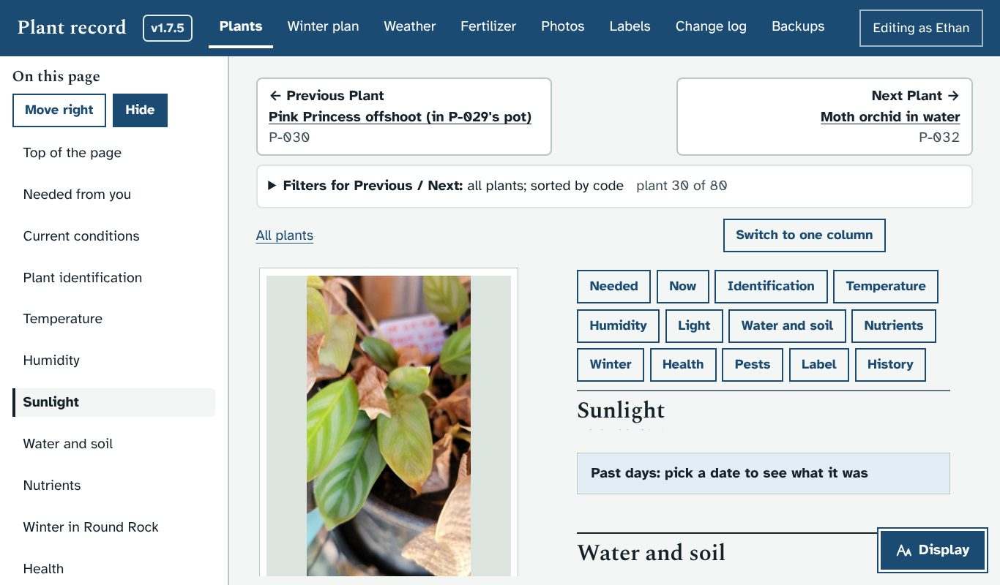
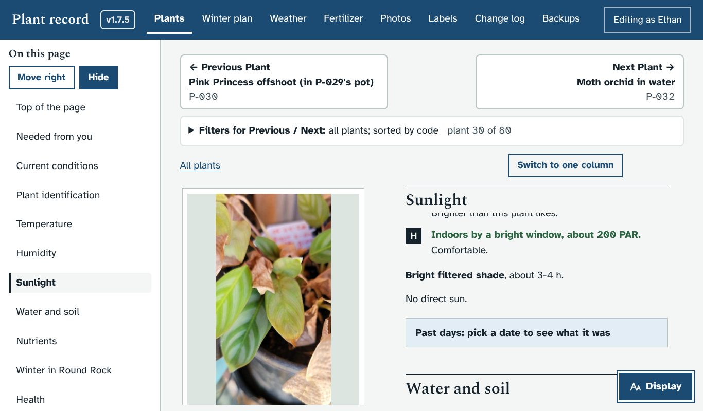

# Prototype: more room on plant pages when the section menu is open

## What it does
On a laptop, a plant page shows the photos on the left and the details on the right. At the top of the right half there is a row of buttons for the sections (Needed, Now, Identification and so on), and it stays pinned while that half scrolls. With the "On this page" menu open, the right half is narrower, so the row wraps to three or four lines and covers a good part of what you are reading.

- **While the On this page menu is open, the row of section buttons is hidden.** The menu lists the same sections, so nothing is lost: choose one in the menu to go to it.
- **Hide the menu and the row comes back**, as before.
- **One column and phones are unchanged**: there the row is not pinned, so it doesn't get in the way.

## Screenshots
A laptop screen, with the right half scrolled down to Sunlight:

| Before | After |
|---|---|
|  |  |

## How to try it
The screenshots show it working. If you would like it on your PC before merging, say so and I will build a zip marked PROTOTYPE; the updater makes a backup first.

## What it changes in the database
Nothing.

## How it works (for whoever merges it)
- `style.css`: one rule hides `.plant .pane .jump` when `<html>` has `data-navopen="1"`, `data-narrow="0"` and the two-halves layout.
- `app.js`: a `MutationObserver` on `<html>` re-measures `--jump-h` (the space the sticky section titles leave for the row) whenever the menu opens or closes or the layout changes, so the titles sit right in both cases. No existing function changes.
- Test: `dev/test/jumprow_check.py` checks the row hiding and coming back, the section titles leaving the right space, the section buttons and menu links, a button at the bottom of the right half being clickable, and the one-column layout. The smoke test passes.
- This branch merges cleanly with the other open prototype branches.

## Questions for Ethan
1. Do you use the row of section buttons, the On this page menu, or neither? If you use only one, the other could go altogether.
