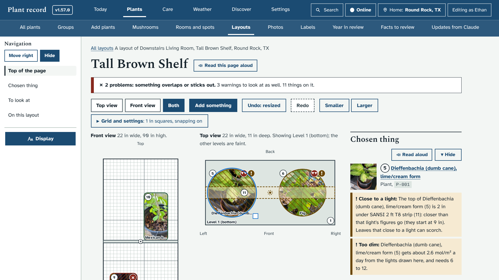
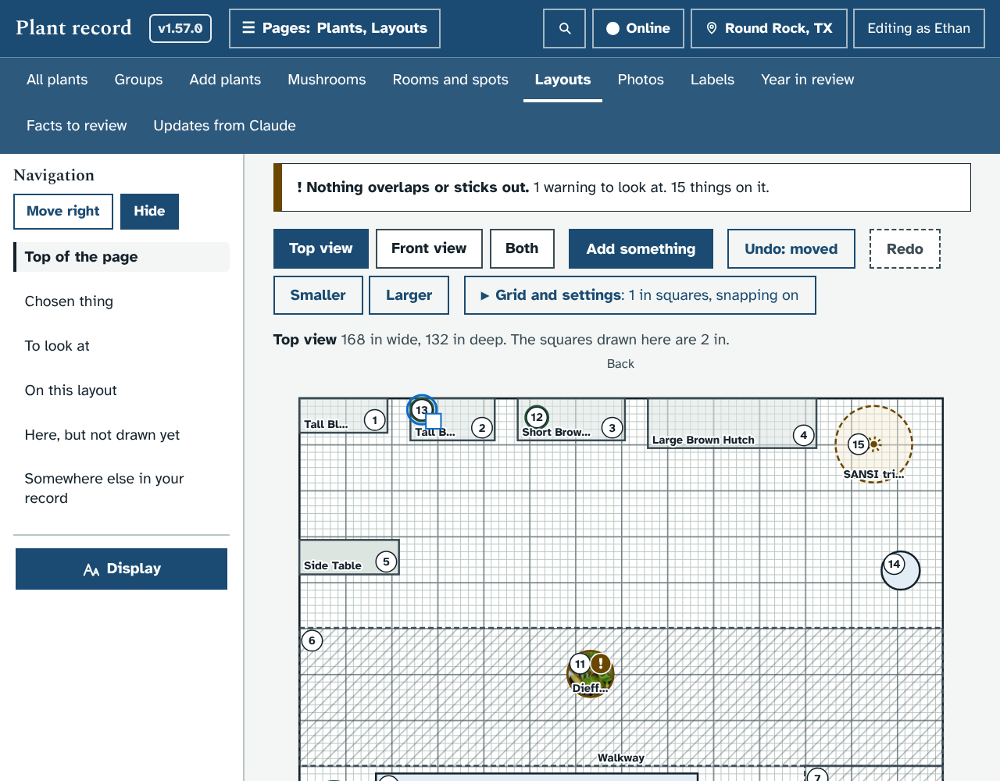
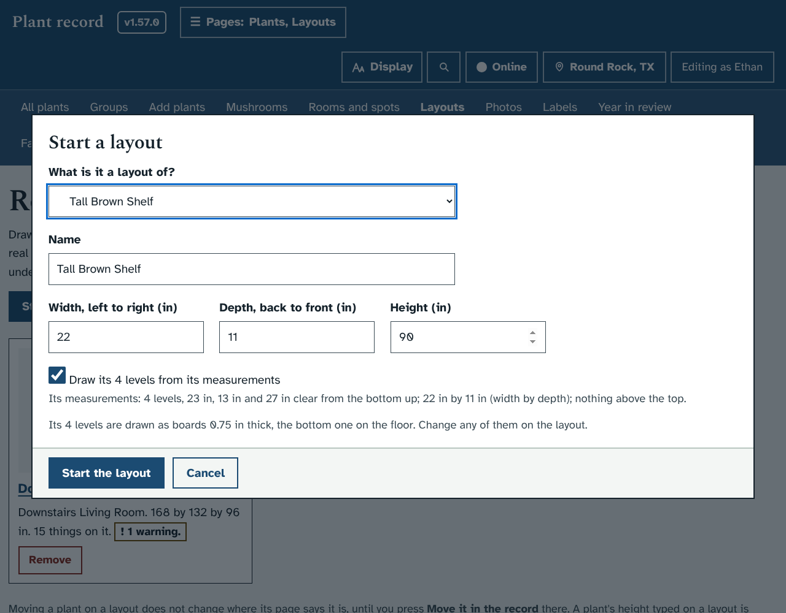
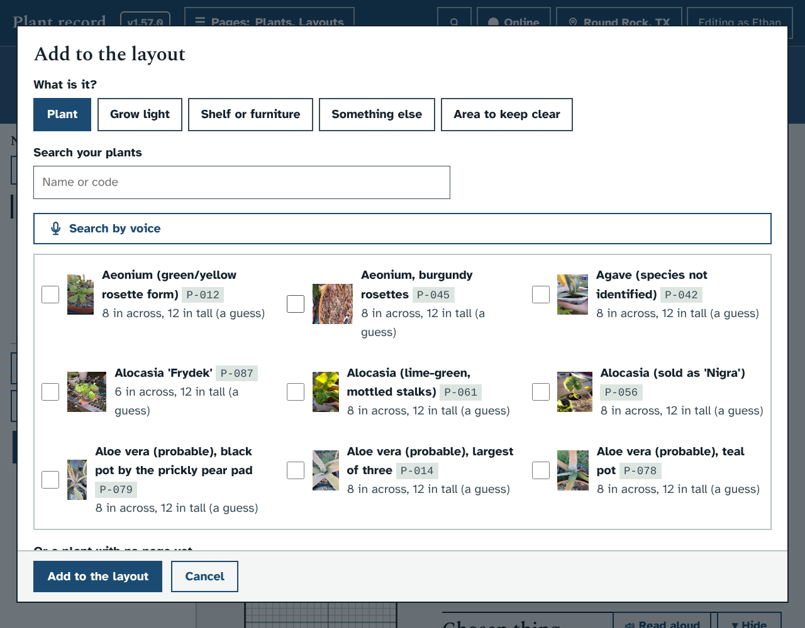
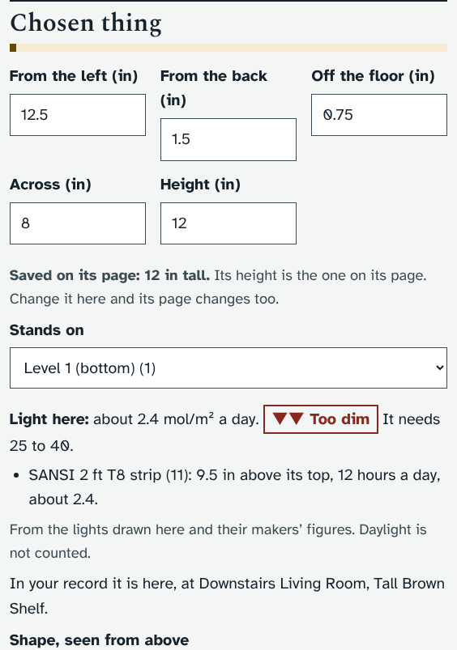
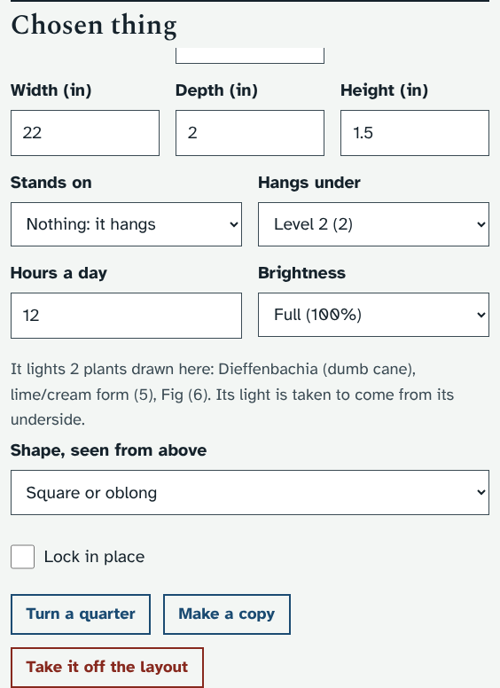
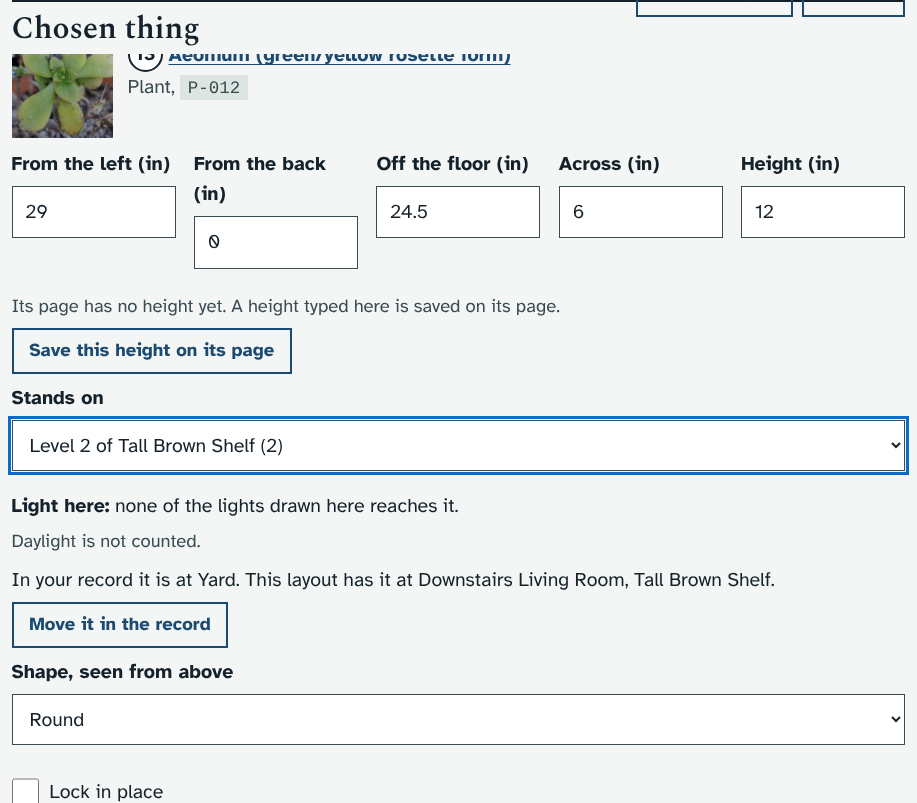
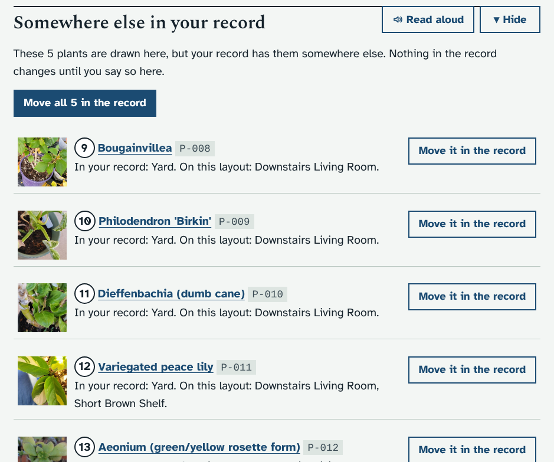
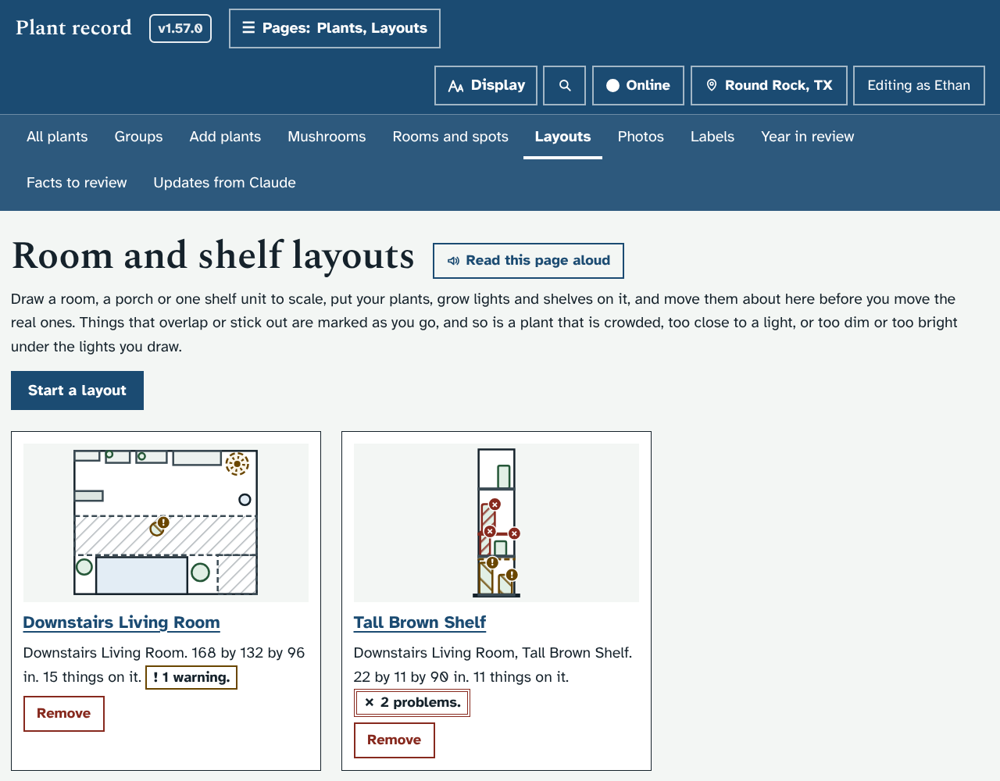
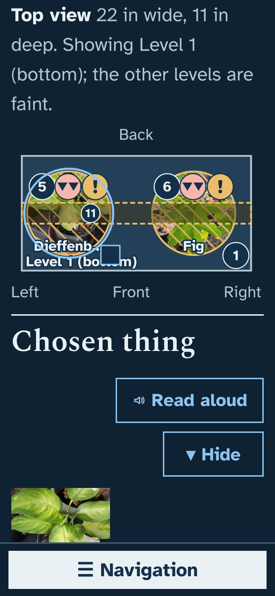

# Prototype: room and shelf layouts

## What it does and why
Ethan asked (November 14, 2026) for a way to simulate a space in two dimensions, and perhaps three later, with the plants, grow lights, shelves and anything else in it: things to drag about, a grid to see and snap to, sizes for the space and for each thing, and marks where things collide or may conflict.

The record already holds most of what such a drawing needs: each shelf's measurements and levels, each light's size from how it holds and the distances its light figures cover, each plant's pot or tray and its height. **Layouts** draws a room, a porch or one shelf unit to scale from that, and lets you move things about on the page before you move the real ones.

- **A new page, Layouts** (Plants → Layouts, after Rooms and spots). It lists your layouts, each with a small drawing and how it stands ("Everything fits", "1 warning", "2 problems"), and has **Start a layout**.
- **Start a layout** asks what it is a layout of: one of your rooms or areas, one of your shelves, or a space of your own. It fills in the size from the measurements:
  - a shelf starts with its own width and depth and its levels drawn as boards at the heights its measurements give;
  - a room starts 12 by 10 ft (rooms have no width in their measurements; type the real one) with its shelves as blocks along the back wall;
  - Rooms and spots has a **Lay it out** button on every room, area and spot, which becomes **Open its layout** once it has one.
- **Everything is a box**, in inches or centimetres as you read them: how far from the left, how far from the back, how far off the floor, and how wide, deep and tall. A pot is round from above. So the same things are seen and moved in two drawings:
  - **Top view**, looking down;
  - **Front view**, from the front, with the floor at the bottom;
  - or **Both**. On a tall shelf the front view runs down the left and the top view of one level sits large beside it.
- **What can be on it:** a plant (one of yours, or a plant with no page yet), a grow light from your list, a shelf or furniture (one of your shelves as a block or level by level, or a board or table you describe), something else (a humidifier, a fan, a chair), and an **area to keep clear** (a walkway, a door, a vent).
- **Moving a thing**, three ways, so no mouse is needed:
  - drag it (on a touch screen, the first touch chooses it and the next one drags it, so the page still scrolls);
  - the arrow keys, one square at a time, five with Shift; in the front view Up and Down stop on each shelf on the way. Each drawing is one stop for the Tab key, and Page Down and Page Up go from thing to thing;
  - type its place in the boxes beside the drawing, or choose what it **Stands on** (and for a light, what it **Hangs under**).
- **Putting a plant on a shelf in a room** (Ethan, November 15, 2026). On a room's layout each of the record's shelves is one block that knows its levels from its measurements.
  - A plant dragged onto the block in the top view, or carried onto it by the arrow keys, stands on it: on the lowest level that has the room for it and nothing in its way, else on the top. Dragged off, it goes down to the floor.
  - **Stands on** lists the floor, every shelf in the room and each level of a shelf that has them. Choosing one puts the plant there.
  - A plant too tall for its level is told so, and by how much. From the front such a shelf is its boards, open between them.
- **The grid:** squares of ½, 1, 2, 3, 6 or 12 in (or 1 to 30 cm), with a heavier line each foot. **Snap to the grid** and **Show the grid** can each be turned off.
- **Sizes:** drag the square on the chosen thing's corner, or type its width, depth and height. **Size and name** changes the space itself. A plant with no pot or height in the record starts at a guess, and its boxes say so.
- **What it marks**, as you go and while a thing is being dragged:
  - **Overlap** and **Sticks out** (a problem): two things take up the same room, or a thing is past a side, the top or the floor of the space. A plant too tall for its level overlaps the shelf above it.
  - **Tight**: a plant is closer to something, beside it or above it, than the room to leave around a plant (1 in to start with; you set it).
  - **Close to a light**: the top of a plant is closer to the light over it than that light's figures go.
  - **Too dim**, **A bit dim**, **A bit bright** and **Too bright**: the lights drawn here give a plant less, or more, light than its page says it needs (below). Every plant the lights reach also carries the sign Grow lights uses (▼▼ ▼ ✓ ▲ ▲▲) in that verdict's colour: red, amber or green.
  - **In an area to keep clear**, **Nothing under it** (a pot in the air), and **More than you own** (three of a light drawn when you own two).
  - Every mark is bars across the thing and a sign (✗ or !) as well as a colour, and each is a sentence in **To look at**, on the thing's own boxes, in the list of everything on the layout and in what a screen reader is told.
- **Also:** Undo (each change made on this visit, newest first, and Ctrl+Z on the drawing), Turn a quarter, Make a copy, Lock in place, Take it off the layout, **Smaller** and **Larger** (remembered for each layout), each plant's photo on its pot, and a line on a plant's own page saying which layouts it is drawn on.
- **The light each plant gets where it is drawn** (Ethan, November 15, 2026). For each plant the page works out the daily light (mol/m² a day) from the grow lights drawn above it, and says it in the words Grow lights uses: **Too dim**, **A bit dim**, **Good**, **A bit bright**, **Too bright**.
  - It uses each light's own figures from Grow lights, how far its underside is above the top of the plant, how far to the side the plant is, and the light's **Hours a day** and **Brightness**, which you set on the layout (a light starts with the setting of its Grow lights spot at that place, else 12 hours at full brightness).
  - Straight under a light, the number is the one Grow lights gives for that light at that distance. Off to the side it is less. A shelf or other thing between the light and the plant shuts that light out. Several lights add up.
  - The number follows the plant, or the light, while you drag it. It is in the chosen plant's boxes (**Light here**, with each light that reaches it), in the plant's line in the list, and in what a screen reader is told.
  - Daylight is not counted: the drawing does not know your windows. So a plant is called too dim only when a drawn light reaches it (1 mol/m² a day, or it stands straight under one).
- **Two things a layout changes in the record**, and nothing else (Ethan, November 15, 2026):
  - **A plant's height.** A plant is as tall on a layout as its page says (**Height now, with its pot**). Type or drag a new height on a layout and it is saved on the plant's page, with a line in its History; change it on its page and every layout follows. A plant whose page has no height keeps the height drawn, and **Save this height on its page** puts it there.
  - **Where a plant is, when you say so.** Moving a plant on the drawing changes nothing in the record. **Somewhere else in your record** lists the plants drawn on a layout that the record has in another place, each with **Move it in the record**, and one button for all of them, which asks first. On a shelf's layout the plant goes to that shelf; on a room's layout, to the shelf it is drawn standing on, or to the room. Each move is a change on the plant's page like any other: a new version and a line in its History.
  - **Undo** takes both back: the height on the page, and the plants' places in the record.
- **Undo and Redo** (Redo: Ethan, November 15, 2026). Undo takes back the changes of this visit, newest first; **Redo** does again what Undo took back; a new change empties Redo. Each has its button, and Ctrl+Z and Ctrl+Y work anywhere on the page except in a box being typed in.
- Removing a layout removes the drawing and nothing else.
- People who can only view see a layout and can choose a thing to read its place, its size, its light and where the record has it; they cannot change it. An editor limited to some homes changes the layouts of those homes only, and through a layout changes only plants at those homes.

## How it looks
A shelf, laptop. The front view on the left; the top view shows the level of the chosen plant, with the other levels faint. One plant is too tall for its level (✗, close bars) and two are close to the strip above them (!, wide bars):

What to look at, in sentences, and the list of everything on the layout:

On a wide screen the chosen thing's boxes sit beside both views:

A room from above, with its shelves as blocks, a walkway and a door as areas to keep clear, and a plant standing in the walkway:

Starting a layout from a shelf's **Lay it out** button, and adding things:

 

The light a plant gets where it is drawn, in the chosen plant's boxes, and the hours and brightness of the chosen light:

 

A plant put on a level of a shelf in a room, and "Stands on" with every shelf and level to choose from:

Plants drawn in a room that the record has somewhere else, with the buttons that move them in the record:

The list of layouts:

Phone, dark mode, large text (one view at a time; nothing scrolls sideways):

 

## How to try it
- Windows cmd.exe: `set "DATA_DIR=%CD%\dev\tmp\data" && python dev\test\mock_server.py`
- PowerShell: `$env:DATA_DIR="$PWD\dev\tmp\data"; python dev\test\mock_server.py`
- bash: `DATA_DIR="$PWD/dev/tmp/data" python3 dev/test/mock_server.py`

Then open http://127.0.0.1:8080/#/layouts, press **Start a layout** and choose **Tall Brown Shelf**. The focused check is `python3 dev/test/layouts_check.py` (or `python3 dev/test/run_checks.py layouts`); the unit tests are `dev/test/unit/test_layouts.py`.

## What it changes in the database
- Two new tables, made the first time the page is used: `layouts` (name, home, the room or shelf it is of, width, depth, height, the size of a square, snapping, the room to leave around a plant, notes) and `layout_items` (the layout, what kind of thing, its name and shape, the plant, light or shelf it is in the record, its place and its size, locked, and for a light its hours a day and brightness).
- **A plant's `height_in`** changes when a height is given to it on a layout, and **a plant's home, area and spot** change when "Move it in the record" is pressed. Both go through `apply_changes()`, as an edit on the plant's own page does: a new version, History, the home limit.
- No existing table or column changes. Nothing in `init_db()` changes, so an upgrade and a new install are the same as before. If this becomes a release, the two tables move into `init_db()`.
- History gets a line when a layout is added, changed or removed and when a thing is put on one or taken off. It does not get a line for each move: who moved a thing last, and when, is kept on the thing.
- A plant, light or shelf that is later archived or removed stays on the drawing under the name it had, marked "No longer in the record".

## How it is built
- `app/plantdb/layouts.py` keeps the layouts, checks what it is given, and adds what only the record knows: what a layout of a place starts with (`layout_start`), how much room each plant and light probably takes (`layout_plant_size`, `layout_light_size`), which plants are at the place, and for each drawn thing what the page needs for the light and the record (a plant's height on its page, its light needs and its place; a light's figures, hours and brightness). Routes: `/api/layouts`, `/api/layouts/<id>`, `/api/layouts/<id>/items`, `/api/layouts/items/<id>` (a plant's height goes on its page here: `layout_plant_height`), and `/api/layouts/<id>/record` (`layout_record`: moves plants in the record).
- `app/static/js/layouts.js` does the drawing (SVG), the moving, the snapping and the looking for trouble, because those must answer while a thing is dragged. `lyFindings()` is the one place that decides what overlaps, sticks out or may be a problem; `lyLight()` works out each plant's light, with the same sums as `lights.py` (`lyPar` is its `_loglog`, `lyVerdict` its `light_verdict`); `lyRecTo()` says where the drawing puts a plant in the record; `lyMeasure()` decides how large each view is drawn and how the views are set out for the width of the page. One `addFeature()` call adds the page, the buttons on Rooms and spots and the line on a plant's page.
- **How the light is worked out**, so it can be checked: the light comes from a light's underside if it hangs and from its top if it stands. Its figure is read off its maker's chart at the straight-line distance to the top of the plant (no closer than the chart can be trusted for), then multiplied by the square of (how far below ÷ how far away), so a plant as far to the side as it is below gets half of what that distance gives. That times the hours and the brightness is the daily light; the lights add up.
- `app/static/css/layouts.css`, `dev/test/layouts_check.py`, `dev/test/unit/test_layouts.py`, and cases in `dev/test/unit/test_home_limit.py`.
- Shared lines: one in `js/manifest.json`, one in `run_checks.py`, the CHANGELOG and README entries, and the IDEAS entry.
- **Three dimensions later:** a place and a size in three directions is everything a view from a corner needs, so a third view can be added without changing what is stored.

## What is not done
- A view in three dimensions.
- The light is said in words and numbers; it is not yet drawn (for example as the pool of light under each lamp).
- Daylight from windows, and the shade one plant casts on another, are not counted.
- Grow lights keeps its own spots (which plants are under which light, at what distance). A layout does not change them, and Grow lights does not read layouts yet: Ethan has said it should (below), and that is the next piece of work, in a pull request of its own.
- Moving a shelf on a room's layout does not carry the plants that stand on it.
- A layout does not change a shelf's measurements in the record when you resize its boards.
- Choosing several things at once, lining things up, and Redo.
- A layout cannot be changed offline.

## What Ethan said (November 15, 2026)
1. **The name.** "Layouts" works fine. Kept.
2. **Should a layout be able to change the record?** Yes. Built: **Move it in the record**, for one plant or all of them, with Undo.
3. **A height typed on a layout.** Yes, save it to the record. Built: a plant has one height, on its page and on every layout.
4. **Light from the drawing, or three dimensions, next?** Light from the drawing. Built; three dimensions is still to do.
5. **The size of the drawing.** It seems good. Kept.

## What Ethan said later on November 15, 2026
- **"There should be a Redo button with Ctrl+Y."** Built.
- **"Preview pictures are very blurry."** In the copy to try, each plant's picture had been shrunk to 184 pixels to keep the page small, and was then shown at two or three times that. The copy now carries the app's own pictures. The app itself was not affected.
- **"When a plant is added to a room's layout there should be means of putting it on a shelf in the same room,"** by dropping it on the shelf and from "Stands on". Built, with each shelf's levels.
- **Trying a height** (Undo afterwards): "This is enough currently."
- **Which light marks:** "I like the color coding marks a lot so having them present for more would be preferred." A bit dim and a bit bright are marks now, and every plant the lights reach carries the light's coloured sign.
- **Should Grow lights read a shelf's layout?** "Yes." Not built here: it changes the Grow lights page, so it comes as its own pull request with a preview first.

## Questions for Ethan
1. **Plants no light reaches.** A plant that the drawn lights do not reach carries no light sign, because it may have a window. Should it carry a grey sign that says "no light drawn reaches it"?
2. **Dropping onto a shelf.** A plant dropped onto a shelf goes to the lowest level it fits on. Is that the level you would want first, or the top?
