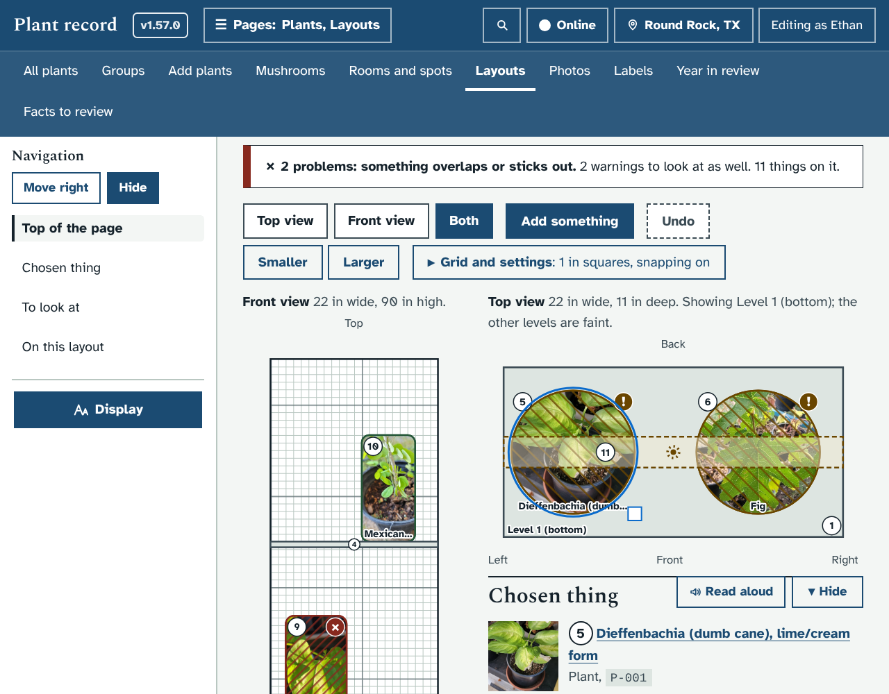
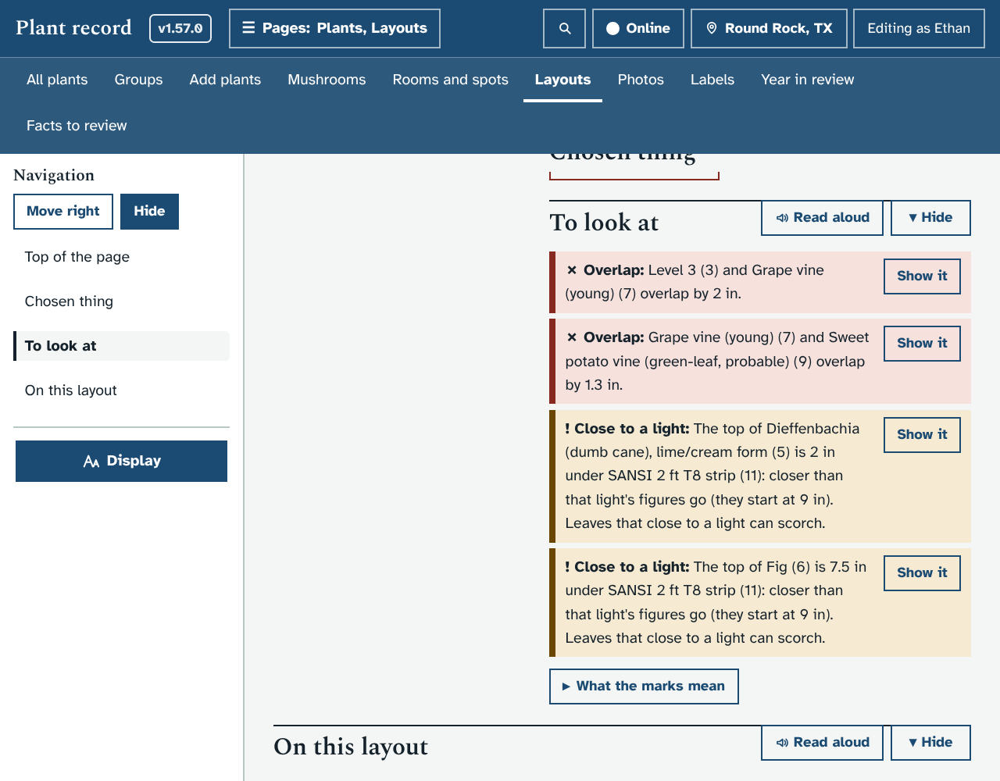
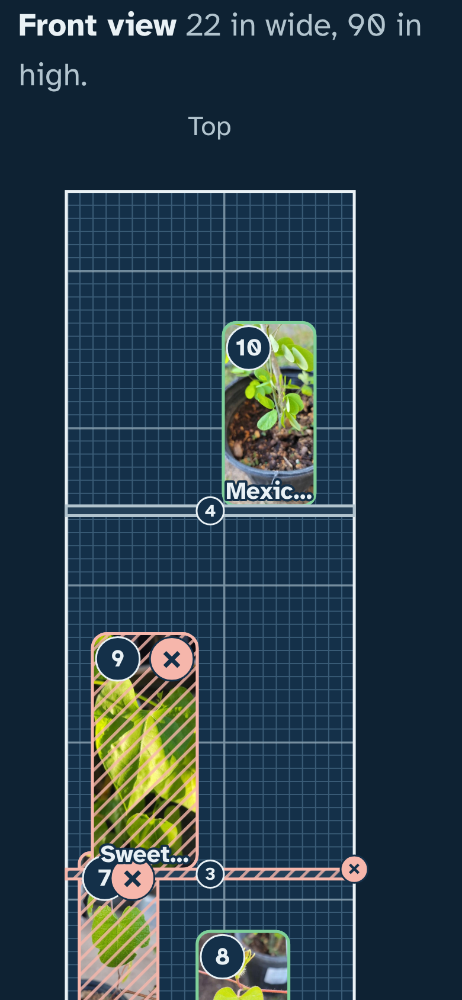

# Prototype: room and shelf layouts

## What it does and why
Ethan asked (November 14, 2026) for a way to simulate a space in two dimensions, and perhaps three later, with the plants, grow lights, shelves and anything else in it: things to drag about, a grid to see and snap to, sizes for the space and for each thing, and marks where things collide or may conflict.

The record already holds most of what such a drawing needs: each shelf's measurements and levels, each light's size from how it holds and the distances its light figures cover, each plant's pot or tray and its height. **Layouts** draws a room, a porch or one shelf unit to scale from that, and lets you move things about on the page before you move the real ones.

- **A new page, Layouts** (Plants → Layouts, after Rooms and spots). It lists your layouts, each with a small drawing and how it stands ("Everything fits", "1 warning", "2 problems"), and has **Start a layout**.
- **Start a layout** asks what it is a layout of: one of your rooms or areas, one of your shelves, or a space of your own. It fills in the size from the measurements:
  - a shelf starts with its own width and depth and its levels drawn as boards at the heights its measurements give;
  - a room starts 12 by 10 ft (rooms have no width in their measurements; type the real one) with its shelves as blocks along the back wall;
  - Rooms and spots has a **Lay it out** button on every room, area and spot, which becomes **Open its layout** once it has one.
- **Everything is a box**, in inches or centimetres as you read them: how far from the left, how far from the back, how far off the floor, and how wide, deep and tall. A pot is round from above. So the same things are seen and moved in two drawings:
  - **Top view**, looking down;
  - **Front view**, from the front, with the floor at the bottom;
  - or **Both**. On a tall shelf the front view runs down the left and the top view of one level sits large beside it.
- **What can be on it:** a plant (one of yours, or a plant with no page yet), a grow light from your list, a shelf or furniture (one of your shelves as a block or level by level, or a board or table you describe), something else (a humidifier, a fan, a chair), and an **area to keep clear** (a walkway, a door, a vent).
- **Moving a thing**, three ways, so no mouse is needed:
  - drag it (on a touch screen, the first touch chooses it and the next one drags it, so the page still scrolls);
  - the arrow keys, one square at a time, five with Shift; in the front view Up and Down stop on each shelf on the way. Each drawing is one stop for the Tab key, and Page Down and Page Up go from thing to thing;
  - type its place in the boxes beside the drawing, or choose what it **Stands on** (and for a light, what it **Hangs under**).
- **The grid:** squares of ½, 1, 2, 3, 6 or 12 in (or 1 to 30 cm), with a heavier line each foot. **Snap to the grid** and **Show the grid** can each be turned off.
- **Sizes:** drag the square on the chosen thing's corner, or type its width, depth and height. **Size and name** changes the space itself. A plant with no pot or height in the record starts at a guess, and its boxes say so.
- **What it marks**, as you go and while a thing is being dragged:
  - **Overlap** and **Sticks out** (a problem): two things take up the same room, or a thing is past a side, the top or the floor of the space. A plant too tall for its level overlaps the shelf above it.
  - **Tight**: a plant is closer to something, beside it or above it, than the room to leave around a plant (1 in to start with; you set it).
  - **Close to a light**: the top of a plant is closer to the light over it than that light's figures go.
  - **In an area to keep clear**, **Nothing under it** (a pot in the air), and **More than you own** (three of a light drawn when you own two).
  - Every mark is bars across the thing and a sign (✗ or !) as well as a colour, and each is a sentence in **To look at**, on the thing's own boxes, in the list of everything on the layout and in what a screen reader is told.
- **Also:** Undo (each change made on this visit, newest first, and Ctrl+Z on the drawing), Turn a quarter, Make a copy, Lock in place, Take it off the layout, **Smaller** and **Larger** (remembered for each layout), each plant's photo on its pot, and a line on a plant's own page saying which layouts it is drawn on.
- **A layout is a drawing only.** Moving or resizing a plant on it changes nothing on the plant's page; removing a layout removes the drawing and nothing else.
- People who can only view see a layout and can choose a thing to read its place and size; they cannot change it. An editor limited to some homes changes the layouts of those homes only.

## How it looks
A shelf, laptop. The front view on the left; the top view shows the level of the chosen plant, with the other levels faint. One plant is too tall for its level (✗, close bars) and two are close to the strip above them (!, wide bars):

What to look at, in sentences, and the list of everything on the layout:

On a wide screen the chosen thing's boxes sit beside both views:

A room from above, with its shelves as blocks, a walkway and a door as areas to keep clear, and a plant standing in the walkway:

Starting a layout from a shelf's **Lay it out** button, and adding things:

 

The list of layouts:

Phone, dark mode, large text (one view at a time; nothing scrolls sideways):

 

## How to try it
- Windows cmd.exe: `set "DATA_DIR=%CD%\dev\tmp\data" && python dev\test\mock_server.py`
- PowerShell: `$env:DATA_DIR="$PWD\dev\tmp\data"; python dev\test\mock_server.py`
- bash: `DATA_DIR="$PWD/dev/tmp/data" python3 dev/test/mock_server.py`

Then open http://127.0.0.1:8080/#/layouts, press **Start a layout** and choose **Tall Brown Shelf**. The focused check is `python3 dev/test/layouts_check.py` (or `python3 dev/test/run_checks.py layouts`); the unit tests are `dev/test/unit/test_layouts.py`.

## What it changes in the database
- Two new tables, made the first time the page is used: `layouts` (name, home, the room or shelf it is of, width, depth, height, the size of a square, snapping, the room to leave around a plant, notes) and `layout_items` (the layout, what kind of thing, its name and shape, the plant, light or shelf it is in the record, its place and its size, locked).
- No existing table or column changes. Nothing in `init_db()` changes, so an upgrade and a new install are the same as before. If this becomes a release, the two tables move into `init_db()`.
- History gets a line when a layout is added, changed or removed and when a thing is put on one or taken off. It does not get a line for each move: who moved a thing last, and when, is kept on the thing.
- A plant, light or shelf that is later archived or removed stays on the drawing under the name it had, marked "No longer in the record".

## How it is built
- `app/plantdb/layouts.py` keeps the layouts, checks what it is given, and adds what only the record knows: what a layout of a place starts with (`layout_start`), how much room each plant and light probably takes (`layout_plant_size`, `layout_light_size`), and which plants are at the place. Routes: `/api/layouts`, `/api/layouts/<id>`, `/api/layouts/<id>/items`, `/api/layouts/items/<id>`.
- `app/static/js/layouts.js` does the drawing (SVG), the moving, the snapping and the looking for trouble, because those must answer while a thing is dragged. `lyFindings()` is the one place that decides what overlaps, sticks out or may be a problem; `lyMeasure()` decides how large each view is drawn and how the views are set out for the width of the page. One `addFeature()` call adds the page, the buttons on Rooms and spots and the line on a plant's page.
- `app/static/css/layouts.css`, `dev/test/layouts_check.py`, `dev/test/unit/test_layouts.py`, and cases in `dev/test/unit/test_home_limit.py`.
- Shared lines: one in `js/manifest.json`, one in `run_checks.py`, the CHANGELOG and README entries, and the IDEAS entry.
- **Three dimensions later:** a place and a size in three directions is everything a view from a corner needs, so a third view can be added without changing what is stored.

## What is not done
- A view in three dimensions.
- How much light each plant gets where it is drawn. The drawing knows which light is over a plant and how far up (the plant's boxes say so); it does not yet work out the light from that light's chart, as Grow lights does for a spot.
- Moving the plants in the record to match a layout you are happy with.
- Choosing several things at once, lining things up, and Redo.
- A layout cannot be changed offline.

## Questions for Ethan
1. **The name.** The page is "Layouts", under Plants. The app already says "Page layout" in Display and "Suggested layout" on Grow lights. Keep "Layouts", or would "Room and shelf plans" (or another name) be clearer?
2. **Should a layout be able to change the record?** Today it is a drawing only. One button could move every plant drawn on a shelf's layout to that shelf in the record, once you are happy with it. Wanted, or keep the two apart?
3. **Sizes.** A plant with no pot from Pots and trays and no height on its page starts at a guess (8 in across, 12 in tall) that its boxes own up to. When you type its real height on a layout, should that also be saved as "Height now, with its pot" on its page?
4. **Light from the drawing.** Next, the layout could say for each plant how much light reaches it from the light drawn over it, in the words Grow lights uses. Is that the most useful next step, or is the view in three dimensions?
5. **The size of the drawing.** It starts as large as the page's width and about a screen and a half of height allow, and **Larger** and **Smaller** change it for that layout. Is that the right starting size?
