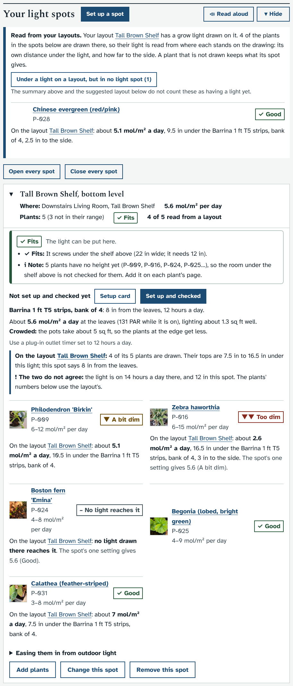
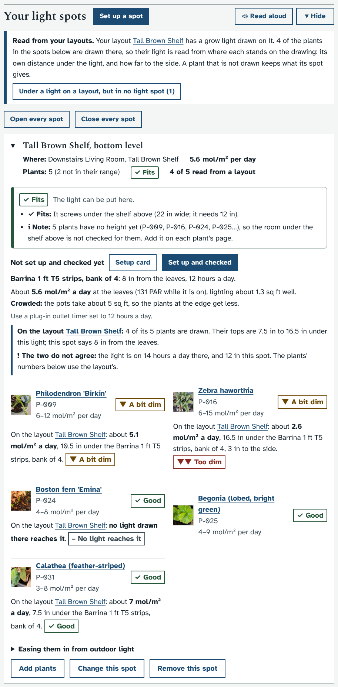
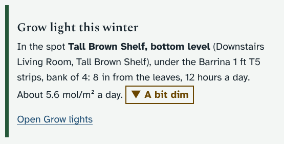
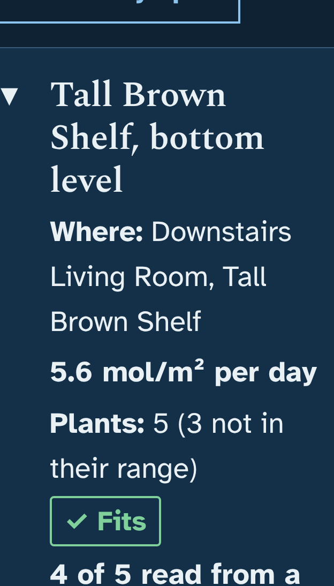

# Prototype: Grow lights reads your layouts

Branch `proto/lights-read-layouts`, on top of `proto/layouts` (pull request 131). It needs Layouts: merge that one first.

## What it does and why
Ethan, November 15, 2026: "Yes" to "Should Grow lights read a shelf's layout where there is one?", then "Proceed with grow lights reading a layout".

A light spot on Grow lights is one setting for every plant in it: one distance from the leaves, and one number for all of them. A layout knows more: where each plant stands under the light, how tall it is, and how far to the side. The two could say different things about the same shelf.

Now, when a plant is drawn on a layout that has a grow light with its maker's figures, Grow lights reads that plant's light from the drawing.

- **Above the light spots**, a note says which layouts are read and how many of the plants in the spots are drawn there.
- **In a spot**, each drawn plant has a line under it:
  - its own daily light on the layout;
  - how far under the light it is, and how far to the side;
  - a link that opens the layout with that plant chosen.
- **The plant's mark** in its spot (Too dim, A bit dim, Good, A bit bright, Too bright) is the layout's. Where the spot's one setting would have said something else, the line says what.
- **No light reaches it:** the plant is drawn, and no light drawn there reaches it. A plant on the level above a strip light is one.
- **A plant that is not drawn** keeps what its spot gives.
- **The spot's summary** counts the plants out of their range by those marks, and says how many are read from a layout.
- **The spot's own box** says how far under the light its plants are on the drawing, beside the spot's one distance. Where the light's hours or brightness on the layout are not the spot's, it says so, and that the plants' numbers use the layout's.
- **Under a light on a layout, but in no light spot:** a folded list of the plants that the drawing puts under a light and that no spot has.
- **A plant's own page** says its light on the layout, under "Grow light this winter".

Nothing is saved and nothing in the record changes. The numbers are worked out by the same code that the Layouts page uses, so the two pages cannot disagree about a plant.

## Two ways of showing it, for Ethan to choose
A gallery on his screens, at the usual and the largest text, each beside Grow lights as it is today (private to him): https://claude.ai/artifact/8k4ngzu9jvDEfpRon5ePvg

**Option 1, the layout decides** (how the branch is set). The mark beside each drawn plant is the layout's:

**Option 2, beside.** The mark stays the spot's, and the layout's is on the line under the plant:

A plant's own page:

A phone, dark, large text:

## How to try it
- Windows cmd.exe: `set "DATA_DIR=%CD%\dev\tmp\data" && python dev\test\mock_server.py`
- PowerShell: `$env:DATA_DIR="$PWD\dev\tmp\data"; python dev\test\mock_server.py`
- bash: `DATA_DIR="$PWD/dev/tmp/data" python3 dev/test/mock_server.py`

Then, at http://127.0.0.1:8080:
1. On **Layouts**, start a layout of a shelf, put two or three plants on it, and add one of your grow lights above them.
2. On **Grow lights**, set up a spot with that light at that shelf, with those plants and one more.
3. Open the spot on Grow lights.

The focused check is `python3 dev/test/run_checks.py lightsread`.

## What it changes in the database
Nothing. No table, no column, no saved setting. It reads `GET /api/layouts`, which now also carries the words for a plant's light (`verdicts`).

## How it is built
- `app/static/js/layoutlights.js` (new) and `app/static/css/layoutlights.css` (new).
  - `lgRead()` runs `lyLight()` from `layouts.js` on every layout and keeps a reading for each plant drawn on a layout that has a light with figures.
  - `lgFor(code, place)` picks the reading to use: on the layout of the spot's own place; else of the place the record has the plant; else one where a light reaches it.
  - One `addFeature()` call adds a note to Grow lights and a line to a plant's page. On Grow lights it then goes through the page's own spot boxes and adds the lines, the marks and the count.
- `app/plantdb/layouts.py`: `verdicts` in the list of layouts (one line).
- Shared lines: one in `js/manifest.json`, one in `run_checks.py`, the CHANGELOG and IDEAS entries, one line in the README's list, one phrase in the table at the end of `docs/ARCHITECTURE.md`. The guide is a section of `manual/layouts.md`; the notes are a section of `docs/architecture/layouts.md`.
- `dev/test/lightsread_check.py` (20 steps) and one line in `dev/test/unit/test_layouts.py`.

## What is not done
- **The server does not use these numbers.** The summary at the top of Grow lights, the suggested layout, "It would suit ..." and Compare lights still use each spot's one number. A plant under a light on a layout but in no spot is listed, and is still counted as having no light.
- **A drawn light and its spot keep their own hours and brightness.** A drawn light starts with its spot's, and after that each is set where it is. This page says where they differ; it does not make them one.
- It changes the Grow lights page from outside, by adding to what that page has drawn. If this becomes a release, Grow lights should ask for the readings itself.
- Daylight from windows is not counted, as on a layout.

## Questions for Ethan
1. **Which way to show it:** option 1 (the layout decides the mark) or option 2 (beside the spot's mark)?
2. **One place for a light's hours.** A light's hours and brightness can be set in its spot on Grow lights and on the drawn light on a layout. Which should be the one place: the spot, the layout, or either with the other following?
3. **A plant under a light on a layout, but in no spot.** Should it count as having a light, so that the summary and the suggested layout leave it alone?
