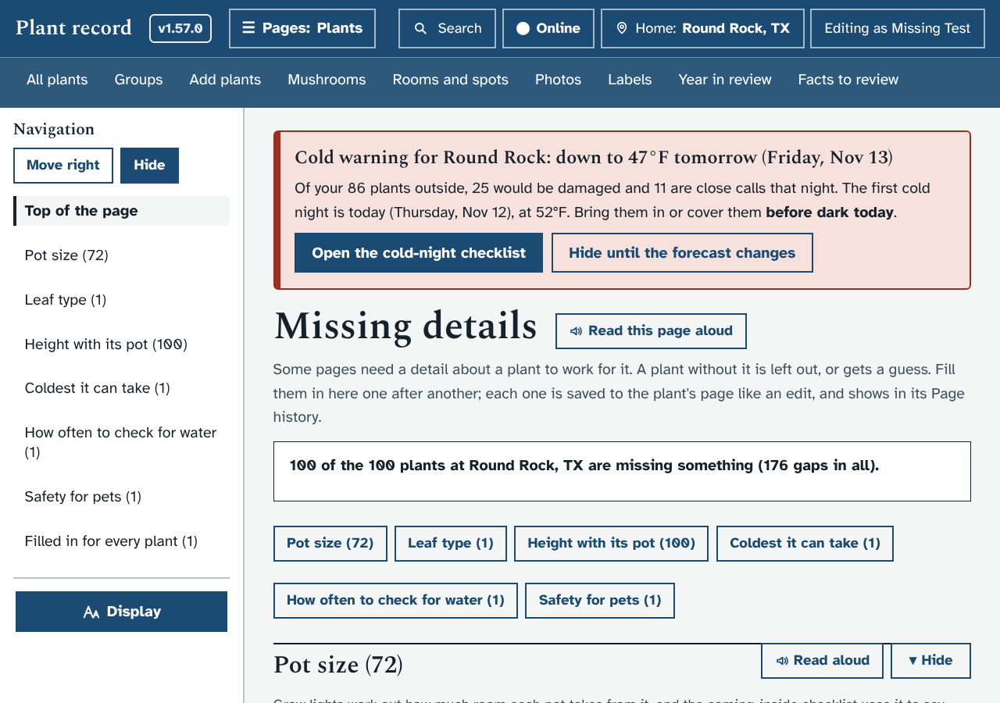
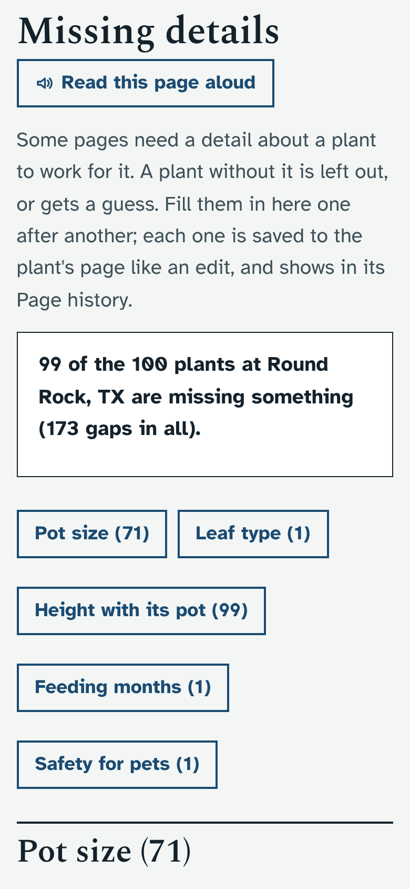
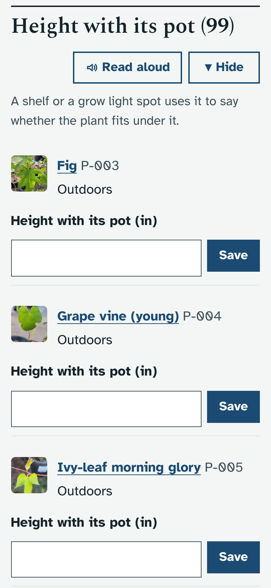
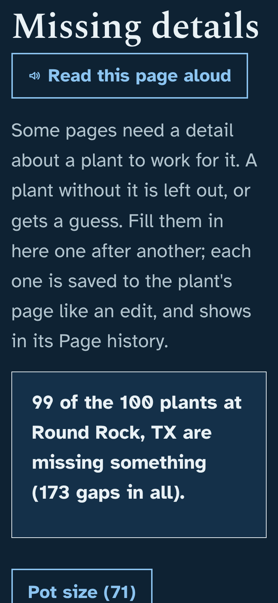
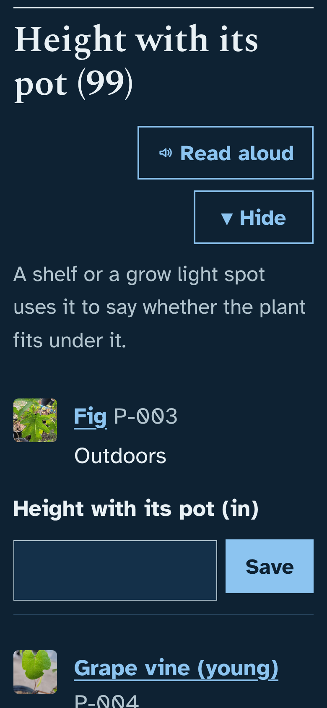

# Prototype: missing details

## What it does and why
Many pages in the app need one detail about a plant to work for it, and when that detail is empty they quietly leave the plant out or use a guess:

| Detail | What uses it | Without it |
| --- | --- | --- |
| Pot size | Grow lights (how much room a pot takes), the coming-inside checklist (can it be soaked) | Grow lights guess how much room the pot takes; the checklist cannot rate soaking |
| Leaf type | The coming-inside checklist (each pest method is rated by it), the repotting plan | Methods are rated without it |
| Height with its pot | Shelves and grow light spots (does it fit under) | "Something is not filled in yet" |
| Coldest it can take | The frost alert and the cold-night checklist | The plant is left out of both |
| How often to check for water | Water on Today | Every 7 days, the usual for a potted plant |
| Feeding months | The feeding calendar and Today's Feed list | No feeding reminders |
| Safety for pets | The pets filter on All plants | The plant only shows under "Pet safety not set" |

On a fresh copy of your plants, 72 of the 100 have no pot size and none has a height yet, so the grow-light planner and the shelf checks are guessing for most of the collection. Finding which ones means opening each plant's Edit page. This puts them all on one page, with a box to fill each one in right there.

- **A new page, Missing details** (`#/missing`). It is part of Plants, but has no link of its own in the top bar, because a ninth link wraps the row (the same as the Propagation guide). You reach it from:
  - a line on **All plants**, under the title: "100 plants are missing details that other pages use. Missing details". It only shows when something is missing.
  - **Search**: type "missing".
- **At the top:** how many of the plants at the home you are using are missing something, and a row of buttons, one per detail with its count, that jump to that list.
- **One section per detail**, with what it is for in one line, then each plant with its photo, name and code, and a box:
  - **Pot size**, **Leaf type**, **Safety for pets**: a list to choose from.
  - **Height with its pot**: a number in inches or centimetres, whichever you use.
  - **Coldest it can take**: a number in °F or °C, whichever you use.
  - **How often to check for water**: a number of days (1 to 60). Only asked for plants with neither this nor a soil moisture range; semi-hydro and water-only plants are not asked.
  - **Feeding months**: an **Open Edit** button, because it is three boxes (from, through, every so many days). Plants set to "None needed" for fertilizer strength are not asked.
- **Save** (or Enter) saves it, says "Saved: Pot size for Fig", and the plant leaves the list. The keyboard moves straight to the next plant in the same list, so you can go down a list with Tab, choose, Enter.
- **Filled in for every plant**: at the bottom, the details nothing is missing for.
- **One plant:** `#/missing?plant=P-006` shows only that plant's gaps, with a link back to its page (nothing links there yet; see the questions).
- People who can only view see the lists but not the boxes.
- Every box has a visible label, and its spoken name says the plant too ("Pot size for Fig"), so a screen reader does not hear 70 boxes all called "Pot size".

## How it looks
Laptop, the top of the page:

Phone, the top of the page and a list with boxes (nothing scrolls sideways):

 

Phone, dark mode, largest text:

 

## How to try it
- Windows cmd.exe: `set "DATA_DIR=dev\tmp\data" && python dev\test\mock_server.py`
- PowerShell: `$env:DATA_DIR='dev\tmp\data'; python dev\test\mock_server.py`
- bash: `DATA_DIR=dev/tmp/data python3 dev/test/mock_server.py`

Then open http://127.0.0.1:8080/#/missing. The focused check is `python3 dev/test/missing_check.py` (or `python3 dev/test/run_checks.py missing`).

## What it changes in the database
- Nothing new: no tables, columns, settings or upgrade batch.
- Filling in a detail is an ordinary edit of that plant's page (`PUT /api/plants/<code>` with its version), with the note "Filled in on Missing details". It raises the page version, is in Page history and the Audit log, and is refused if someone changed the plant since the list loaded (the list reloads and says so; nothing is overwritten).

## How it is built
- `app/plantdb/missing.py`: `MISSING_DETAILS` (the seven details, their fields, what each is for, and how each is filled in), `missing_of()` (pure: which details one plant lacks) and `GET /api/missing[?plant=CODE]`. Active plants at the place in use only, as the other lists.
- `app/static/js/missing.js`: the page, the Save form (`data-form="msave"`, in the person's units with `lenIn()` and `tIn()`), and one `addFeature()` call: the page, and the line on All plants.
- `app/static/css/missing.css`: its own styles, and the rule that hides the boxes for viewers.
- One line each in `js/manifest.json` and `dev/test/run_checks.py`; `dev/test/missing_check.py`.

## Open questions for Ethan
1. **Which details?** These seven are the ones a page leaves a plant out of, or guesses, without. Should any go (pet safety, say), or should others join (the ideal temperature range, humidity, light needs)?
2. **"I don't know" or "Skip".** Some details you may not know for a plant yet (its height until you measure it). Would you like a **Not now** button that hides a plant from one list for a month? That would store a small list in settings.
3. **A line on each plant's page**, such as "Missing: pot size and height. Fill them in", linking to that plant's gaps? It would sit under the plant's name.
4. **On Today:** should a short "Missing details (3)" reminder show there, one plant at a time, or is the link on All plants enough?
5. **Long lists:** Height has 100 plants. Is one long list fine with the jump buttons and Hide, or would you rather see 10 at a time with **Show 10 more**?

Reply on this pull request with changes, or say 'merge' when you are happy.
