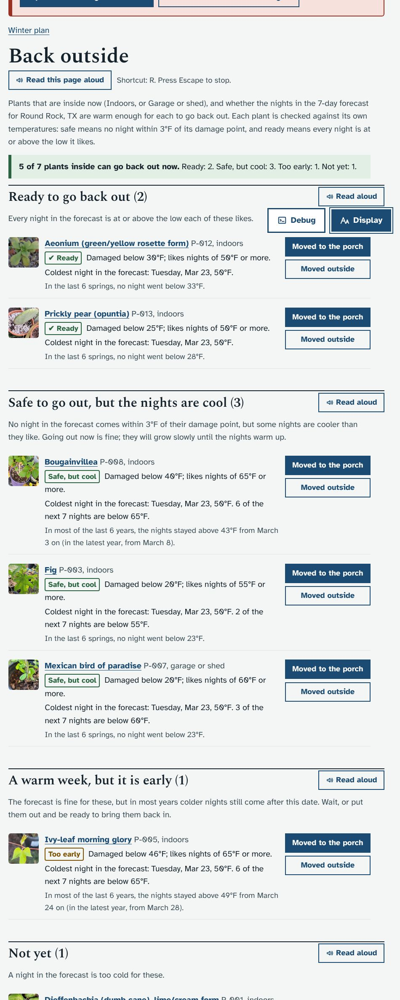
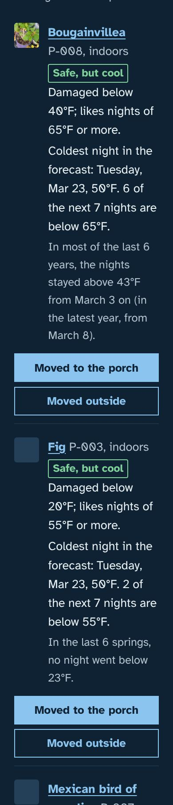
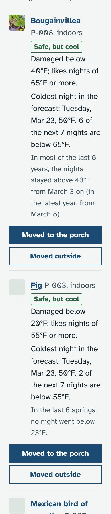
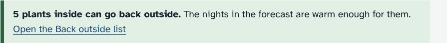
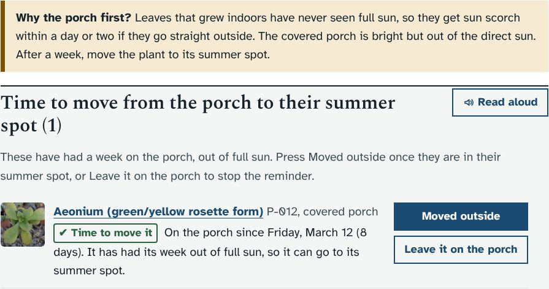
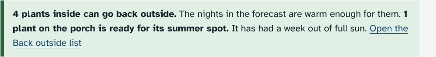

# Prototype: Back outside (spring list)

Branch `proto/move-outside`. Idea from `docs/IDEAS.md`: when the nights stay above each indoor plant's comfortable low, list the plants that can go back out.

## What it does and why
Over winter many plants are inside. In spring each one can go back out at a different time: a fig is safe long before a dieffenbachia. This page checks every plant that is inside against its own temperatures and the 7-day forecast, so Ethan does not have to compare numbers plant by plant.

- **New page, Back outside** (`#/outside`), under Winter plan. It is linked from the "Already inside" list on the Winter plan page ("Which can go back outside?").
- **Who is listed:** active plants whose Location is Indoors or Garage or shed.
- **Each plant gets one of four labels** (words in a box, not colour alone):
  - **Ready:** every night in the forecast is at or above its ideal low (`temp_ideal_low`).
  - **Safe, but cool:** no night comes within 3°F (`FROST_MARGIN`, the same as the cold-night checklist) of its damage point (`temp_damage_below`), but some nights are cooler than it likes.
  - **Too early:** the forecast is safe, but the weather history says colder nights usually still come. In spring: today is before the date after which, in most years, nights stayed above its safe temperature. In autumn: within a week of, or after, the usual first night below it.
  - **Not yet:** a night in the forecast is too cold. It says which night and how cold.
- **The usual date**, when there are 3 years or more of weather history: "In most of the last 6 years, the nights stayed above 53°F from April 5 on (in the latest year, from April 9)". Without history the page says how to load it.
- **Buttons:** "Moved to the porch" (Location becomes Covered porch, the first step) and "Moved outside" (Outdoors). Both change Location, so the audit log, timeline and cold-night checklist follow. Focus moves to the next plant's button. Hidden from viewers.
- **Porch first, to protect from sun scorch (Ethan's answer):** a note on the page ("Why the porch first?") and a line under each plant that can go say the porch is there to protect leaves that grew indoors from sun scorch.
- **Porch reminder (Ethan's answer):** "Moved to the porch" notes the day, and a week later the plant shows in "Time to move from the porch to their summer spot" on this page and in a note on the Today page (all year, not just spring). **Moved outside** ends it; so does moving the plant anywhere else. **Leave it on the porch** turns it off and logs that in the audit log. Plants waiting out their week are listed under "On the porch for now".
- **The next 7 nights** as a small table, and a short "Going back out" section: ease plants in from shade, pots dry faster outside, start feeding with new growth.
- **Today page, in spring only:** a note "5 plants inside can go back outside" with a link, when any are Ready or Safe.

## How it looks
Made-up test data: today is March 20, coldest forecast night 50°F, six years of made-up history. The frost banner at the top is from the same made-up forecast.

 

The porch note and a reminder a week later, and the Today page note with it:

## How to try it
- `python3 dev/test/outside_check.py` runs its own copy of the app with the spring test data, checks the levels and the page (laptop and phone, light and dark, keyboard), and saves screenshots to `dev/tmp/shots/outside-*.png`.
- With the mock server, move a few plants to Indoors and open `#/outside`. In October everything shows the autumn note, and only very cold-hardy plants would be Safe.

## Changes to the database
No new tables or columns. "Moved to the porch" keeps one small entry per plant in the existing `settings` table (key `bo_porch`: plant code, day, who), used only for the reminder. Everything else is read from plants, the forecast and the daily weather history. Moving a plant changes its Location as the existing Location menu does.

## For Claude: where the code is
- `server.py`: a block before "getting plants ready to come inside": `BO_LEVELS`, `bo_porch_state()`, `bo_porch_list()`, `POST /api/outside/porch` (`start` or `clear`), `bo_daily_lows()` (cached 6 h per place), `bo_md()`, `bo_usual(lows, t)`, `outside_report(c)` and `GET /api/outside`.
- `app.js`: a block after `viewWinter()` (`loadOutside()`, `boRow()`, `viewOutside()`, `boMove()`, the Today-page MutationObserver); one line each in `route()` and the nav mapping; the link in the Winter plan's "Already inside"; `Object.assign(acts, {boporch, boout})` after `changeActs`.
- `style.css`: its own block after the 1.8.0 cold-night styles, including its viewer rule.
- `dev/test/smoke.py` now also opens `#/outside`.

## Ethan's answers (October 25)
1. Ready uses each plant's ideal low: "this will work fine". No change.
2. Porch first, with a note about sun scorch and a reminder a week later: added.
3. The note on the Today page is useful: kept, and it now also carries the porch reminder.
4. Garage or shed plants stay included.
