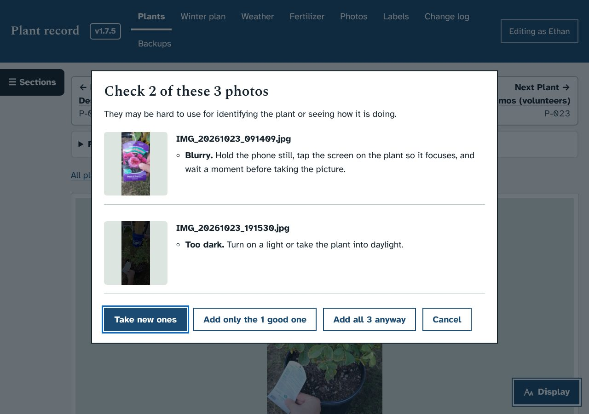
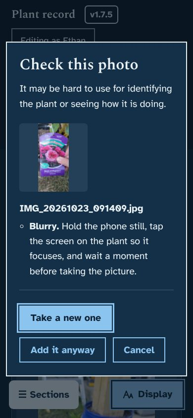

# Prototype: photo check before adding photos

## What it does
When you add photos, Plant record now looks at each one first and tells you, in words, if it may be hard to use. That way a blurry or dark picture can be retaken while you are still standing by the plant, instead of finding out later when I can't make out the leaves.

- It checks for four things:
  - **Blurry.** Hold the phone still, tap the screen on the plant so it focuses, and wait a moment before taking the picture.
  - **Too dark.** Turn on a light or take the plant into daylight.
  - **Too bright (washed out).** Keep strong sun off the leaves and out of the background.
  - **Very small picture**, such as a screenshot or thumbnail instead of the photo itself.
- Photos that look fine are added straight away, as before, with nothing extra to press.
- If any photo looks wrong, a box shows it with a small preview and what to do, and four buttons:
  - **Take a new one**: opens the camera (or the file picker on the PC) again. It is the button that starts selected, so pressing Enter retakes the photo.
  - **Add only the good ones**, when some of the photos are fine
  - **Add it anyway** (or "Add both anyway" and "Add all 3 anyway"), because sometimes a dark or blurry photo is the only one there is
  - **Cancel**
- It works for photos added on a plant page, on the Photos page, and with the quick "Add a photo" button if the watering prototype is merged.
- The check happens in your browser. Nothing extra is sent anywhere.

## Screenshots
The photos in the dialog are copies of one of your P-022 photos, blurred and darkened on purpose for the test.

| | |
|---|---|
|  |  |

## How to try it
The screenshots show it working. If you would like it on your PC before merging, say so and I will build a zip marked PROTOTYPE; the updater makes a backup first.

## What it changes in the database
Nothing.

## How it works (for whoever merges it)
- `app.js`: `photoStats()`, `photoProblems()` and `photoCheck()`, placed before the Photos page code. The `addphotos` and `addloose` change handlers call `photoCheck()` before uploading.
  - The photo is decoded with `createImageBitmap()` and shrunk to 512 pixels on its long side.
  - Brightness: the average, and how much of the picture is near black or near white.
  - Sharpness: the variance of the Laplacian (how sharply brightness changes from pixel to pixel) in a 4 by 4 grid of squares. The third-sharpest square counts, so a soft background behind a sharp plant is not called blurry.
  - The limits are in `PCHK`. I set them on your own photos in `dev/photos-raw`: none of the 223 is flagged, and every blurred, darkened, washed-out or shrunk copy is.
  - Previews are drawn on a `<canvas>`, so the Content Security Policy stays as it is (it does not allow `blob:` images).
  - A browser that cannot read the photo (for example an iPhone HEIC file on Windows) skips the check and uploads as before.
- CSS: one block, "1.8.0: photo check before adding photos".
- Test: `dev/test/photocheck_check.py` runs the check on every real photo and on spoiled copies, then goes through each button in the dialog on a plant page and on the Photos page, and checks the dialog on a phone at the largest text size. The smoke test passes.
- This branch merges cleanly with the other open prototype branches.

## Questions for Ethan
1. Should it also warn when the plant is very small in the frame, for example a whole shelf when the question was about one leaf? That is harder to judge reliably, so I left it out.
2. Is "Take a new one" the right first choice, or would you rather "Add it anyway" be selected first?
