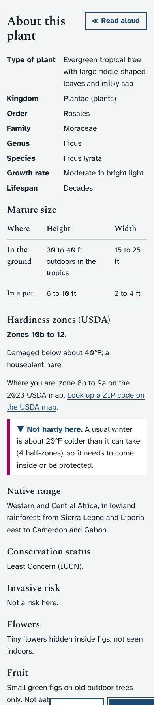
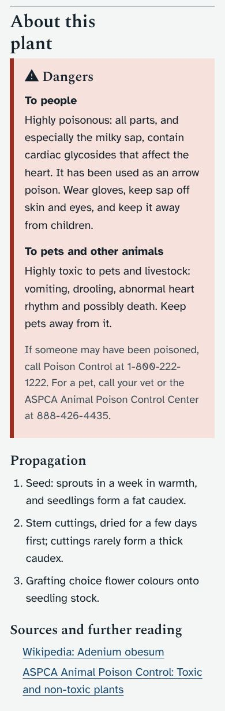
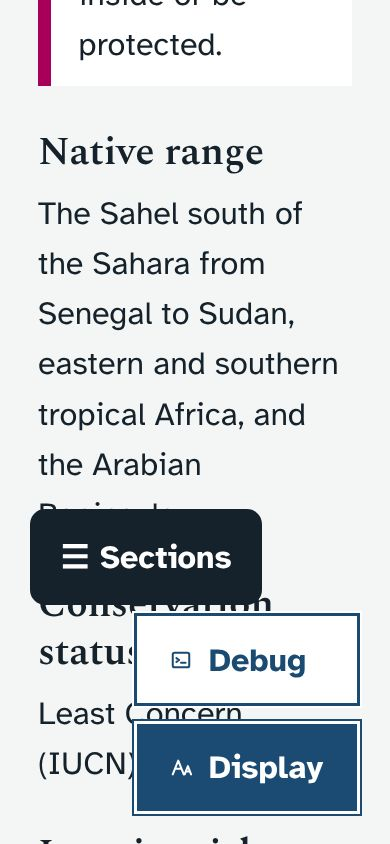

# About this plant (1.14.0)

Asked for by Ethan on October 25, 2026: more details on each plant page, "such as, but not limited to": mature height and width in the ground and in a pot, preferred growth zones with the zone where he lives, kingdom, family and genus, conservation status, native regions, type of plant, fruit, dangers to people and animals, and propagation. He then asked for citations with links to the sources.

## What it does
- A new section, **About this plant**, after Identification on every plant page, and in the jump row and the section menu.
- Claude added order, growth rate, lifespan, invasive risk and flowers to his list.
- **Zones.** The plant's USDA zones, the zone where the plants are, and a ✓ / ▼ verdict in words. The zone is worked out from the place's own weather history (the mean of each winter's coldest night: 22°F over 43 winters on Ethan's data, so 9a). The 2023 USDA map, which puts Round Rock on the 8b/9a line, is named and linked. With no weather history yet, the verdict uses the colder end of the map zone.
- **Dangers** in a box of their own, with Poison Control and the ASPCA Animal Poison Control Center.
- **Sources** as links under every plant (104 distinct pages). Every link came from web search results, not from memory, and the test checks each link in the batch is on that list.
- **Unsure IDs.** Below 85% ID confidence a note says the details are for the closest match.
- **Not identified yet.** P-036 has only the cautions. P-053 (a gourd-family vine) has family-level facts and a warning not to eat the fruit until it is identified, since some gourds are poisonous.

## Where the facts came from
- One profile per species or group (51) in `dev/seed_src/profiles_A5.py`, mapped from plant codes. The sources are in `sources_A5.txt`.
- Conservation statuses are only given where Claude confirmed them (majesty palm Vulnerable, vanilla Endangered; Least Concern for the fiddle-leaf fig, rubber tree, desert rose and moon cactus; ZZ plant Least Concern in South Africa). Otherwise the page says no assessment could be confirmed.
- CITES is mentioned for orchids, cacti, aloes and succulent euphorbias, with the exemptions.

## Screenshots
| | | |
|---|---|---|
|  |  |  |

## What it changes in the database
- 23 new plant columns, added by `init_db()`.
- Batch `batchA5` fills them where empty, so nothing Ethan typed is replaced.

## Tests
`dev/test/details_check.py` covers:
- the zone maths, and every plant having its details;
- every source being a secure link from the checked list;
- the batch being guarded;
- the page: classification, size table, zone verdict both ways, danger box, links opening in a new tab, the edit form's labels, the unsure-ID note, phone width at the largest text, and viewers.
