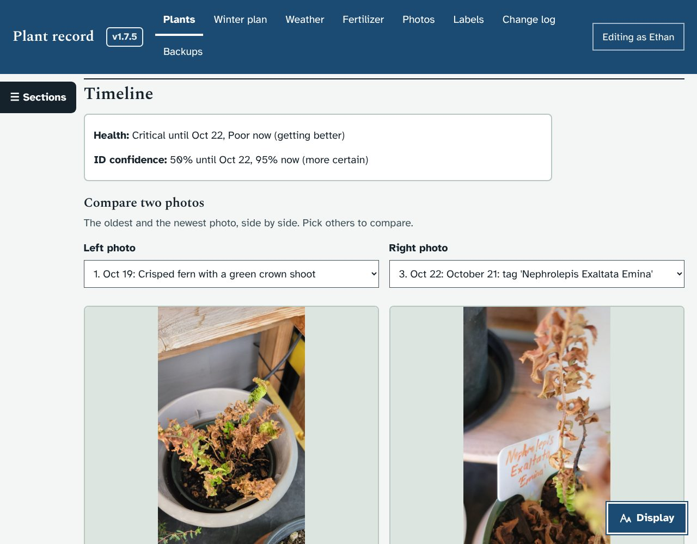
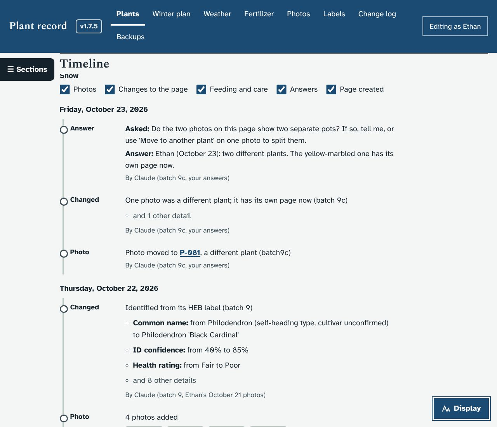
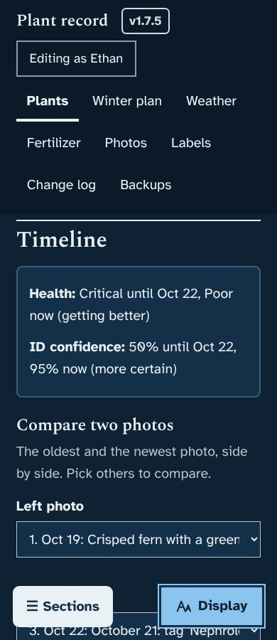

# Prototype: plant timeline and photo comparison

## What it does
Each plant page gets a **Timeline** section, between Label and Page history, listed in the On this page menu. It answers "is this plant getting better?" without reading the change log.

- **How it is doing.** A short summary at the top, when something has changed:
  - "Health: Critical until Oct 22, Poor now (getting better)"
  - "ID confidence: 50% until Oct 22, 95% now (more certain)"
- **Compare two photos.** The oldest and newest photos of the plant, side by side, each with its date and caption.
  - Pick any two photos with the **Left photo** and **Right photo** menus. They are numbered in the order they were taken.
  - Every photo in the list below has a **Compare** button that puts it on the right.
  - On a phone the two photos sit one above the other, full width.
- **Everything that has happened**, newest first and grouped by day:
  - **Photos:** "4 photos added", with small pictures. Photos moved to or from another plant say where they went, with a link.
  - **Changes to the page**, with the ones that matter picked out: name, health, ID confidence, location and winter plan, in words ("Health rating: from Fair to Poor"). Smaller edits are counted ("and 8 other details").
  - **Feeding and care:** feedings from the Fertilizer page. If the watering log and frost alert prototypes are merged too, waterings, checks and "covered for tonight" show here as well.
  - **Answers:** each request that is finished, with the question and your answer. That includes the ones an update settled for you.
  - **Page created**, with the photos the page started with.
  - Tick boxes under **Show** hide any kind of entry.

## Screenshots
| | |
|---|---|
|  |  |
|  | |

## How to try it
The screenshots are taken from a copy of a database at version 1.7.4, so they show real history (P-024 for the summary and photos, P-055 for the list). If you would like it on your PC before merging, say so and I will build a zip marked PROTOTYPE; the updater makes a backup first.

## What it changes in the database
Nothing. The timeline only reads the change log, the photos and the requests. It works on an existing database straight away, history included.

## How it works (for whoever merges it)
- New read-only route `GET /api/plants/<code>/timeline` in `server.py`, next to `/history`.
  - It walks `audit_log` for the plant. Rows saved together (same time, note and action) become one event. `TL_KEY_FIELDS` lists the fields shown by name; others are counted.
  - Finished requests come from the `requests` table rather than the log, because requests settled by an upgrade batch have no log row.
  - Photos with no "added" row (the ones a page was created with) are attached to the "created" event.
  - `TL_KIND` already maps the `care` and `frost` actions from the other prototypes, so nothing needs changing when they are merged.
- Front end: `loadTimeline()` and `tlRender()` in `app.js`. A `MutationObserver` on `#app` loads the timeline whenever a plant page draws, so `route()` and `viewPlant()` are untouched apart from the empty section. Filter and photo choices use `data-act="tlkind"`, `"tlsel"` and `"tlpick"`; focus stays on the control that was used.
- CSS: one block, "1.8.0: plant timeline and photo comparison".
- Test: `dev/test/timeline_check.py` checks the entries, the summary, the photo choices, the filters (including focus), the answered requests and phone width. It passes on a fresh install and on a 1.7.4 database copy; the smoke test passes too.
- This branch merges cleanly with the other four prototype branches.

## Questions for Ethan
1. Should the timeline sit higher on the page, for example straight after the photos? It is near the bottom now, so the care details come first.
2. Is "oldest next to newest" the right first comparison, or would you rather see the two most recent photos?
3. Would you like a "Take a comparison photo" button that opens the camera, so new photos are easier to line up with old ones?
