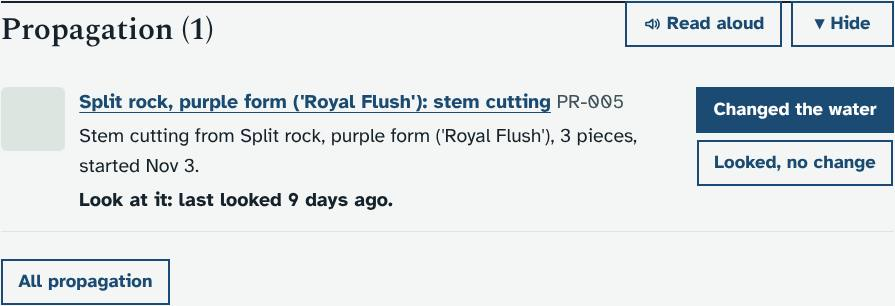
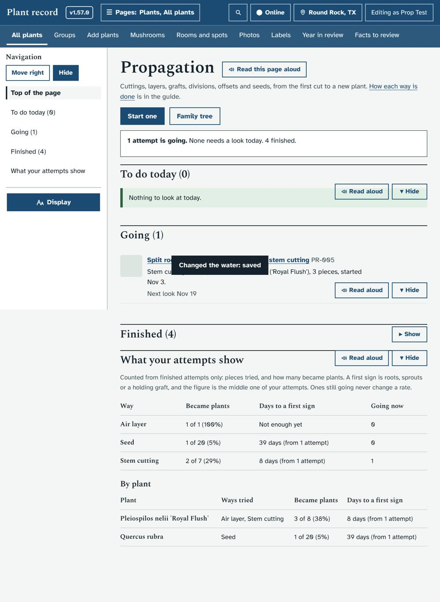
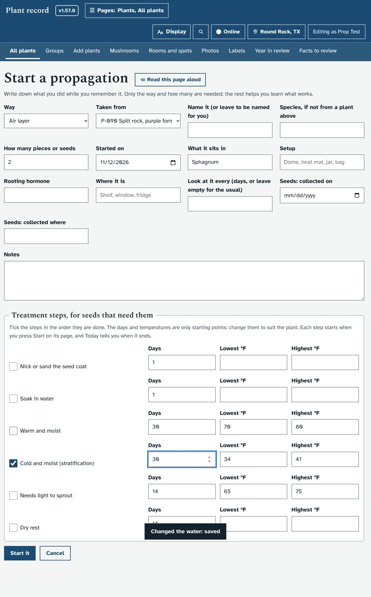
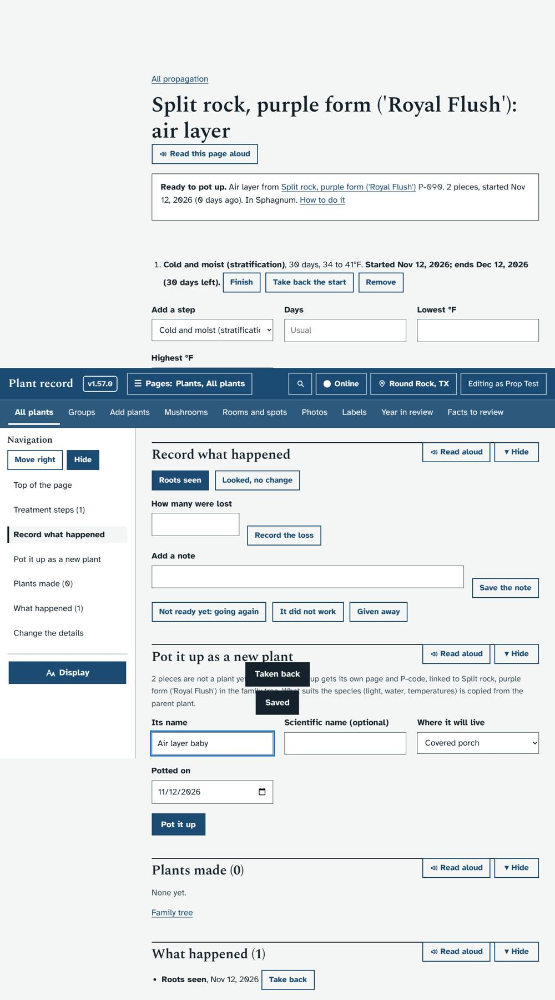
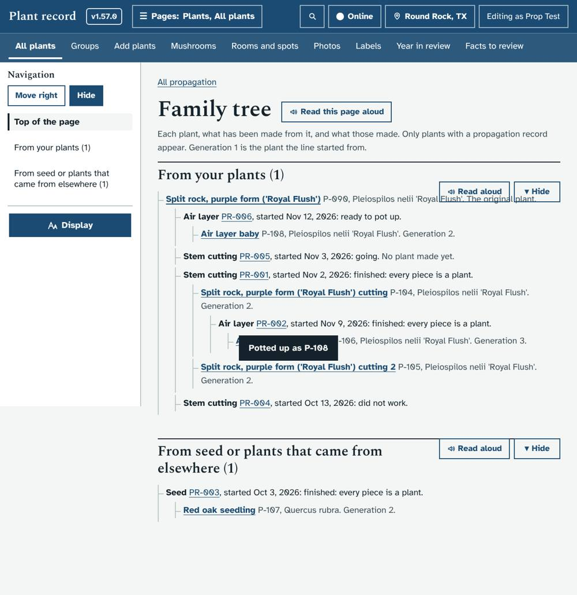
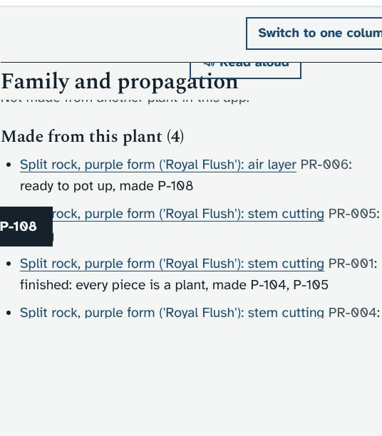
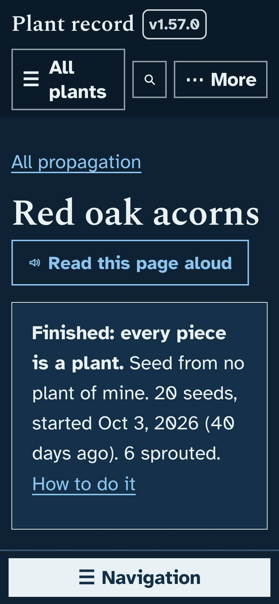

# Propagation: cuttings, layers, grafts, divisions and seeds

Asked for by Ethan on November 12, 2026: a dedicated area to track, monitor and build knowledge about cuttings, grafts and other ways of making new plants. His answers: a propagation links to its parent with a viewable family tree; once rooted and potted it becomes a full plant with its own P-code; seeds are in scope.

## What it does
- **Start an attempt** (`#/propagating/new`, or **Start a cutting, layer or seeds from this plant** on a plant's page): the way (12 ways, matching the sections of the propagation guide), the parent plant, how many, the date, medium, setup, hormone, place and how often to look.
- **Record what happens**: callus, roots, new growth, graft holding, sprouted (counted), lost (counted), changed water, looked with no change, notes. Any of them can be taken back.
- **Treatment steps** for seeds: soak, scarify, warm, cold, light, dry rest, each with days and a temperature range, started and finished by you. Today shows what ends soon.
- **Pot it up**: makes a real plant with the next P-code, copies the species-level facts from the parent, notes where it came from, and links the two. Seedlings are potted one at a time.
- **Family tree** (`#/propagating/family`) as a nested list with generation words, readable by screen reader and at large text.
- **What your attempts show**: finished attempts only, by way and by plant: pieces tried, how many became plants, the middle days to a first sign.
- **Today block** and **plant page section** ("Family and propagation": where this plant came from, what was made from it).
- View-only people see everything and no buttons.

## Screenshots
| | |
|---|---|
|  |  |
|  |  |
|  |  |
|  | |

## What it changes in the database
New tables only, made the first time a propagation route runs (`CREATE TABLE IF NOT EXISTS`): `propagations`, `prop_events`, `prop_stages`, `prop_children`. No column is added to `plants`, and no upgrade batch is needed. Promoting an attempt creates an ordinary plant row exactly as "Add a plant" does (version and audit rows included). Removing the prototype leaves four unused empty tables and any plants already made.

## How to try it
Run it on the mock server or your own copy: open **Propagation** from the guide page or a plant's page, start a stem cutting of any plant with 3 pieces, record "Roots seen", then **Pot it up**. Start a seed lot with a cold step to see Today's reminders.

Windows cmd.exe, PowerShell and bash (from the repository folder):

    cmd:        set DATA_DIR=dev\tmp\data_prop && python dev\test\mock_server.py
    PowerShell: $env:DATA_DIR="dev\tmp\data_prop"; python dev\test\mock_server.py
    bash:       DATA_DIR=dev/tmp/data_prop python3 dev/test/mock_server.py

Then open http://localhost:8080/#/propagating.

## Tests
`dev/test/unit/test_propagation.py`; `dev/test/propagation_check.py` (about 60 checks: API, page, promotion with P-code, two generations, seed steps, results math, phone width with dark theme and 160% text, view-only).

## Open questions for you
1. Temperatures are entered in °F. Should they follow a Celsius setting if there is one?
2. Photos on an attempt (and on each check)? Not in this prototype.
3. Should seedlings from seed bought elsewhere count as "Generation 1", or start at 0 with no parent?
4. Should Propagation get its own link in the top bar? It is reachable from Today, the guide, plant pages and Search for now.
5. Push reminders for steps and checks, as other care kinds have?
6. Breeding crosses (two parents, seed from a named cross) as a second pass?
7. Results are not yet written into the facts table (Library). Do you want your own trial results to become facts about a species?
8. From the Seed lots idea, still not built: Library facts, Identify examples, and counting days from a fridge or heat-mat sensor.
