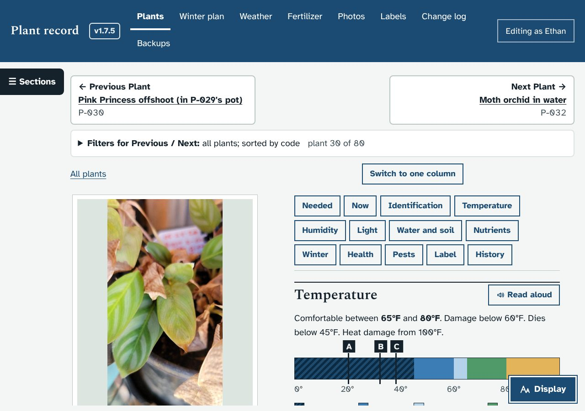
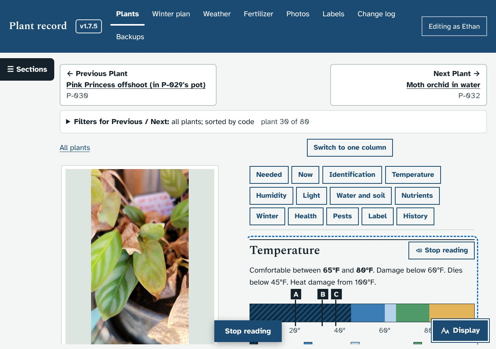
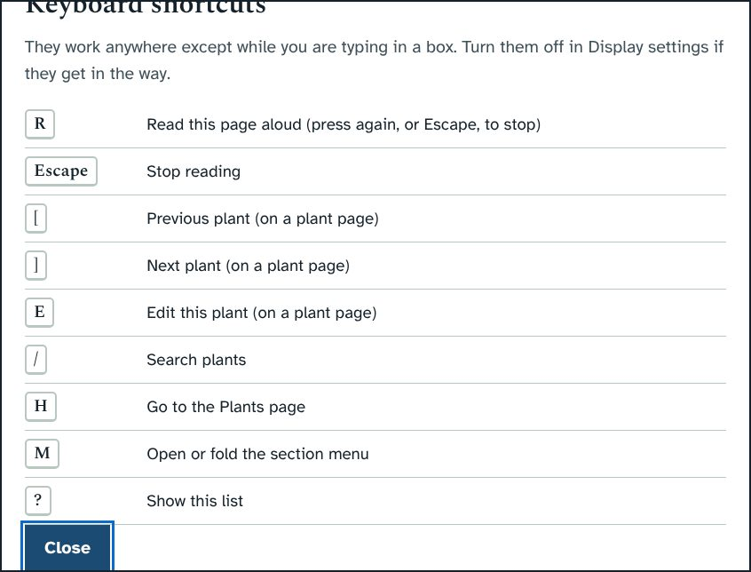
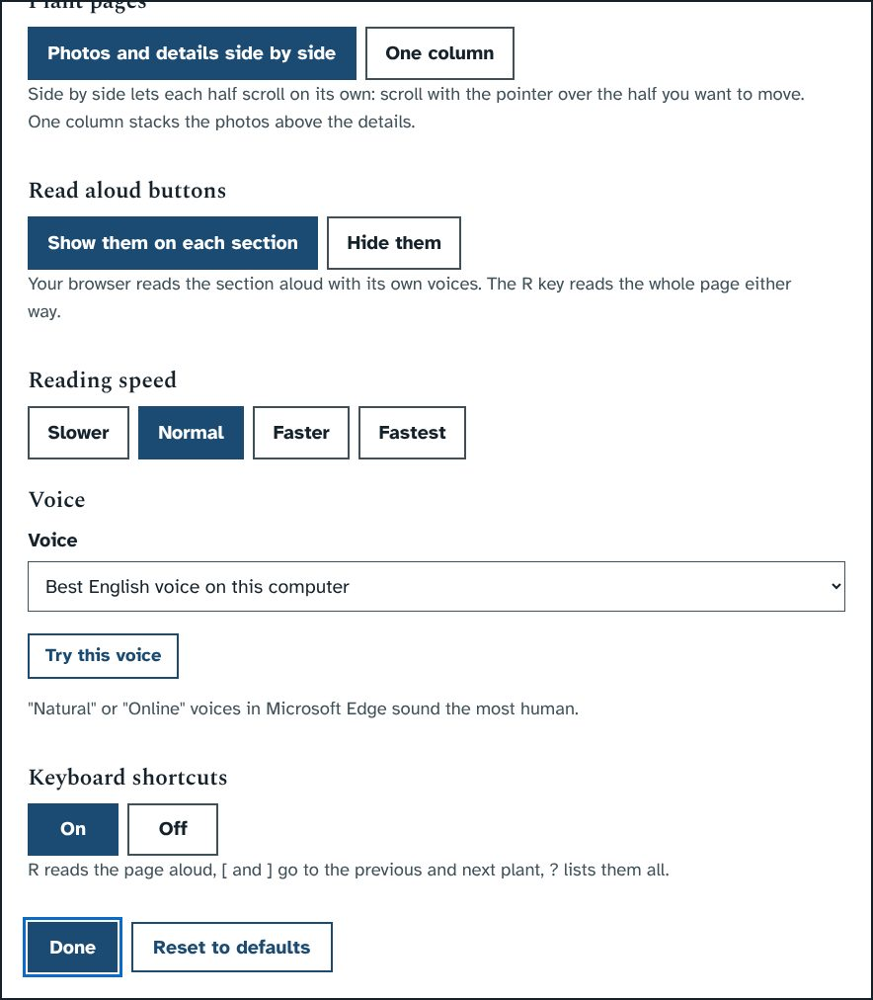
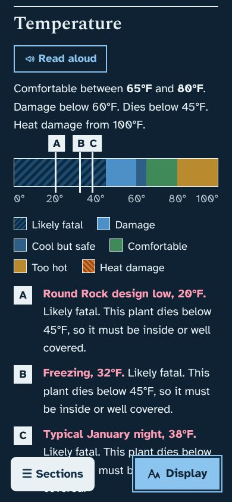

# Prototype: read aloud, keyboard shortcuts, and a top bar that scrolls away on phones

## What it does
- **Read aloud.** Every section has a **Read aloud** button: Temperature, Light, Water and soil, Needed from you, and the sections on the Winter plan, Weather and Fertilizer pages too.
  - Your browser reads the section in its own voice, and the section gets a dashed outline while it is read.
  - The button changes to **Stop reading**, and a big Stop reading button stays at the bottom of the screen.
  - **Read this page aloud**, under the page title, reads the whole page. On a plant page that is the details half.
  - The reading skips buttons, menus and the coloured bars, and says things the way you would:
    - "P 0 3 1" instead of "P minus 31"
    - "45 degrees" instead of "45 °F"
    - "3 to 4 hours" instead of "3-4 h"
    - "micromoles per square metre per second" instead of "umol/m2/s"
- **Display settings** has three new choices:
  - **Read aloud buttons:** show or hide them.
  - **Reading speed:** slower, normal, faster or fastest.
  - **Voice:** any English voice your browser has, with **Try this voice**. In Microsoft Edge, the "Natural" voices sound the most human.
- **Keyboard shortcuts.** They do nothing while you are typing in a box, and Display settings can turn them off.

  | Key | What it does |
  |---|---|
  | **R** | Read this page aloud |
  | **Escape** | Stop reading |
  | **[** and **]** | Previous and next plant |
  | **E** | Edit this plant |
  | **/** | Search plants |
  | **H** | Go to the Plants page |
  | **M** | Open or fold the section menu |
  | **?** | List the shortcuts |
- **Phones: the top bar scrolls away.** On a phone the menu bar used to stay pinned and cover about a third of the screen. Now it scrolls off with the page. Scroll up to reach it, and the Sections and Display buttons stay at the bottom as before.

## Screenshots
| | |
|---|---|
|  |  |
|  |  |
|  | |

## What it changes in the database
Nothing. The reading speed, voice and on/off choices are kept in this browser, like the other Display settings.

## How it works (for whoever merges it)
- Uses the Web Speech API (`speechSynthesis`), which Edge and Chrome on Windows have. If a browser lacks it, the buttons and settings do not appear.
- `readableText()` walks the visible text of a section, skipping controls, gauges and closed folds, and `speakable()` rewrites units and plant codes. The text is read in short pieces, because some voices stop after about 15 seconds of one long piece.
- `addReadButtons()` runs after each page draws, beside `buildSideNav()`.
- New display preferences in `prefs.js`: `readbtns`, `rate`, `voice` and `keys`.
- The phone top bar: `navLayout()` sets `--top-h` to 0 on narrow screens, and CSS makes `.top` static there.
- Test: `dev/test/read_check.py` replaces the voice with a recorder. It checks what would be said, every shortcut, shortcuts staying off while typing, the setting that turns them off, and the phone top bar scrolling away.

## Questions for Ethan
1. Do you use a screen reader or screen magnifier as well? If you use a screen reader, the read-aloud buttons may be less useful than better headings and labels, and I'd tune for that instead.
2. Is the reading speed range right (slower 0.8× to fastest 1.5×)?
3. Should **R** start from the section you are looking at rather than from the top?
