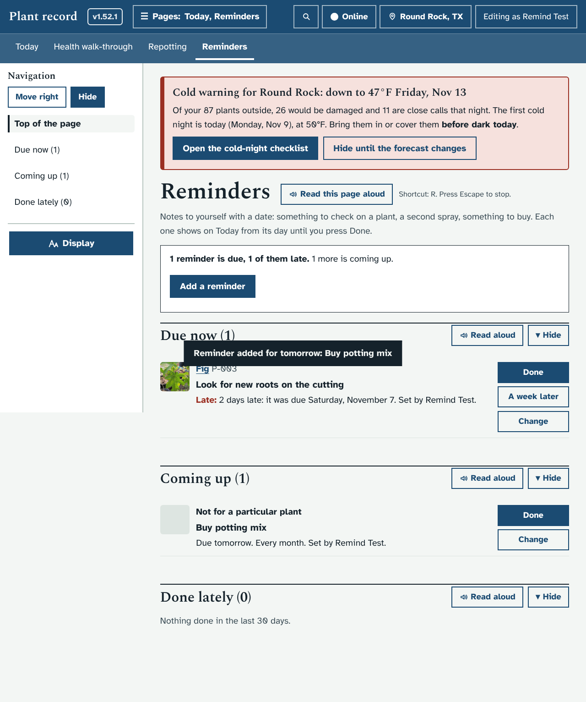
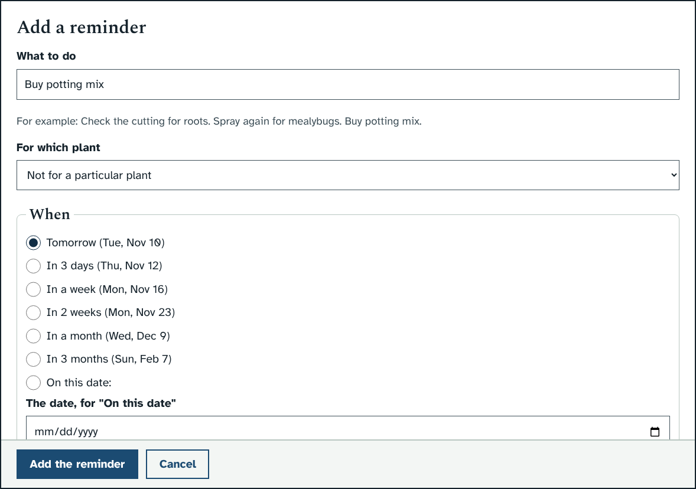
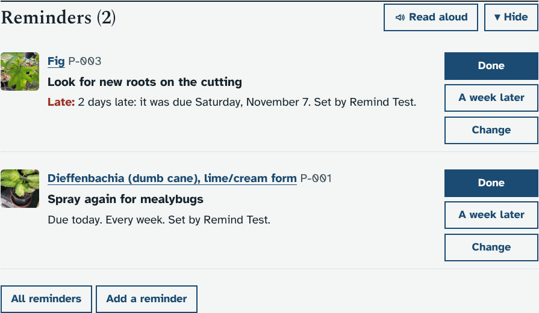
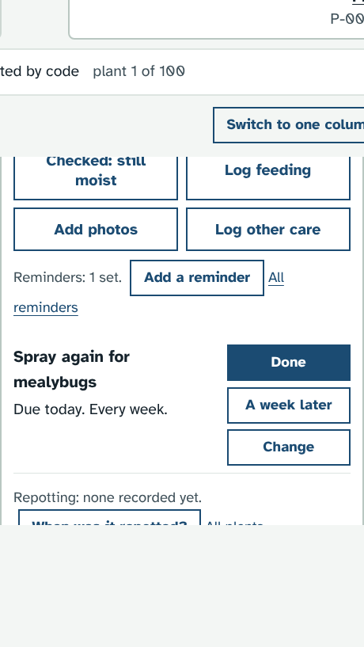
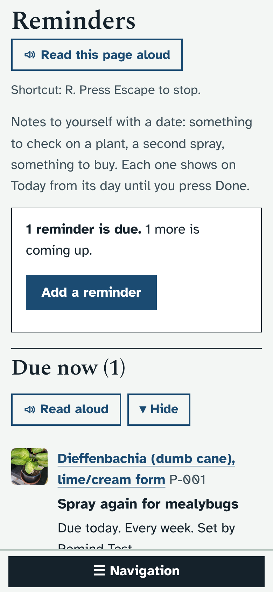
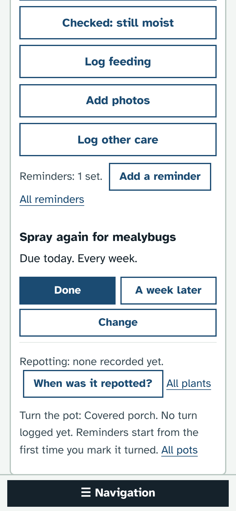
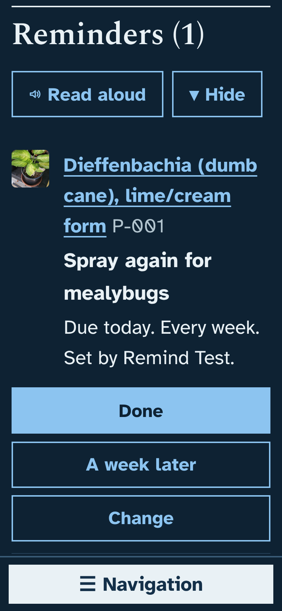
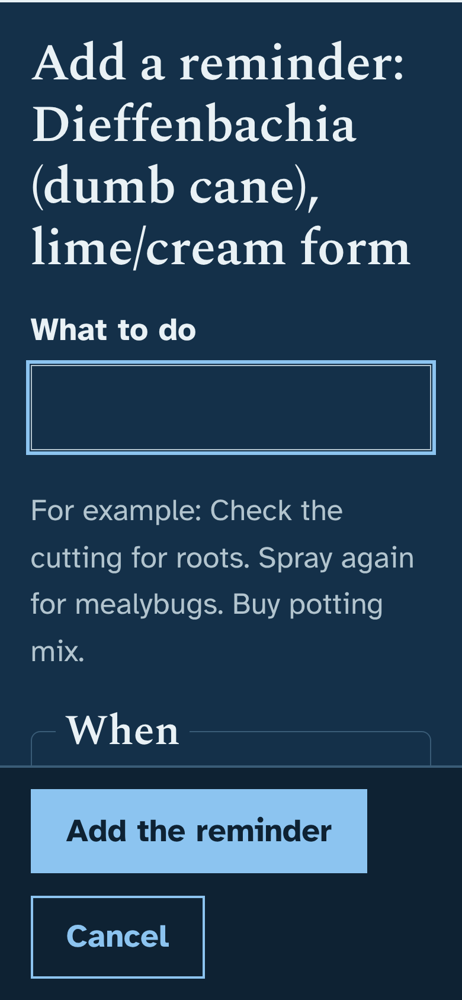

# Prototype: your own reminders

## What it does and why
The app already reminds you about watering, feeding, cold nights, turning the pots and repotting, because it can work those out. What it cannot work out is everything else you think of while standing next to a plant: "check this cutting for roots in two weeks", "spray again for mealybugs in 5 days", "this one looked droopy, look again on Friday", "buy potting mix". Today those go on paper or in your head. This lets you write them into Plant record, so they turn up on Today on the right day, next to everything else.

The ideas list had nothing left that was not done or in progress, so this one is suggested by Claude.

- **A new page, Reminders** (Today → Reminders, after Repotting). It has:
  - one line saying how many are due (and how many of those are late), with **Add a reminder**;
  - **Due now**: today's and any late ones, each with **Done**, **A week later** and **Change**;
  - **Coming up**: the ones set for later;
  - **Done lately**: the last 30 days, with **Not done yet** to put one back.
- **Add a reminder** opens a window with:
  - **What to do** (a short sentence, up to 200 letters);
  - **For which plant** (from the Reminders page or Today: any plant at this home, or **Not for a particular plant**; from a plant's page it is for that plant);
  - **When**: Tomorrow, In 3 days, In a week (chosen to start with), In 2 weeks, In a month, In 3 months, each with its date, or **On this date**;
  - **Repeat**: does not repeat, or every week, 2 weeks, month, 2 months, 3 months, 6 months or year.
- **Repeating** reminders come back that long after the day you press **Done**, not after the day they were due. So "Spray again every week" done two days late still waits a full week before the next spray.
- **On Today:** a **Reminders** section and a **Reminders (N)** jump button, only when something is due. A reminder stays on Today from its day until you press Done; once its day has passed it says **Late:** and how many days, in words (not only in red).
- **On a plant's page:** a line under the care buttons, "Reminders: none set." or "Reminders: 2 set.", with **Add a reminder** for that plant and the plant's reminders listed under it.
- **Change** lets you edit the words, move the date, change the repeat, or **Remove it** (after asking).
- Every reminder added, moved, done, put back or removed goes in the **Audit log**, against the plant it is for, so a plant's reminders also show in its Timeline. People who can only view see the reminders but not the buttons. Reminders follow the home you are looking at: a plant's reminder goes with the plant, and one for no plant stays with the home it was written at.
- Search finds the page ("Reminders").

## How it looks
Laptop, the Reminders page (one late reminder for a plant, one for no plant coming up tomorrow):

The Add a reminder window:

On Today:

On a plant's page, under the care buttons:

Phone, light, the page and a plant's page:

 

Phone, dark mode, largest text: Today and the window (nothing scrolls sideways):

 

## How to try it
- Windows cmd.exe: `set "DATA_DIR=dev\tmp\data" && python dev\test\mock_server.py`
- PowerShell: `$env:DATA_DIR='dev\tmp\data'; python dev\test\mock_server.py`
- bash: `DATA_DIR=dev/tmp/data python3 dev/test/mock_server.py`

Then open http://127.0.0.1:8080/#/reminders. The focused check is `python3 dev/test/reminders_check.py` (or `python3 dev/test/run_checks.py reminders`), and the unit tests are in `dev/test/unit/test_reminders.py`.

## What it changes in the database
- **One new table, `plant_reminders`**, created the first time the app needs it (`CREATE TABLE IF NOT EXISTS`). Nothing else in the database changes, no existing table gets a column, and nothing happens to your plants when you upgrade. If you never add a reminder, the table stays empty.
- Done and removed reminders are kept in the table (marked, not deleted), so **Not done yet** and the Audit log work. The one exception: "Not done yet" on a repeating reminder deletes the next one it made, as long as nobody has changed it.
- New Audit log entries, under "Feeding, watering and care".
- Backups include it like any other table. It is not yet in **Download all data (JSON)** (see the questions).

## Open questions for Ethan
1. **Phone notifications.** Should a reminder also send a notification to your phone on its morning (like the cold-night ones), or is Today enough? It would be a new choice under Notifications.
2. **Offline.** Right now a reminder can only be added or ticked off while the app can reach your PC. Should Done work offline from the garden, like Watered does, and be sent later?
3. **Plant-sitter sheet.** Should reminders due while you are away appear on the sitter sheet as one more thing to do?
4. **"A week later"** is the one quick way to put a reminder off. Would "Tomorrow" be more useful there, or both?
5. **Download all data (JSON)** and the calendar file: should reminders go in them too?
6. The Today block sits after Repotting and before Needed from you. Would you rather have it near the top, before Water?

Reply on this pull request with changes, or say "merge" when you are happy.
