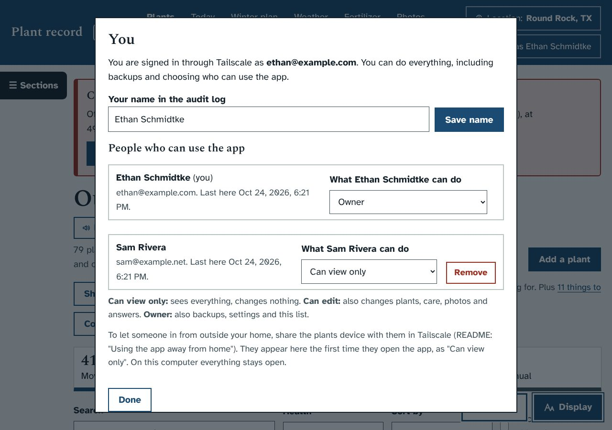
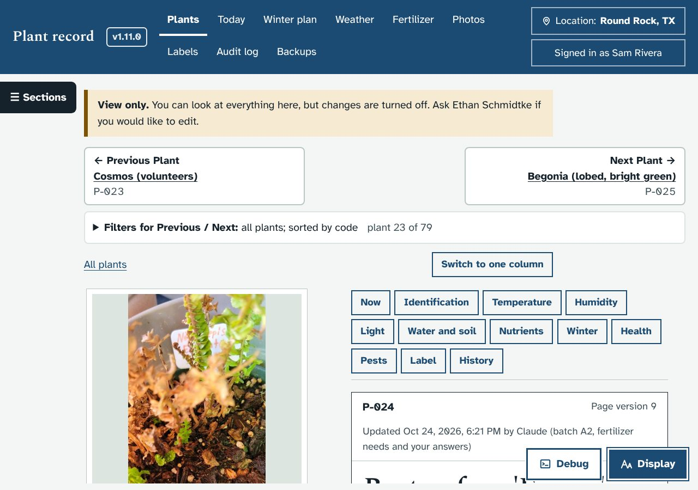
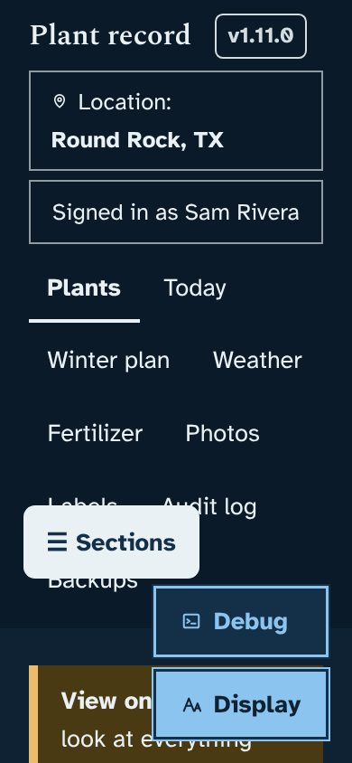

# Using the app away from home, and sharing it (1.12.0)

Asked for by Ethan on October 24, 2026. He wanted to use the app away from home and share it with his long-distance girlfriend, while keeping it secure. He already used Tailscale, the app was http only, and Docker was warning about security updates. He chose the recommended setup: keep Tailscale, but give the app its own device.

## What it does
- **Its own Tailscale device.** A `tailscale` container (`tailscale/tailscale:stable`, userspace networking, no extra privileges) joins Ethan's tailnet as **plants**.
  - Tailscale Serve answers `https://plants.<tailnet>.ts.net` with a real certificate and passes each visit to the app. Funnel is off.
  - The router is untouched, and nothing is open to the internet.
- **Closed to the home network.** The app's own port (8080) is published on 127.0.0.1 only, for the updater, backups and a browser on the PC. `PLANTDB_BIND=0.0.0.0` in `.env` opens it again, with the README's warning and the optional password.
- **Sign-in by Tailscale.** Serve adds `Tailscale-User-Login`/`-Name` and strips any copies the visitor sends. Those headers are trusted only on port 8081, which only the Tailscale container can reach. The audit log names people by their Tailscale account.
- **Roles**, enforced by the server on every request:
  - **Can view only**: everyone starts here. They get a "View only" note, change buttons are hidden, and menus that save straight away are switched off.
  - **Can edit**: can make changes.
  - **Owner**: also backups, settings and the people list.
  - Press your name at the top right to see the list and change roles. There is always at least one owner.
- **Sharing.** Share the plants device in Tailscale. The other person reaches only the plant app, not Ethan's PC.
- **Sensors.** Port 8082 takes only `POST /api/readings` with the token. It is shut unless `PLANTDB_SENSOR_BIND=0.0.0.0` is set.
- **Container hardening:**
  - user 10001 instead of root
  - `read_only`, tmpfs `/tmp`, `cap_drop: ALL` and `no-new-privileges`
  - The updater now builds with `--pull` and fetches the newest Tailscale image.
  - 1.12.0: if the data folder wasn't writable for the new user, the app printed `PLANTDB_NOT_WRITABLE`, and the updater wrote `docker-compose.override.yml` to run it the old way.
  - 1.12.1: the container starts as root, and `app/start.py` switches to user 10001 only when that user can write to the data folders; otherwise it stays root. On Ethan's PC (Windows bind mounts written by older root-run versions) it stays root. The updater removes the 1.12.0 override file.
- **Set Up Remote Access** (`tools\Set Up Remote Access.cmd`):
  - starts the containers and opens Tailscale's sign-in page
  - checks that HTTPS certificates are on (and opens the DNS page if not)
  - makes the signed-in account the owner
  - warms up the certificate
  - offers to point label QR codes at the new address
  - lists the next steps: phone, key expiry, sharing.

## Screenshots
| | |
|---|---|
|  |  |
|  | |

## What it changes in the database
One new table, `people` (login, name, role, first seen, last seen). It is created on start. Nothing else changes.

## Tests
- `dev/test/access_check.py` covers:
  - roles, owner-only areas, and spoofed headers on the local port
  - other websites' requests
  - the sensor port, the audit names and the people window
  - view-only pages and phone width
- `dev/test/remote_setup_check.sh` runs the setup script with a fake `docker` and scripted Tailscale states: not signed in, HTTPS off, already set up, and an old folder.
- `dev/test/updater_check.sh` gains two checks:
  - The updater pulls fresh images.
  - The permission fallback works, and the release has the Tailscale config but no sign-in state.
- What can't be tested in the sandbox: the real Docker image build, and the Tailscale container itself (Docker Hub is not reachable). `docker compose config` passes.
