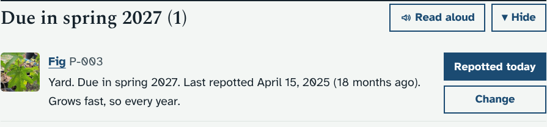
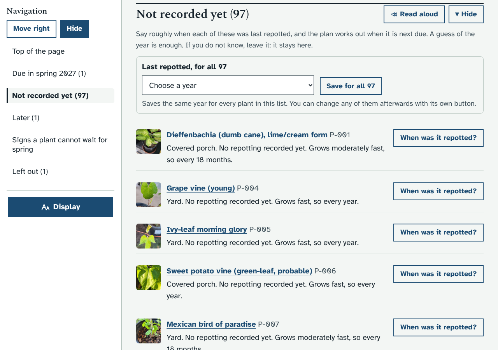
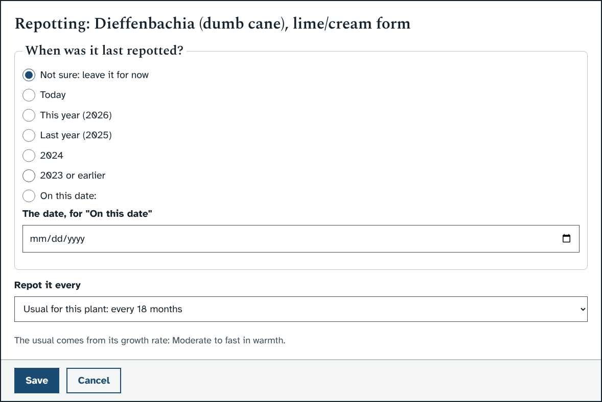
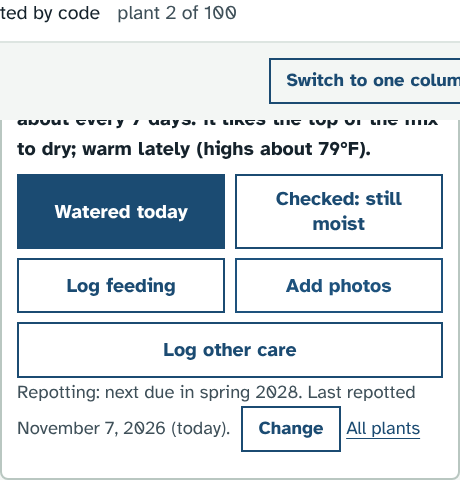
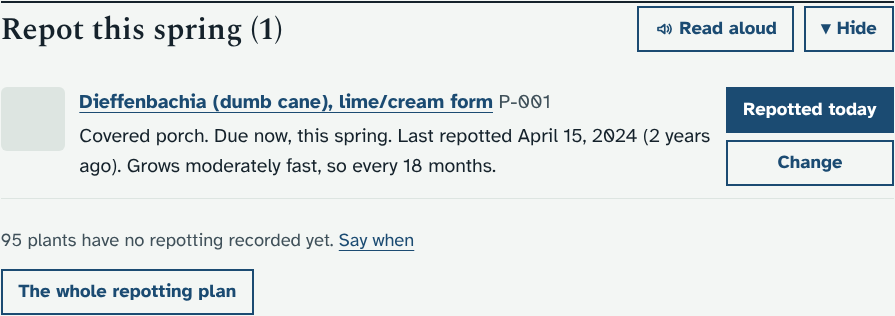
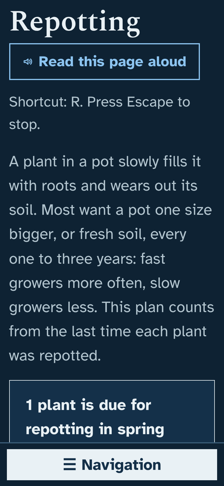
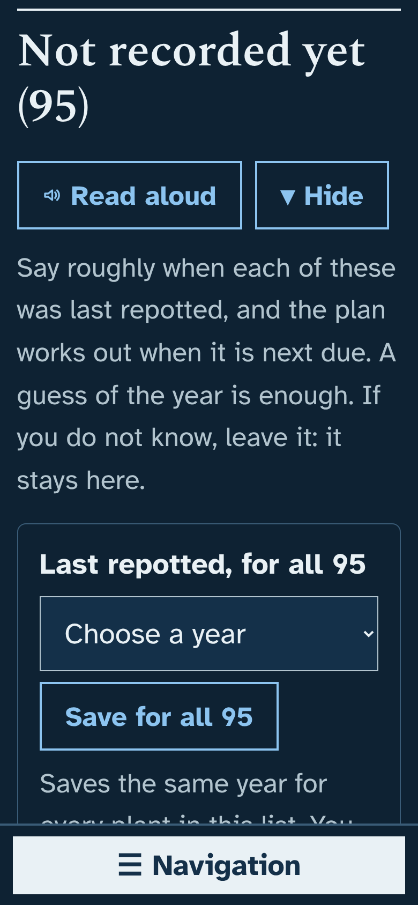
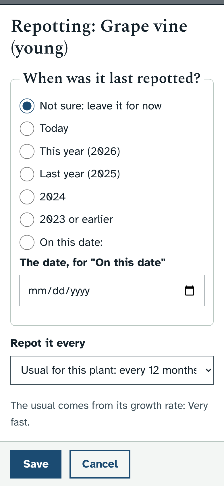

# Prototype: repotting plan

## What it does and why
A plant in a pot slowly fills it with roots and wears out its soil. Most potted plants want a pot one size bigger, or fresh soil, every one to three years, and the best time is spring, as they start to grow. With about 80 plants it is hard to remember which ones were repotted when. The app already lets you log "Repotted" in a plant's care log, but nothing uses it yet. This turns those entries into a plan for the spring.

- **A new page, Repotting** (Today → Repotting, beside the Health walk-through). It has:
  - one line saying how many plants are due, and whether it is repotting season now (March to May) or when it starts;
  - **Due in spring 2027** (or **Due this spring** in season), with **Repotted today** and **Change** for each plant;
  - **Not recorded yet**: plants with no repotting in the log. **When was it repotted?** on each one, and **Save for all** to give every plant in the list the same rough year in one go;
  - **Later**: plants not due until a later spring;
  - **Signs a plant cannot wait for spring** (roots out of the drainage holes, water running straight through, and so on), and short steps for when you repot;
  - **Left out**: plants that grow in water, and plants you switched off.
- **How often** comes from each plant's growth rate (About this plant): fast growers every year, moderately fast every 18 months, moderate every 2 years, slow growers every 3 years. If the growth rate is empty it uses 2 years. You can choose 12, 18, 24 or 36 months, or no reminders, for any plant.
- **When it is due:** the plan counts from the last "Repotted" in the care log (and "Repotted in fresh soil" from the coming-inside checklist). A plant due by the end of August is put in that year's spring, a few months early, rather than waiting a whole year. One due from September on waits for the next spring.
- **When was it repotted?** opens a window with: Not sure (leave it), Today, This year, Last year, two years ago, three or more years ago, or an exact date, plus **Repot it every** for how often. A year is saved as April 15 of that year with the note "Date estimated: some time in 2025", so you can tell it was a guess.
- **On a plant's page:** a line under the care buttons, for example "Repotting: next due in spring 2028. Last repotted November 7, 2026 (today)." with **Change**.
- **On Today:** a **Repot this spring** section with the plants due and a **Repot (N)** jump button, from four weeks before the season starts (February) until the end of May. The rest of the year Today says nothing about repotting.
- Each repotting shows the usual **Undo** message. People who can only view see the plan but not the buttons.

## How it looks
Laptop, the plants due (the plan in November looks ahead to spring 2027):

Not recorded yet, with Save for all:

The window for one plant:

On a plant's page:

Today in repotting season (pictured by pretending it is spring; in November it does not show):

Phone, dark mode, largest text (nothing scrolls sideways):

 

Phone, the window:

## How to try it
- Windows cmd.exe: `set "DATA_DIR=dev\tmp\data" && python dev\test\mock_server.py`
- PowerShell: `$env:DATA_DIR='dev\tmp\data'; python dev\test\mock_server.py`
- bash: `DATA_DIR=dev/tmp/data python3 dev/test/mock_server.py`

Then open http://127.0.0.1:8080/#/repotting. The focused check is `python3 dev/test/repotting_check.py` (or `python3 dev/test/run_checks.py repotting`), and the unit tests are in `dev/test/unit/test_repotting.py`.

## What it changes in the database
- No new tables or columns, and nothing changes when you upgrade.
- Each repotting is a row in `care_log` with kind `repot` (the kind that already exists in Log other care).
- One key in `settings`, written only when you choose how often for a plant: `repot_choice` (plants with their own number of months, or switched off). Changes are in the Audit log.

## How it is built
- `app/plantdb/repotting.py`: `repot_auto()` (how often, from the growth rate), `repot_season()`, the pure `repot_plan()` (unit tested), `repot_report()`, and `GET/PUT /api/repotting`. A PUT is refused for viewers automatically.
- `app/static/js/repotting.js`: the page, the window, Save for all (a form, so moving through the year list with the arrow keys saves nothing), a wrapper round `viewToday()` for the Today section and one round `loadCarePlant()` for the line on a plant's page, so `care.js` is not edited. It adds itself to the Today row of the top bar (not Care: a ninth page there makes that row wrap to two lines on a laptop, and the taller bar stops the Grow lights summary staying at the top).
- Small additions, each placed so it merges cleanly with the other open pull requests (frost dates and the 1.44.0 release): its own lines in `server.py` and `sw.js` (not the shared lists), the script in `index.html`, one route line in `core.js`, a CSS block at the end of `style.css` (including the viewer rule), and `repotting` in `run_checks.py`.

## Open questions for Ethan
1. **Are 12, 18, 24 and 36 months about right** for fast, moderately fast, moderate and slow growers? Cacti and most succulents come out as slow (every 3 years).
2. **Are any of your plants in the ground** rather than in pots (the Yard plants, the grape vine)? I can leave out plants in the ground if there is a way to tell, or you can switch them off one by one with **No reminders**.
3. **Is March to May the right season** for you in Round Rock? Some people also repot in early fall (September and October).
4. **Do you remember roughly when most plants were last repotted?** If most were done in the same year, **Save for all** fills that in for all of them at once, and you can fix the odd one afterwards.
5. **Where should Repotting go in the top bar?** It is in the Today row, beside the Health walk-through. In the Care row it would make that row wrap to a second line on a laptop. If you would rather have it under Care, I can take out a page from that row or let the row wrap.
