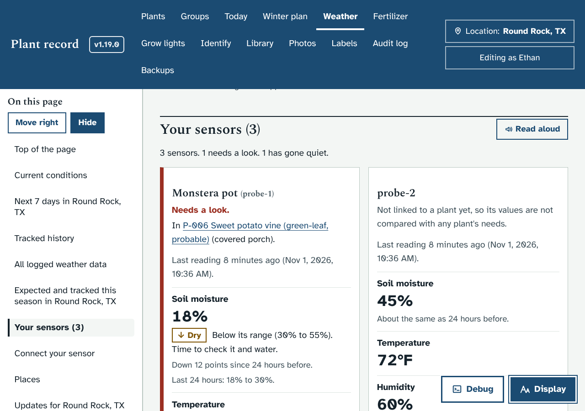
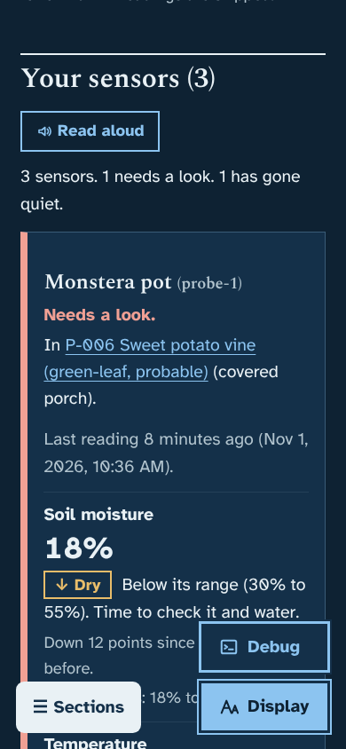
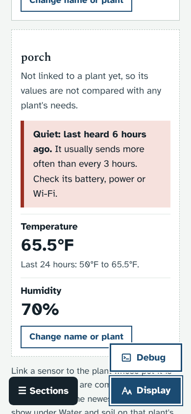
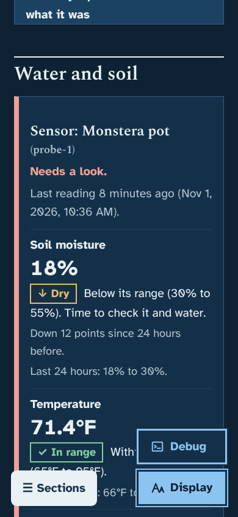
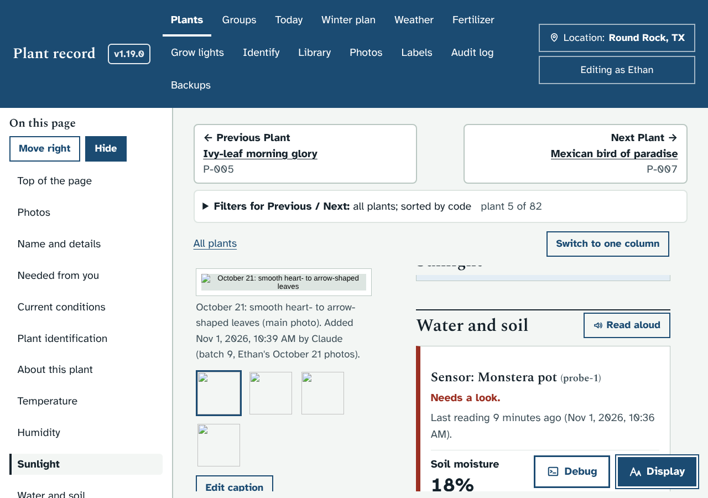
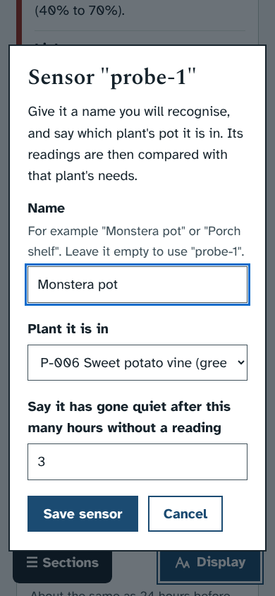

# Prototype: Your sensors at a glance

Branch: `proto/sensor-dashboard`

## What it does and why
The app already takes readings from your own sensors, but they only show up mixed into the weather charts and tables. This prototype gives each sensor its own card, so you can see at a glance whether a pot needs water and whether a sensor has stopped sending.

- **"Your sensors" on the Weather page**, just above "Connect your sensor". It is in the On this page menu.
  - One card per sensor, with its newest values in large type: soil moisture, temperature, humidity, light now, root-zone temperature and soil pH (whichever it sends).
  - Under each value: the lowest and highest in the last 24 hours. For soil moisture it also says how much it went up or down since about a day before ("Down 12 points since 24 hours before").
  - **Daily light** for the last 24 hours, worked out from the light readings once at least 18 of the 24 hours have one.
  - A line at the top counts them: "3 sensors. 1 needs a look. 1 has gone quiet." Sensors that need a look come first.
- **Link a sensor to a plant.** "Change name or plant" lets you:
  - give it a name you will recognise ("Monstera pot" instead of "probe-1"),
  - choose the plant whose pot it is in,
  - say after how many hours without a reading it counts as quiet (3 to start with).
- **Once it is linked**, each value is compared with that plant's ranges, in words with a mark, never colour alone:
  - "✓ In range", "↓ Dry. Below its range (30% to 55%). Time to check it and water.", "↑ Wet", "Cool", "Warm", "Dry air", "Humid", "Too dim", "Too bright".
  - "! Too cold" when the temperature is below the plant's damage point.
  - The card gets a red edge and "Needs a look."
- **Quiet sensors.** When nothing has arrived for longer than its quiet hours, the card says "Quiet: last heard 6 hours ago. Check its battery, power or Wi-Fi." Its border turns dashed.
- **On the plant's page**, the same card appears at the top of "Water and soil", as "Sensor: Monstera pot". Plants without a sensor look the same as before.
- People who can only view see the cards but not the "Change name or plant" button.
- Every change is in the audit log (kind "Settings and backups"), as `Sensor "probe-1" set up`, with the before and after.

## How it looks
Weather page on a laptop, light theme (one sensor dry and in a plant, one unlinked, one quiet):



On a phone, dark theme, and a quiet sensor in light:

 

On the plant's page, under Water and soil:

 

The window for naming and linking a sensor:



## How to try it
With the app running from this branch, send a few readings from this computer. Get the token from Weather, Connect your sensor, and put it in place of TOKEN.

Windows (cmd.exe):
```
curl -X POST http://localhost:8082/api/readings -H "X-Ingest-Token: TOKEN" -H "Content-Type: application/json" -d "{\"device\":\"probe-1\",\"soil_moisture\":22,\"temp_f\":71,\"humidity\":48}"
```
Windows (PowerShell):
```
Invoke-RestMethod -Method Post -Uri http://localhost:8082/api/readings -Headers @{"X-Ingest-Token"="TOKEN"} -ContentType "application/json" -Body '{"device":"probe-1","soil_moisture":22,"temp_f":71,"humidity":48}'
```
bash:
```
curl -X POST http://localhost:8082/api/readings -H "X-Ingest-Token: TOKEN" -H "Content-Type: application/json" -d '{"device":"probe-1","soil_moisture":22,"temp_f":71,"humidity":48}'
```
Then open Weather, press "Change name or plant" on probe-1 and pick a plant.

Tests: `dev/test/sensors_check.py` (with `dev/test/mock_server.py` running) sends two days of made-up readings from three sensors and checks the API, both pages at phone and laptop width in light and dark, the window with the keyboard, saving and the audit log.

## What it changes in your database
- One new table, `sensor_devices` (the sensor's name, its plant, and its quiet hours). It is made the first time the sensors are looked at, with `CREATE TABLE IF NOT EXISTS`, so an existing database upgrades in place and running it again changes nothing.
- Your readings are not changed. If you never link a sensor, the table stays empty.

## Open questions for you
1. Should a dry pot also go on the **Today** page (for example "Monstera pot: soil 18%, below its range"), or is the card on the Weather page and the plant page enough?
2. When a sensor is linked to a plant, should that plant's **Current conditions** use that sensor instead of the newest reading from any sensor?
3. Is **3 hours** a good starting point for "gone quiet"? A battery sensor that sends every hour might want 2; one that sends twice a day needs 13 or more.
4. Would you like a **page of its own** (in the top menu) instead of a section on the Weather page? That means one more link in the menu.
5. What sensors are you planning to use? If they send something other than the fields above (for example a battery level), the cards can show that too.
