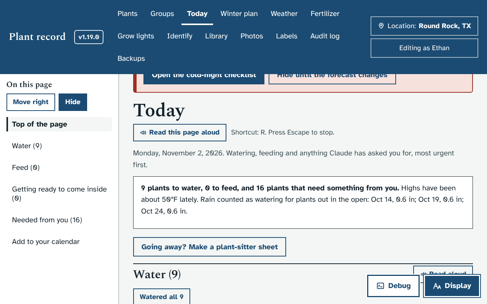
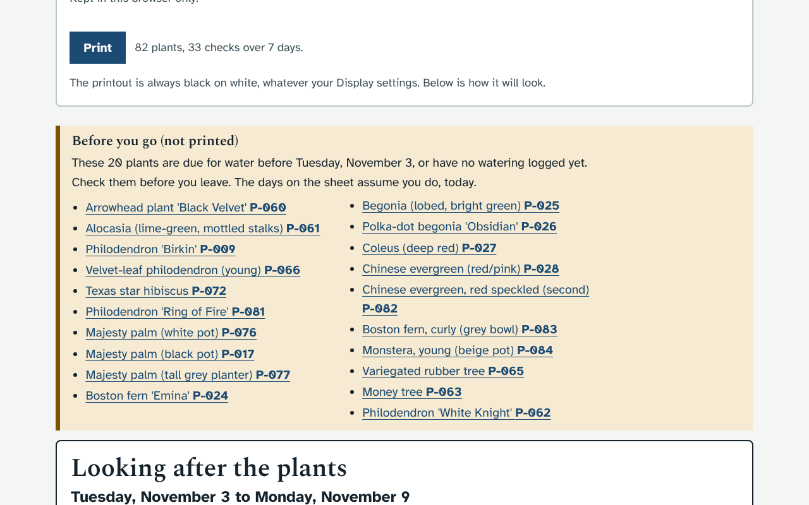
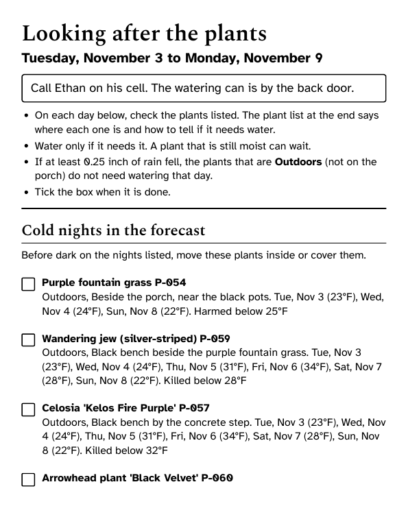
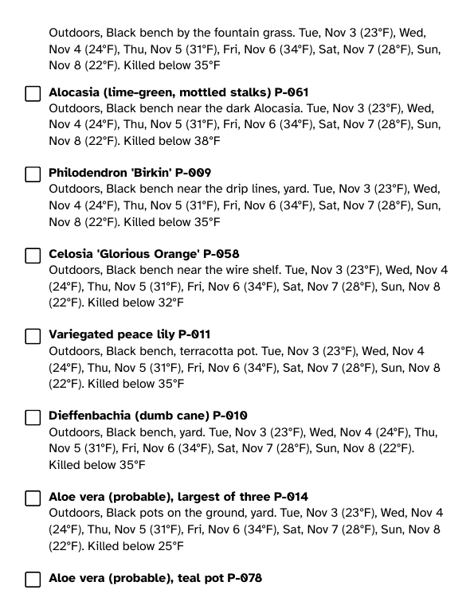
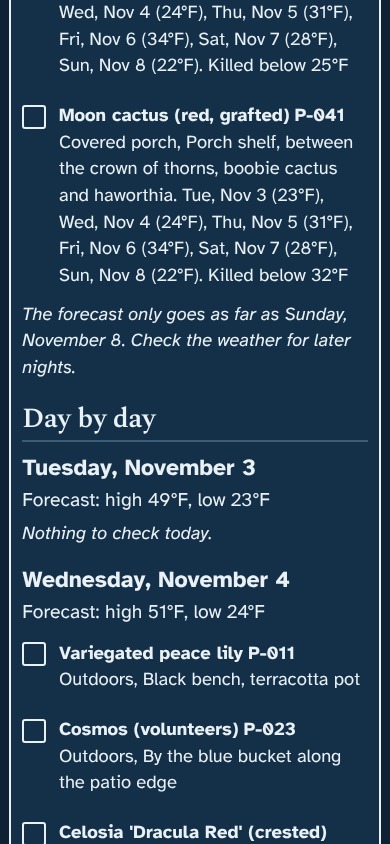
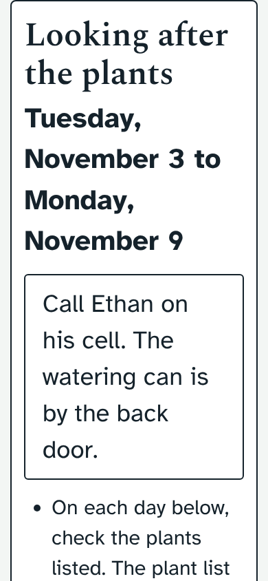

# Prototype: plant-sitter sheet

## What it does
A printable plan for someone looking after your plants while you are away. You choose the days you will be gone, and it lists, day by day, which plants to check for water, where each one is, and how to tell if it needs it. It also lists any cold nights in the forecast and which plants to bring in or cover.

It uses the same watering reminders as the Today page (each plant's "check every N days", the recent weather and your care log), carried forward over the days you are away. So it is the plan you would follow yourself, written down for someone who doesn't know the plants.

This idea was suggested by Claude: the ideas list had nothing left that wasn't already being built.

- **Where to find it:**
  - On **Today**, under the summary box: **Going away? Make a plant-sitter sheet**.
  - On a group's page: **Plant-sitter sheet for this group**.
- **Choices, above the sheet** (remembered in this browser):
  - **First day** and **Last day** (up to 6 weeks).
  - **Which plants:** all plants, or one of your groups (for example, to leave out the plants someone else looks after).
  - **Also show:** a photo of each plant, and the plant list at the end.
  - **Note for the sitter:** printed at the top, for example how to reach you and where the watering can is.
  - **Print** opens your browser's print window.
- **Before you go (on screen only, not printed):** the plants that are due before your first day away, or have no watering logged yet. The sheet assumes you check these the day before you leave.
- **The sheet:**
  - The dates, your note, and four short instructions: check the plants listed each day, water only if it needs it, plants that are **Outdoors** can skip a day after 0.25 inch of rain, and tick the box when done.
  - **Cold nights in the forecast:** one line per plant that is outside, with the nights it is at risk, the low for each, and the temperature that harms or kills it. If the trip goes past the end of the forecast, it says so.
  - **Day by day:** each day, with the forecast high and low when there is one, and a tick box for every plant to check. The plants are in walking order: Outdoors first, then the covered porch, indoors and the garage, grouped by spot.
  - **The plants:** each plant's photo, where it is, how often to check it and on which days, the first two sentences of its watering notes, and (for plants outside) the temperature that harms it.
- **The printout** is black on white whatever your Display settings, large print (about 15.5 point and up), with the choices and "Before you go" left off. On screen it follows your Display settings and works at phone width with the largest text, with no sideways scrolling.

People who can only view the app can make and print the sheet too, because it changes nothing.

## Screenshots
| | |
|---|---|
|  |  |
|  |  |
|  |  |

The test data has a deliberately cold week, so the cold-night list is long. The photos are missing in the test copy only.

## How to try it
1. Open **Today** and press **Going away? Make a plant-sitter sheet**.
2. Choose your first and last days away, and the plants.
3. Type a note for the sitter if you like, then press **Print**. Your browser's print window lets you pick the printer, or "Save as PDF" to send it by email or text.

## What it changes in your database
Nothing. The sheet only reads what is already there: no new tables or columns, and no upgrade batch. Your note and choices are kept in the browser you made the sheet in.

## How it is built
- `app/static/sitter.html` and `app/static/sitter.js` make a page of their own (`/sitter.html`, or `/sitter.html#group=3` from a group page), so the printout carries nothing but the sheet. Same `style.css` and Display settings, and no inline scripts.
- `server.py` has one new read-only route, `GET /api/sitter?from=&to=[&group=]`, in its own block after `/api/water`. It runs `water_report()` and repeats each plant's interval from its next check across the dates, takes the cold nights from `frost_report()` and the forecast highs and lows. It refuses dates in the past, a last day before the first, and more than 42 days, in plain words.
- `app.js` has one new block after `viewToday()`: a `MutationObserver` adds the link when Today or a group page draws, so `route()` and `viewToday()` are unchanged.
- `style.css` has one new block, headed "prototype proto/sitter-sheet", before the 1.9.0 block.
- Choices are stored in localStorage `plantdb.sitter`.
- Test: `dev/test/sitter_check.py` (start the mock server with `MOCK_BASE_F=40` for cold nights). It covers the API (one entry per day, the repeat interval, groups, refusals), both links, labels on every choice, the choices and remembering them, no sideways scrolling in light and dark at laptop, phone and largest-text sizes, and the printout (black on white, large print, choices left off). It saves a PDF to `dev/tmp/shots/sitter-print.pdf`.

## Open questions for Ethan
1. With all 82 plants and the plant list, the printout is long (in a cold test week it ran to over 40 pages). Would you rather the plant list be off to begin with, or shorter (no photos, one line each)?
2. Should "Before you go" assume you water those plants the day before you leave (as now), or the sheet start them on the sitter's first day?
3. Would you like the sheet to include feeding too? It leaves feeding out now, because most sitters only water.
4. Is a page per day better than days running on one after another? A page per day is easier to stick on the fridge but uses more paper.
