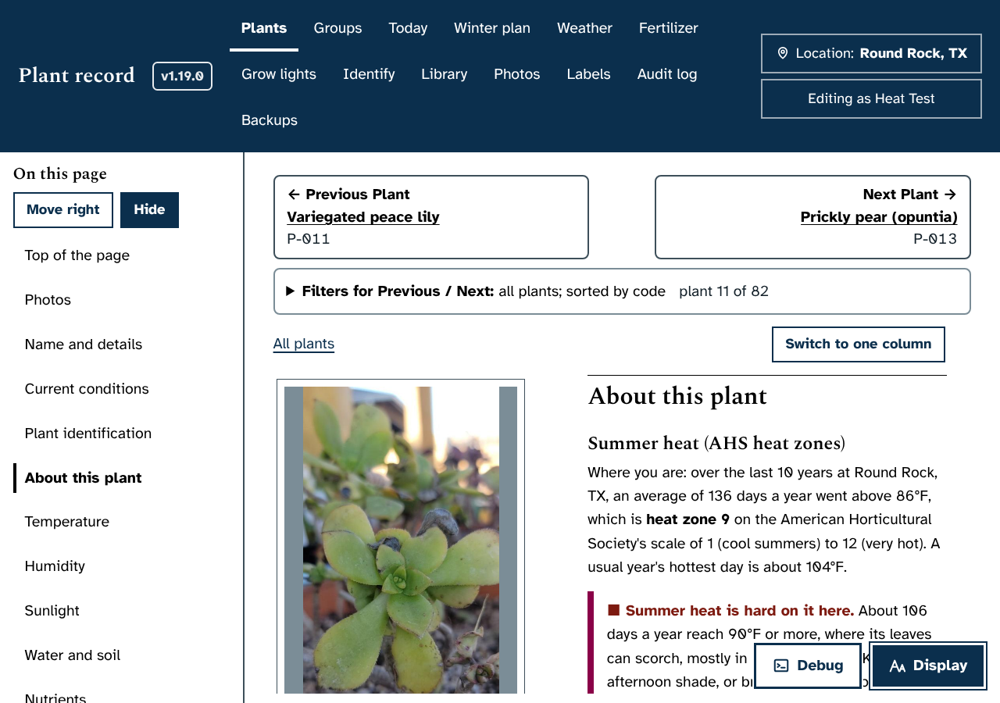
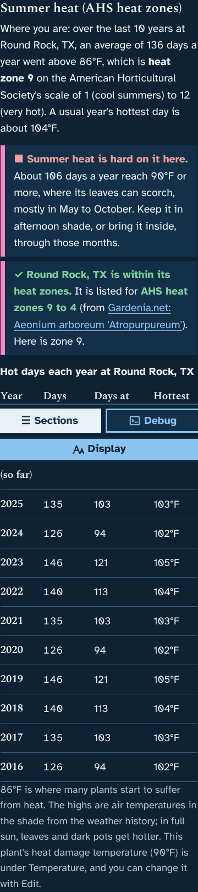
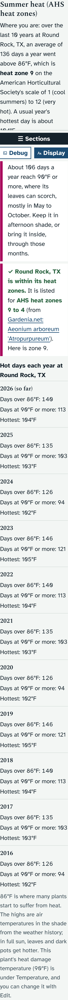
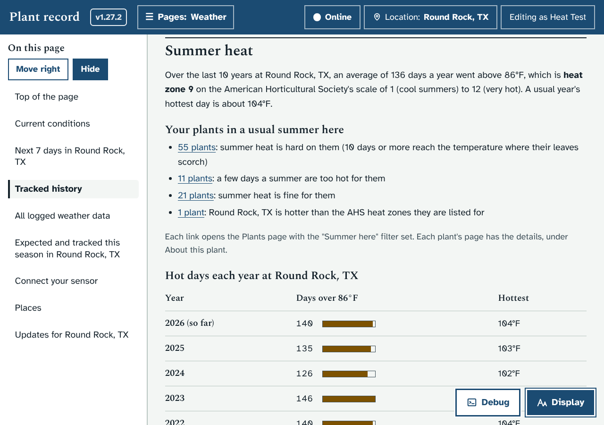
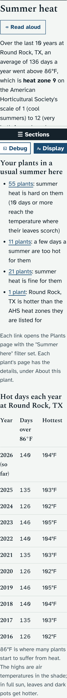

# Prototype: summer heat (AHS heat zones)

Branch `proto/summer-heat`.

## What it does and why
The USDA hardiness zone on About this plant says whether a plant survives a usual Round Rock **winter**. Many of your plants struggle in the **summer** instead. This adds a "Summer heat (AHS heat zones)" part right after the hardiness zones on every plant page:

- **Where you are.** From the weather history: how many days a usual year go above 86°F at the place in use, and the American Horticultural Society heat zone that gives (1 = cool summers, 12 = very hot), plus how hot a usual year's hottest day is.
- **What it means for this plant.** It uses the plant's own "Heat damage above" temperature (already filled in for every plant, under Temperature) and counts how many days a usual year reach it, and in which months:
  - "✓ Summer heat is fine for it here" when a usual year never gets that hot.
  - "▲ A few days a summer are too hot for it" (under 10 days): shade it on those afternoons.
  - "■ Summer heat is hard on it here" (10 days or more): afternoon shade or inside through those months.
  - For a plant that is indoors or in the garage, it adds that this matters when it goes outside.
- **Hot days each year.** A table of this year so far and the last 10 whole years: days over 86°F (with a bar on wide screens), days at the plant's damage temperature or more, and the hottest day.

Each verdict starts with a symbol and words, so nothing depends on colour. With very large text, the table turns into a short list per year so nothing scrolls sideways.

## Added after Ethan's review (November 3, 2026)
Ethan answered the four questions on the pull request: the heat-damage line is right; add a filter; add it to the Weather page; add heat-zone ranges to his plants.
- **Summer here filter** on the Plants page (under More filters, and in the Previous / Next panel): "Summer heat is hard on it", "A few days a summer are too hot", "Summer heat is fine for it", "Hotter than its heat zones" and "No summer verdict yet".
- **Weather page:** a "Summer heat" section before All logged weather data, with the heat zone, how many of your plants fall in each verdict (each count is a link to the Plants page with the filter set), and the hot-days table.
- **AHS heat zone range for each plant:** three new fields under About this plant in Edit (Heat zone, hottest; Heat zone, coolest; Heat zone source). The plant page says whether your place is within, hotter than or cooler than the plant's range, with the source link.
- **Upgrade batch B3** fills the range for 20 plants. It uses only ranges that a web page actually printed, and each one keeps its link. 18 come from Gardenia.net, a plant encyclopedia. After Ethan asked to keep looking, a second pass added the silver-striped wandering jew (12 to 7) and the 'Queen of Elegance' floribunda rose (9 to 3, from other floribundas) from Backyard Gardener. NC State, Missouri Botanical Garden, Texas Tech, Proven Winners and Monrovia list USDA hardiness zones only. The rest are left empty on purpose:
  - No range found anywhere: Dieffenbachia, Boobie cactus, fig, mustang grape, both morning glories, Mexican bird of paradise, Philodendrons, peace lilies, Aloe vera, hardy aloe, majesty palms, Graptosedum, desert rose, miniature roses, Boston ferns, Chinese evergreens, Calathea, moth orchid, ZZ plants, moon cactus, vanilla, arrowhead plants, Monstera, water hyacinth, the variegated Tradescantia (its species is not certain), Zexmenia, Texas star hibiscus, money tree, rubber tree and mini Monstera.
  - Found but not trusted: Bougainvillea (listed as 1 to 12, which looks like a placeholder for a frost-tender tropical), Celosia (listed as 2 to 9, which does not fit a heat-loving summer annual) and figs (listed as 1 to 1).
  - Ethan said to leave anything not found empty for him to fill in later, and to keep "hotter than its heat zones" separate from the heat-damage verdict.
  - Only a different species had a range: begonias, Alocasias and the agave (its species is not known yet).

## How it looks
Laptop, high contrast (Aeonium, heat damage at 90°F):



Phone, dark theme, the whole part:



Phone with the largest text (the table becomes a list):



Weather page, laptop:



Weather page, phone with the largest text:



The screenshots use made-up weather in the test copy, so the numbers are not Round Rock's real ones. Yours come from the weather history your app has already loaded.

## What it changes in your database
- Three new plant fields, added by `init_db()` on the next start: `heat_zone_high`, `heat_zone_low` and `heat_zone_source`. Nothing else in the table changes.
- Upgrade batch B3 fills them for 18 plants, once, and only while they are still empty, so anything you type yourself stays.
- Everything else only reads the daily weather history and each plant's heat-damage temperature. If a place has under 3 whole years of history, it says so and links to the Weather page.

## How it works (for Claude)
- `server.py`, block "prototype proto/summer-heat" after `place_climate()`: `ahs_heat_zone()`, `place_highs()` (cached 6 hours per place), `place_heat()` and `GET /api/heat[?above=F][&loc=ID]`. Whole years have 330 or more days of highs; the zone needs 3 whole years. "Above 86°F" is strictly above, as the AHS defines it; the plant count is "at or above" its damage temperature.
- `app.js`, block after `aboutBlock()`: a MutationObserver puts `#heat-box` after the hardiness zones and fills it (`loadHeat()`, `heatBlock()`, `heatVerdict()`, `heatTable()`, `heatFit()`). No edits to shared code.
- `style.css`: its own block after the 1.14.0 block.
- `GET /api/heat/plants[?loc=ID]` (`plants_heat()`, `heat_level()`, `heat_zone_fit()`): every active plant's verdict and range fit, for the filter and the Weather page.
- Plant fields `heat_zone_high`, `heat_zone_low` (`INT_RANGES` 1 to 12) and `heat_zone_source` (`Title | URL`). Batch B3 is built by `dev/seed_src/build_batchB3.py`.
- Front end: `heatRange()`, the `heat` key in `MORE` / `MORE_KEYS` / `moreOk()` (`heatOk()`, loading `HEATP` on first use), and `loadWeatherHeat()` with its own MutationObserver for `#wx-heat`. Links on the Weather page set the filter with `data-heatf`.
- `dev/test/filters_check.py` now expects 9 More filters. Its "Care today: water due" check fails on main too, before this change.
- Merges cleanly with the open prototypes except one line of `docs/IDEAS.md` next to proto/sensor-dashboard's (keep both "in progress" notes).
- Test: `dev/test/heat_check.py` (zones, counts, refusals, placement, the three verdicts, phone, dark, large text, high contrast).

## How to try it
Start the mock server with a fresh data folder in one window, then run the check in a second window (it loads ten years of made-up highs first):

cmd.exe:
```
set DATA_DIR=%CD%\dev\tmp\heat-data
python dev\test\mock_server.py
set SERVER_DATA=dev\tmp\heat-data
python dev\test\heat_check.py
```

PowerShell:
```
$env:DATA_DIR = "$PWD\dev\tmp\heat-data"; python dev\test\mock_server.py
$env:SERVER_DATA = "dev\tmp\heat-data"; python dev\test\heat_check.py
```

bash:
```
DATA_DIR=$PWD/dev/tmp/heat-data python3 dev/test/mock_server.py
SERVER_DATA=dev/tmp/heat-data python3 dev/test/heat_check.py
```

## Open questions for Ethan
None left: Ethan answered them all on pull request #33.
