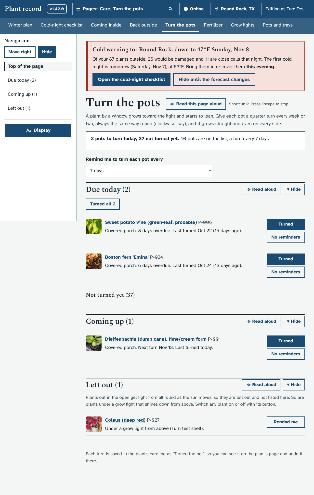
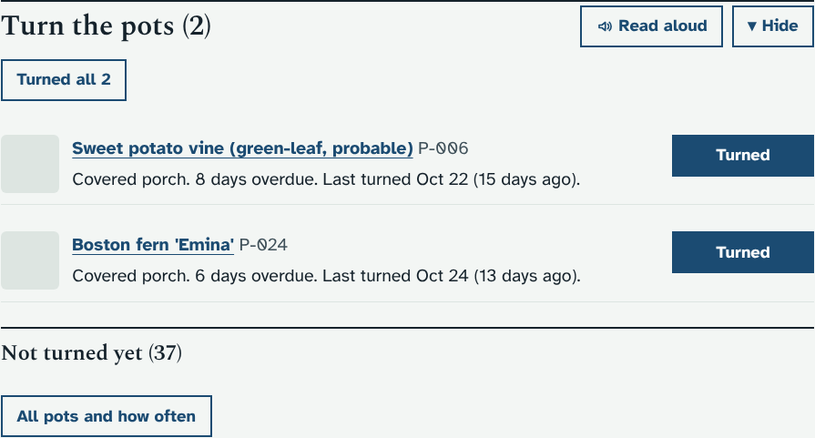
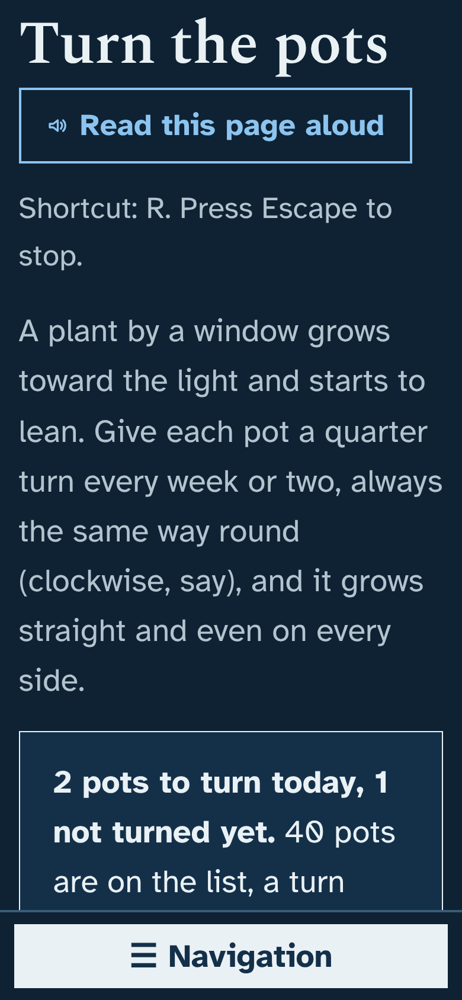
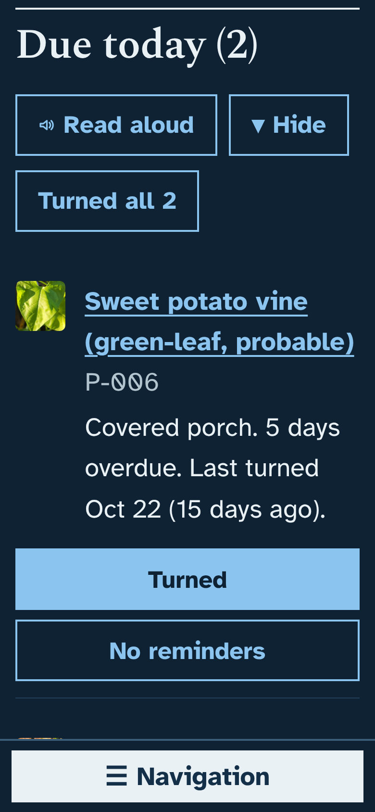
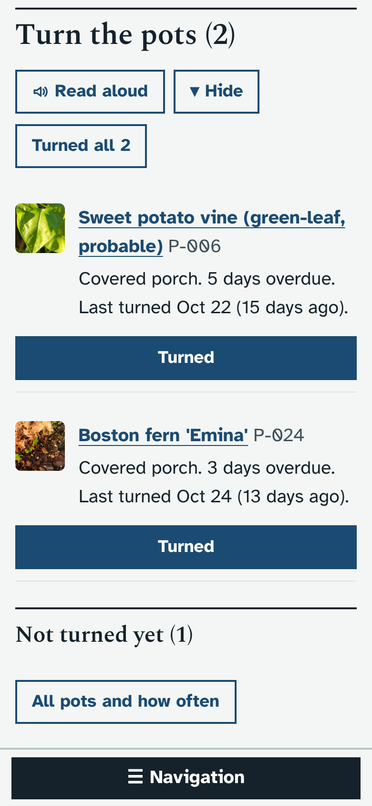
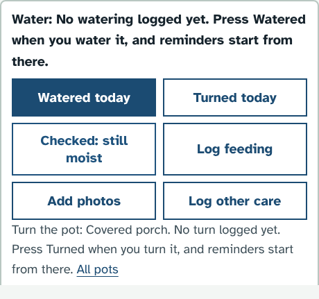

# Prototype: turn the pots

## What it does and why
A plant by a window grows toward the light and starts to lean. A quarter turn every week or two, always the same way round, keeps it growing straight and full on every side. With many plants coming inside for the winter, it is easy to lose track of which pots were turned and when. This adds a reminder for that, the same way the app already reminds you about water.

- **A new page, Turn the pots** (Care → Turn the pots, after Back outside). It has:
  - one line saying how many pots to turn today;
  - **Remind me to turn each pot every**: 7, 10, 14 (the usual), 21 or 30 days, for all pots;
  - **Due today**, with a **Turned** button for each plant and **Turned all** for the lot;
  - **Not turned yet** (folded): plants with no turn in the log. **I turned all … today** starts the clock for all of them at once, as Watered does for watering;
  - **Coming up**: when each of the others is next due;
  - **Left out**: plants that do not need turning, with the reason, and a **Remind me** button.
- **Which plants:** those Indoors or on the Covered porch at the home you are looking at. Left out are plants out in the open (the sun goes round them), in the garage or shed, and plants in a grow-light spot whose light shines down from above (they get even light). **No reminders** on any plant switches it off; **Remind me** switches it back on.
- **On Today:** a **Turn the pots** section just before Needed from you, with the pots due and the ones not turned yet, and a **Turn (2)** jump button beside the others at the top.
- **Turned** saves "Turned the pot" in the plant's care log, with the usual **Undo** message. It is also offered in **Log other care** on a plant's page.
- **On a plant's own page** (added November 6): **Turned today** sits next to **Watered today** for a pot on the list, with a line under the buttons saying when it is next due. Once pressed it shows "✓ Turned today" until tomorrow (Undo or Remove in the care log puts it back). A plant that is left out says why, with **Remind me**; a plant out in the open gets nothing about turning.
- People who can only view see the lists but not the buttons.

## How it looks
Laptop, the new page (the cold-night warning at the top is the mock weather):

The section on Today:

Phone, dark mode, largest text (nothing scrolls sideways):

 

Phone, Today:

Turned today on a plant's page:

## How to try it
- Windows cmd.exe: `set "DATA_DIR=dev\tmp\data" && python dev\test\mock_server.py`
- PowerShell: `$env:DATA_DIR='dev\tmp\data'; python dev\test\mock_server.py`
- bash: `DATA_DIR=dev/tmp/data python3 dev/test/mock_server.py`

Then open http://127.0.0.1:8080/#/turning. The focused check is `python3 dev/test/turning_check.py` (or `python3 dev/test/run_checks.py turning`).

## What it changes in the database
- No new tables or columns.
- Each turn is a row in `care_log` with kind `turn`.
- Two keys in `settings`, written only when you change them: `turn_every_days` (how often) and `turn_choice` (plants switched on or off by hand).
- Changes to either are in the Audit log.

## How it is built
- `app/plantdb/turning.py`: `turn_report()` and `GET/PUT /api/turning`. It adds `turn` to `CARE_KINDS`, so the usual `POST /api/care` logs a turn. A PUT is refused for viewers automatically.
- `app/static/js/turning.js`: the page, its buttons, a wrapper round `viewToday()` that adds the Today section, and a wrapper round `loadCarePlant()` that adds **Turned today** to a plant's quick care buttons (`#tn-plant-btn`, `#tn-plant`), so `care.js` is not edited. Turns go through `POST /api/care`, so they queue offline like the other care buttons.
- Small additions: the module in `server.py`, the script in `index.html` and `sw.js`, the page in `core.js` (Care row and router), a CSS block at the end of `style.css` (including the viewer rule), and `turning` in `run_checks.py`.

## Your answers (November 6), and what changed
1. **14 days is good.** No change: it stays the usual.
2. **Plants on the covered porch are on the list.** They already were; no change.
3. **A plant just moved indoors is not due straight away.** No change: it starts under "Not turned yet" until its first turn.
4. **A Turned button on each plant's page.** Added: **Turned today**, next to Watered today, as described above.

Also brought up to 1.42.0: it merges with the current code, its sections fold like the others (Show or hide), and it is listed in Navigation.

No open questions are left.
