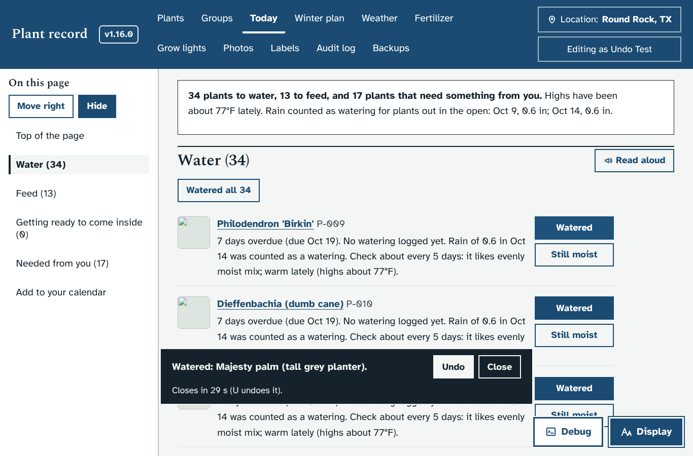
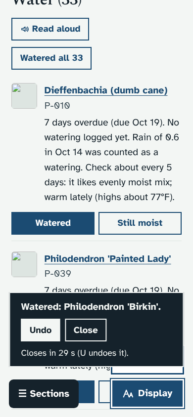
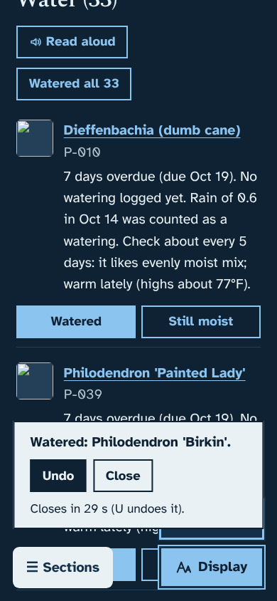
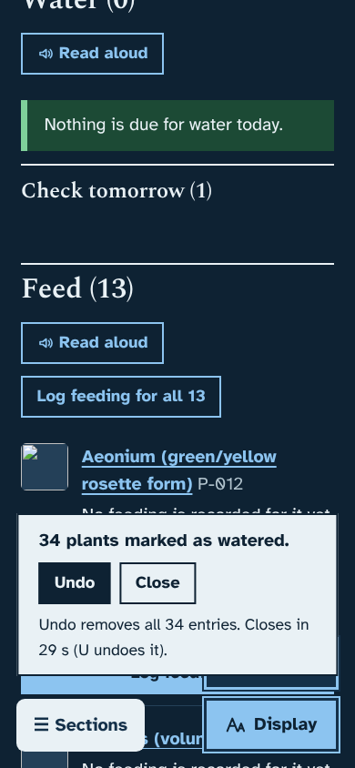
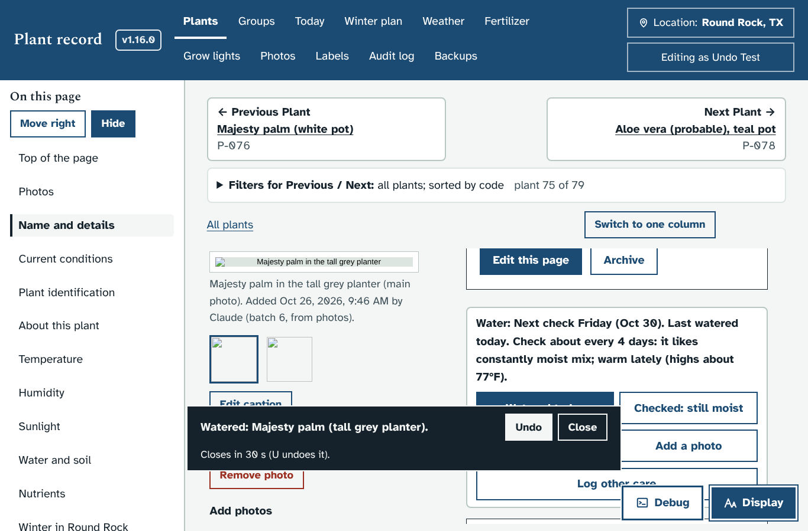

# Prototype: Undo right after a care button

Branch: `proto/undo-care`

## What it does and why
If you press "Watered" or "Still moist" by mistake, you can now undo it straight away from the message that appears. You no longer have to open the plant's page and find the entry in its care log.

- The message now says what was saved ("Watered: Majesty palm (white pot).") and has two buttons: **Undo** and **Close**.
- It works for:
  - "Watered" and "Still moist" on the Today page
  - "Watered today" and "Checked: still moist" on a plant page
  - "Watered all …" and "I watered all … today" (Undo removes all of them, and the message says how many)
  - "Log other care"
- The message stays for 30 seconds and shows how long is left.
  - The countdown stops while the mouse is over the message or the keyboard focus is on one of its buttons, so there is time to read it at large text sizes.
- With a keyboard, press **U** while the message is showing. U is listed with the other keyboard shortcuts (press ?), and it is off when Display settings turn shortcuts off.
- After Undo you see "Undone. The entry was removed from the care log." The Today list and the plant page update, so the plant goes back on the list.
- Undo only removes the entries made by that press. If someone else has already removed the entry, it says "Nothing to undo" and changes nothing.
- The change log still records the undo, as "Undone right after it was logged: Watered, Monday, Oct 26", so you can tell it apart from removing an older entry.

## How it looks
Today page on a laptop, light theme:

On a phone, light and dark. The message stretches across the screen so the text and buttons have room:

 

After "Watered all", the message says Undo removes all the entries:

On a plant page:

## What it changes in your database
Nothing. No new tables or columns. Undo uses the same "remove this care entry" the care log already has, and only the wording of its change-log line is different.

## How to try it
1. Start the mock server with a new data folder, then press Update now on the Weather page (or POST `/api/weather/refresh`).
2. Open Today, press "Watered" on a plant, then press Undo or U.

Checks: `python3 dev/test/undo_check.py`. It covers the Today page at laptop and phone width in light and dark, the U key, the countdown pausing, Close, an entry already removed by someone else, the plant page, Log other care, and Watered all. `care_check.py` and `smoke.py` still pass. The smoke test's only errors are missing plant photos, because the photos aren't in this sandbox.

## Open questions for Ethan
1. Is 30 seconds right? It pauses while you are on the message, but you might want it longer, or to stay until you close it.
2. Should feeding ("Log feeding") and the frost "Moved indoors" buttons get the same Undo message? This prototype covers watering and other care only.
3. On a plant page the message can sit over the lower care buttons until it closes or you press Close. Would you rather it sat at the top of the screen?
