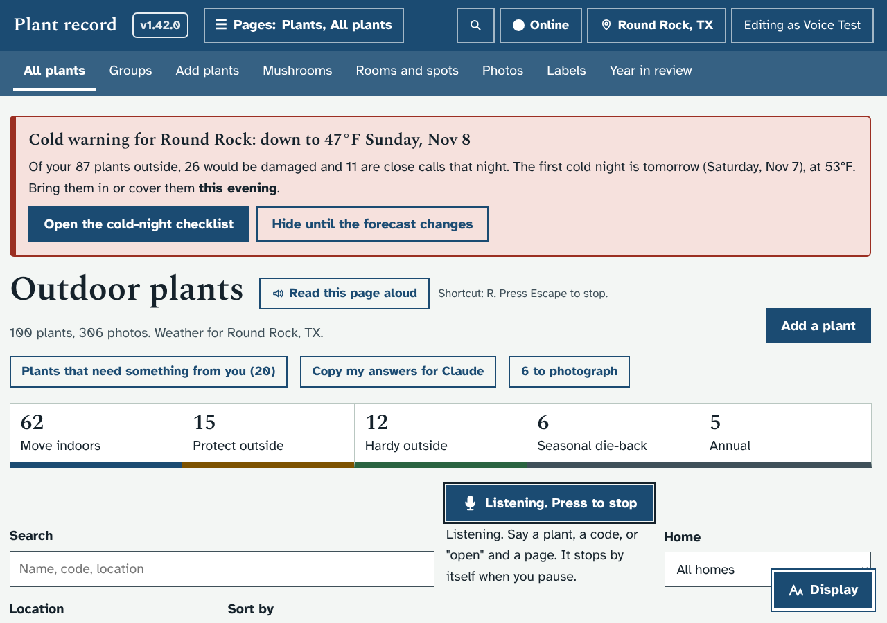
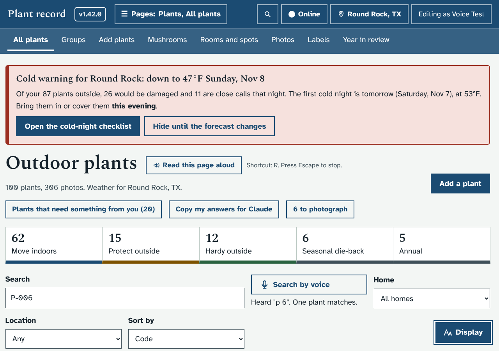
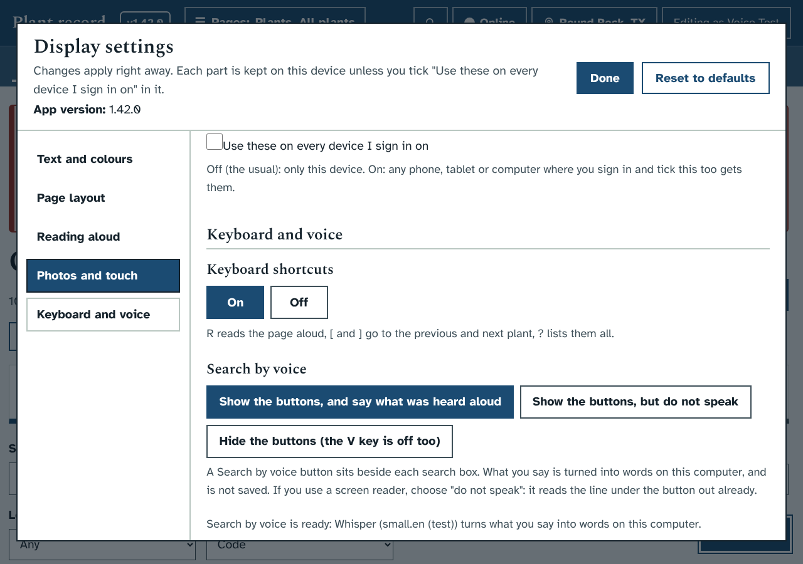
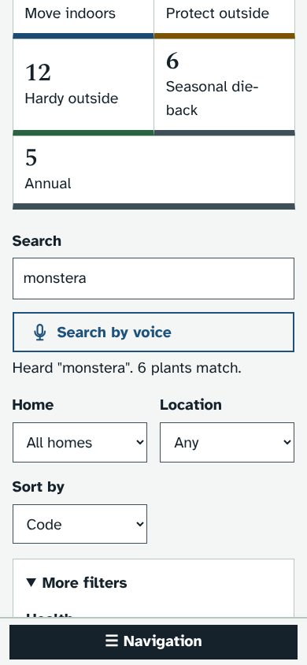
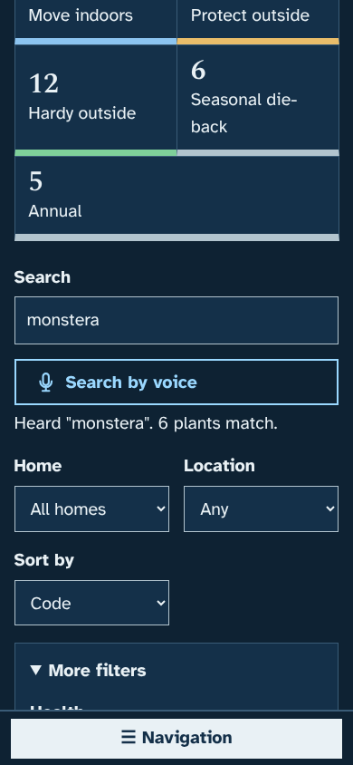
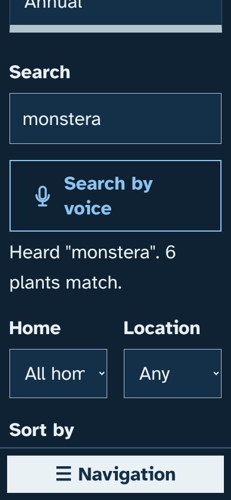

# Prototype: search by voice

Branch: `proto/voice-search`. Rebuilt on 1.42.0 on November 6, with Ethan's answers, and with its own speech service so nothing
goes to Google or Microsoft.

## What it does and why
Typing a plant name into a small search box is slow when the text is hard to see, and long names like "Philodendron 'Pink
Princess'" are easy to mistype. Every search box now has a **Search by voice** button beside it. Press it, say what you are
looking for, and the app puts the words in the box and searches.

- **Where:** the Plants page, the Previous / Next filters on plant pages, the Search window (the magnifier in the top bar),
  Identify (Your plant photos), the Library, Mushrooms, the Audit log, the light spot window, and "Find a plant" in group windows.
- **Recording:** press the button and speak. It stops by itself after about a second and a half of quiet, after 15 seconds, or when
  you press it again. While it listens the button is filled in and says **Listening. Press to stop**; then **Working out what you
  said…** for a moment.
- **Your voice stays on your computer.** The recording goes to Plant record, which passes it to its own speech service (the
  container `plant-speech`: OpenAI's Whisper, small.en, on the processor). Nothing goes to Google, Microsoft or anyone else, and
  the recording is not saved. The first start downloads the model, about 465 MB, into `data/speech`.
- **The line under the button** says what it heard and how many plants match, for example *Heard "monstera". 4 plants match.*
  It is also said aloud in your Read aloud voice.
- **Codes are tidied up.** "P 36", "pea zero three six" and "P036" become **P-036**; "F 2" becomes the mushroom find **F-002**.
  Extra words are dropped: "show me the monstera plants" searches for **monstera**.
- **"Open …"** (or "go to …", "take me to …") opens, in this order: a plant code (that plant; a mushroom code opens Mushrooms
  searched for that find); otherwise a page by name ("open weather", "open Today", "open grow lights", "open coming inside",
  "open display settings"); otherwise the one plant whose name matches. If several match, the list is filtered and the line asks
  for one of their codes.
- **Keyboard shortcut V** starts listening. On a page with no search box it opens the Search window and listens there.
- **Display settings → Keyboard and voice → Search by voice:** show the buttons and say the line aloud (the usual); show them
  without speaking (for a screen reader, which reads the line already); or hide them, which turns V off too. Under it, a line
  says whether the speech service is ready. The Identify page shows the same line under the picture checker's.
- **Plain words when something is wrong:** the speech service still getting ready (with how much has downloaded) or not running;
  the microphone not allowed (with where to allow it), not found, or blocked because the page is not on a secure address; nothing
  heard; the recording too long.
- **Viewers can use it too,** because it only searches.

### Browsers
Any browser that can record from the microphone: Chrome, Edge, Brave (also on the iPad mini), Firefox and Safari. Browsers only
allow the microphone on a secure address, so on a phone or tablet open Plant record through its **https** Tailscale address (on
this computer, http://localhost works). The first time, the browser asks whether Plant record may use the microphone.

## How it looks
Plants page while listening, and after hearing "p 6":

The choice in Display settings:

On a phone, light and dark, and with the largest text:

  

## What it changes
- **Your database:** nothing. No new tables, columns or settings on the server; the Display choice stays in the browser (and
  follows you when you share the Keyboard part of Display).
- **A new container**, `plant-speech` (`speech/`), built by the updater like the picture checker. It has no ports outside Docker's
  private network and cannot see the plant records. `PLANTDB_SPEECH=0` in the `.env` file turns it off;
  `PLANTDB_SPEECH_MODEL` chooses tiny.en, base.en, small.en or medium.en.
- **The server** lets its own pages use the microphone (`microphone=(self)` in the `Permissions-Policy` header), and has
  `POST /api/voice` and `GET /api/voice/status`.
- **The updater** starts the rest of the app if only the speech service fails to build, and tidies its old images.

## Testing
- `dev/test/voice_check.py`: a stand-in microphone (a tone the test switches on and off) so the real recording, the quiet
  detection and the upload run, against a stand-in speech service (`dev/test/mock_speech.py`). It covers code tidying, page names,
  stopping by itself, pressing to stop, nothing heard, not ready, the microphone refused or missing, "open" for plants and pages,
  the V key, every search box, the Identify and Display status lines, the three Display choices, reading the line aloud, a viewer
  through Tailscale, browsers that cannot record, and phone widths with the largest text in light and dark.
- `dev/test/unit/test_voice.py`: `/api/voice` with the stand-in service (the words, the prompt, not ready, not running, size limits).
- The real service was tried here with faster-whisper 1.2.1 and the tiny.en model on spoken WebM and MP4 clips ("Open Pink
  Princess.", "P-36."). The Docker image itself could not be built here (Docker Hub is not reachable from Claude's computer);
  `docker compose config` passes.
