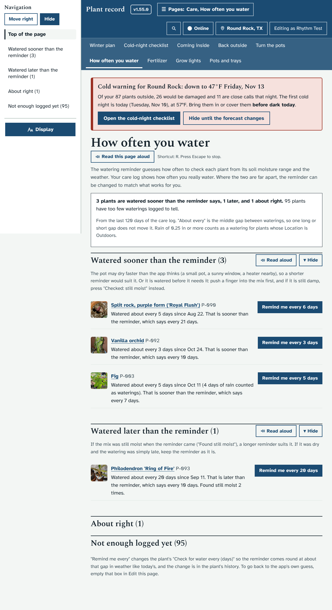
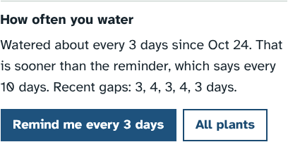
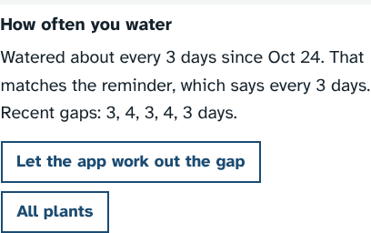
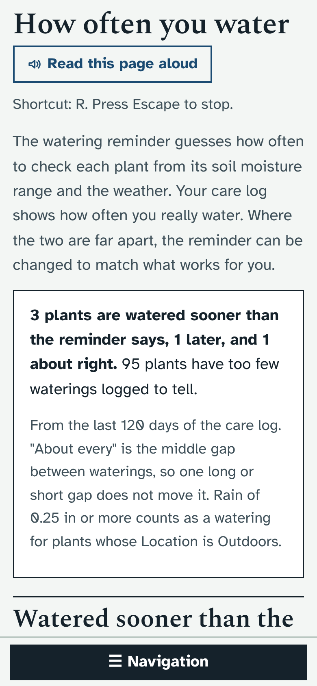
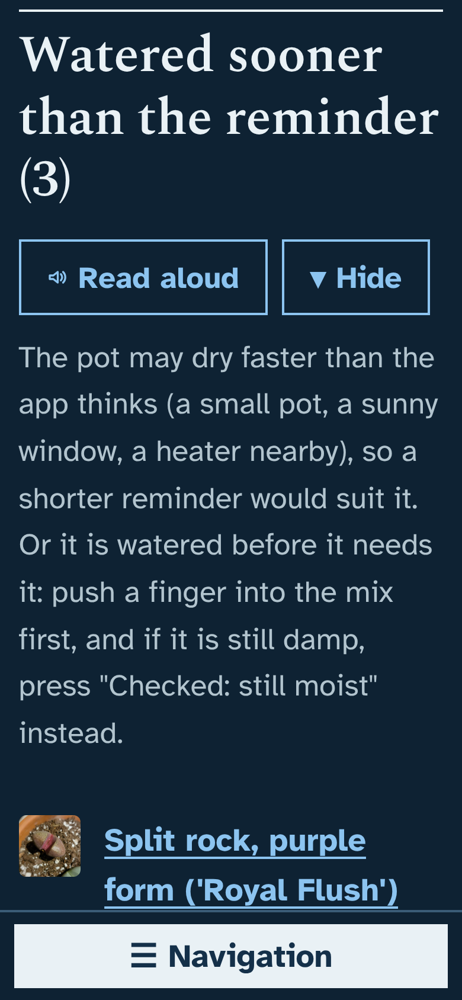
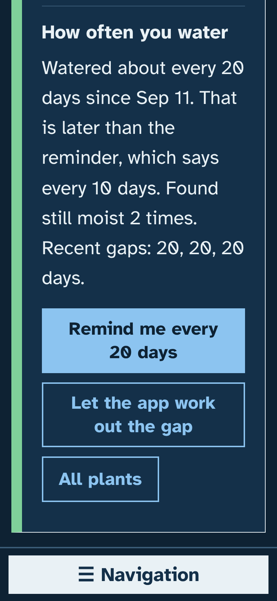

# Prototype: how often you water

## What it does and why
The watering reminder guesses how often to check each plant from its soil moisture range ("likes to dry out between waterings" means about every 10 days), then stretches it indoors and shortens it in hot weather. It never learns from what you actually do. With about 80 pots, some will dry much faster than the guess (a small pot, a sunny window) and some much slower, and the only way to fix it today is to open each plant's Edit page and work out a number for "Check for water every (days)".

Your care log already knows the answer: every "Watered today" has a date. This puts the two side by side and lets you make the reminder match with one button.

- **A new page, How often you water** (Care → How often you water, after Turn the pots):
  - one line saying how many plants are watered sooner than the reminder says, how many later, and how many about right;
  - **Watered sooner than the reminder**: the pot may dry faster than the app thinks, so a shorter reminder would suit it. Or it is being watered before it needs it, so the page suggests the finger test and "Checked: still moist" first;
  - **Watered later than the reminder**: if it was found still moist when the reminder came, a longer reminder suits it;
  - **About right** and **Not enough logged yet** (both folded).
  - Each plant says, for example, "Watered about every 5 days since Aug 22. That is sooner than the reminder, which says every 21 days." and, where it applies, "Found still moist 2 times."
- **Remind me every N days** sets the plant's "Check for water every (days)" so the reminder comes round at about that gap in weather like today's. The message has **Undo**, and the change is in the plant's history and the Audit log like any edit.
- **On a plant's own page**, inside the Watering box: how often it has been watered, the recent gaps ("3, 4, 3, 4, 3 days"), the same button, and **Let the app work out the gap** when the box already has a number. Focus moves to that line after a change, so a screen reader reads the new words.
- **How it counts:**
  - "About every" is the middle gap (the median) between waterings in the last 120 days, so one late or early watering does not move it.
  - A gap longer than 45 days is left out, as a time nothing was logged (away, or forgot to press the button), and the plant's page says so.
  - A pattern needs at least 4 waterings (3 gaps).
  - For a plant whose Location is Outdoors, a day with 0.25 in of rain or more counts as a watering, as it already does for the reminder, from the plant's first logged watering on.
  - "Sooner" and "later" need a real difference: a quarter of the reminder and at least 2 days. A day either way counts as about right.
- People who can only view see the comparison but not the buttons.

## How it looks
Laptop, the new page (the cold-night warning at the top is the mock weather; the photos are missing in the test copy):

On a plant's page, inside the Watering box, before and after pressing the button:

 

Phone, light, the top of the page; and dark mode with the largest text (nothing scrolls sideways):

  

## How to try it
- Windows cmd.exe: `set "DATA_DIR=dev\tmp\data" && python dev\test\mock_server.py`
- PowerShell: `$env:DATA_DIR='dev\tmp\data'; python dev\test\mock_server.py`
- bash: `DATA_DIR=dev/tmp/data python3 dev/test/mock_server.py`

Then open http://127.0.0.1:8080/#/rhythm. A fresh test copy has no waterings logged, so log a few with dates in the past ("Log other care" → Watered, with a date) first. The focused check fills some in and walks the page: `python3 dev/test/rhythm_check.py` (or `python3 dev/test/run_checks.py rhythm`).

## What it changes in the database
- Nothing new: no tables, no columns, no settings, no batch.
- It reads the care log and the weather it already keeps.
- The only thing it writes is the plant's existing "Check for water every (days)" field, and only when you press a button. That goes through the normal edit path, so it gets a page version, an Audit log line and can be undone from the plant's history.

## Open questions for Ethan
1. **Rounding indoors.** The app stretches the gap by half for plants indoors and rounds, so an indoor reminder can be 3, 4, 6, 8 or 9 days but never exactly 5 or 7. The button says what you will really get ("Remind me every 6 days" for a plant you water every 5). Should the indoor stretch be dropped for a plant once you have set its gap by hand from this page, so the number you pick is the number you get?
2. **Today.** Should Today get a short line ("3 plants are watered well before their reminder") with a link here, or is a page under Care enough?
3. **Whole groups.** Would a "Make all of these match" button on each list be useful, or do you prefer to decide plant by plant?
4. **The window.** 120 days mixes summer and autumn. Would you rather it looked at the last 60 days, so the comparison follows the season?

Reply on this pull request with changes, or say "merge" when you are happy.
